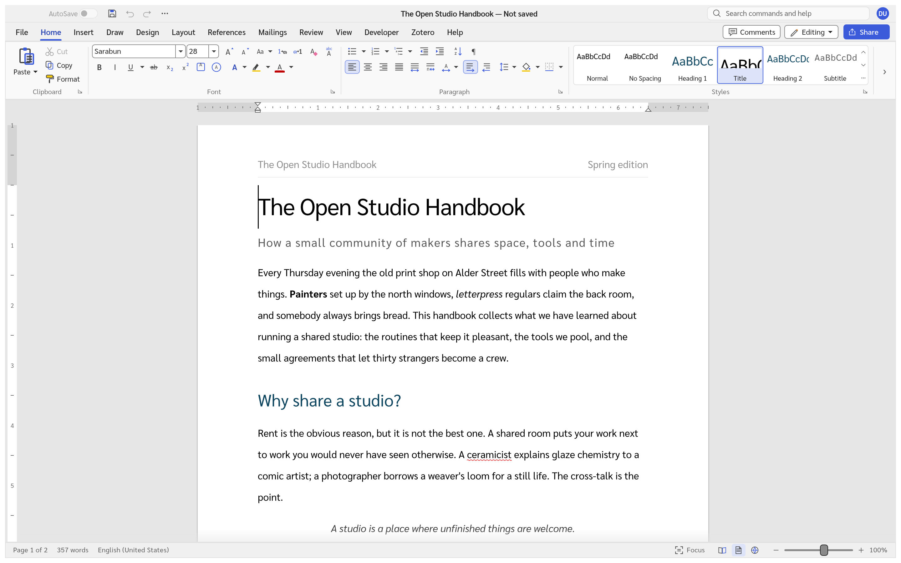
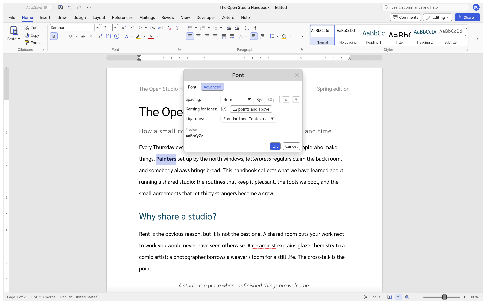
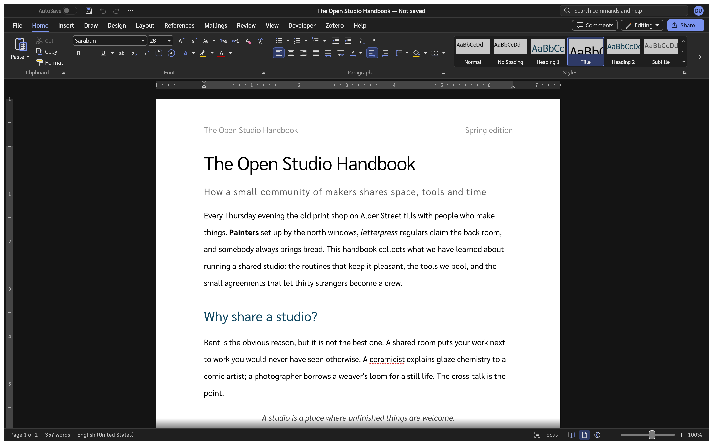
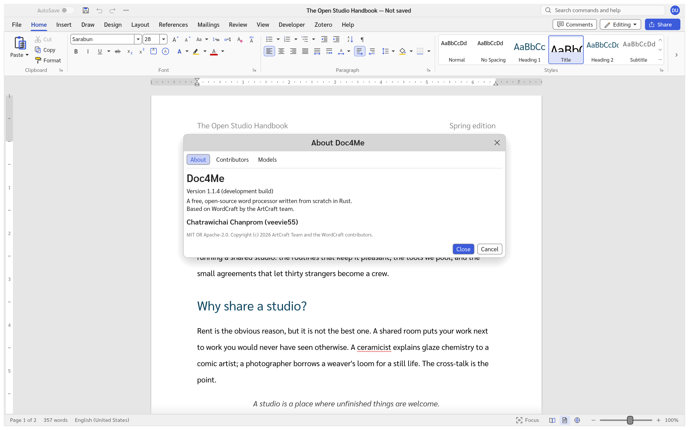
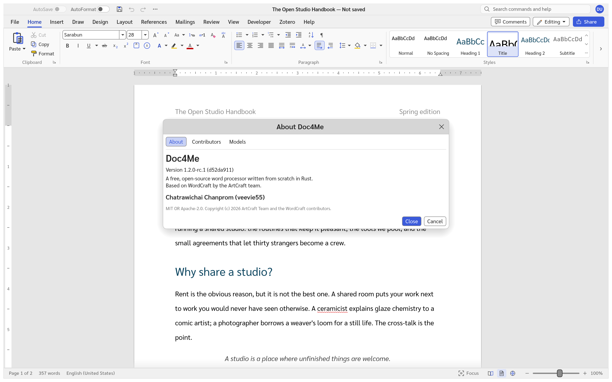

# Doc4Me

**English** · [ภาษาไทย](README.md)

Doc4Me is a clean-room, open-source word processor written in Rust. It aims for complete parity
with Microsoft Word, then goes further on speed, openness and agent control: every feature is a
command that scripts and AI agents can run, over a local control channel or MCP.

Doc4Me is still in **alpha**. See [ROADMAP.md](ROADMAP.md) for progress.
The latest official Windows measurement (run 44462404197) is **95.5%**, or **97.4% excluding 22 deferred checks**.
All 219 corpus documents open and round-trip; page counts match for 219/219 and page boundaries for 144/219. See the [readiness report](docs/readiness.md) and [bilingual blocker assessment](docs/readiness/blockers-2026-11-14.md) for remaining failures and their evidence.



## Download

Releases the repository owner publishes (such as the Windows MSI installer and portable zip) are on the
[Releases](https://github.com/veevie55/doc4me/releases) page, and the workflows below build them. They are not code-signed yet, so
Windows SmartScreen may ask before it runs them. The MSI installs over an earlier Doc4Me installation.

Windows x86, Windows x64, Windows ARM64, macOS, Linux, FreeBSD, and the Web App have separate workflows to build the source you choose.
Local packaging scripts are in [`packaging/`](packaging/).

### Build with GitHub Actions

Open this repository's [Actions](https://github.com/veevie55/doc4me/actions), select a workflow, then choose **Run workflow**.
Keep **Use workflow from: main** to use the current build instructions. Set **ref** to `main` for the latest code,
or the branch or commit you want to build.

| Workflow | Target | Files under the run's Artifacts |
|---|---|---|
| [Build Windows x86](.github/workflows/build-windows-x86.yml) | 32-bit x86 Windows app (i686 MSVC; also runs on compatible 64-bit Windows) | MSI and portable ZIP |
| [Build Windows x64](.github/workflows/build-windows-x64.yml) | 64-bit Windows (x86_64 MSVC) | MSI and portable ZIP |
| [Build Windows ARM64](.github/workflows/build-windows-arm64.yml) | Windows ARM64 | MSI and portable ZIP |
| [Build macOS](.github/workflows/build-macos.yml) | Universal (Apple Silicon + Intel), or one architecture | DMG and CLI ZIP |
| [Build Linux](.github/workflows/build-linux.yml) | x86_64, glibc 2.35 or newer | AppImage, DEB, RPM, and tar.gz |
| [Build BSD (FreeBSD)](.github/workflows/build-bsd.yml) | FreeBSD 14.5 x86_64 | App and CLI tar.gz |
| [Build Web App](.github/workflows/build-web.yml) | Browsers with WebAssembly | Static web app ZIP |
| [Build Web App on GitHub Pages](.github/workflows/build-web-pages.yml) | Public Doc4Me website | Deploys to [veevie55.github.io/doc4me](https://veevie55.github.io/doc4me/) |

**Every workflow starts only when someone chooses Run workflow.** Pushing code or tags does not start a build,
deploy a site, or publish a release. These seven platform-build workflows keep their files in the run's **Artifacts** for 14 days,
with `SOURCE_COMMIT.txt` recording the actual source commit. Windows ARM64 is unsigned; macOS uses ad-hoc
signing without notarization. The Pages workflow builds its selected `ref` and replaces the current site
after a successful manual deployment; choose **Use workflow from: main** for the current workflow definition.
Extract the Web App ZIP and serve it over HTTP(S); see the
[hosting instructions](packaging/web/README.md).

Windows package and readiness workflows use the same pinned OFL font set and verify the hashes of
additional corpus fonts before building. See [docs/releasing.md](docs/releasing.md) for the pinned
revisions and licence details.

Latest Windows measurement: [run 44462404197](https://github.com/veevie55/doc4me/actions/runs/44462404197); readiness is 95.5% overall / 97.4% without 22 deferred rows, with page counts 219/219 and page boundaries 144/219. There are still 0 page-count and 75 boundary failures. See the [report](docs/readiness.md) and [bilingual blocker assessment](docs/readiness/blockers-2026-11-14.md).

Each build workflow also takes an optional **version** (such as `1.2.0` or `1.2.0-rc.1`), shown in
`--version` and the installers' version fields; left empty, the build is named by its commit only.
**about** (the line under the name in the About dialog) and **file-name** (the download file names) each
choose whether the version and the commit appear: `commit` (default) gives `Commit 01234567` /
`doc4me-01234567-windows-x64.msi`, `version` gives `Version 1.2.0` / `doc4me-1.2.0-windows-x64.msi`,
`version-commit` gives `Version 1.2.0 (01234567)` / `doc4me-1.2.0-01234567-windows-x64.msi`, and `none` shows
nothing / `doc4me-windows-x64.msi` (version choices need a version). About follows the choice also for builds of
older commits. The [Release](.github/workflows/release.yml) workflow tags `v<version>` and publishes a GitHub
Release, only when someone runs it: type the version, choose `main` (latest code) or a commit, pick the Windows
builds in **windows** and tick the other platforms, then choose **file-name** (default `version`) and **about**
(default `version-commit`); a version with a pre-release part such as `1.2.0-rc.1` is published as a pre-release.
See [docs/releasing.md](docs/releasing.md) for platform requirements.

## Highlights

- Opens and saves `.docx`, RTF, ODT, HTML, Markdown, LaTeX and plain text; reads `.doc`; exports
  PDF and page images (PNG, JPG/JPEG).
- A Word-style ribbon, styles, lists, tables, equations, SmartArt, charts, comments and tracked
  changes, references and citations (with Zotero), mail merge and Reading Mode.
- Interface in 91 languages, English, Thai, Russian, Hungarian, Turkish and Italian among them (some are AI-drafted and await native-speaker review; right-to-left and Indic languages warn before use, as the interface doesn't shape them correctly yet). Thai comes
  with dictionary word breaks, a Thai spelling checker, Thai list numbers and line spacing measured
  as Word for Windows measures it; see the [Thai page](README.md).
- Dictate recognises speech, Thai included, on the computer
  (whisper.cpp; the free speech model is downloaded once); Translate (MyMemory or your own
  LibreTranslate server), Online Pictures (Creative Commons pictures from Openverse, credited),
  Ink Equation and Get Add-ins.
- The desktop app bundles fonts with the same metrics as Word's core fonts (Carlito for Calibri, Caladea for Cambria, Arimo for Arial, Tinos for Times New Roman, Cousine for Courier New; OFL 1.1), used when the computer lacks the original, so lines and pages break closer to Word.
- Table commands select cells, rows and columns; edit borders; add or remove rows and columns; repeat headers; and split tables. The internal Doc4Me clipboard preserves tables, pictures, shapes, text boxes and other supported objects with their dependencies. See the [table and clipboard audit](docs/readiness/table-clipboard-audit-2026-11-13.md) for coverage and limits.
- Light and dark themes; in the dark theme the page stays white.
- `doc4me-cli` converts and edits documents without a window, and `doc4me-cli mcp` serves every
  command to AI agents ([docs/mcp.md](docs/mcp.md)).

### Kerning and ligatures

The Font dialog's Advanced page sets "Kerning for fonts", ligatures, and character spacing.
The spacing buttons step by 0.1 pt; these settings are stored in `.docx`. Without them, text gets Word's defaults: no kerning, and no ligatures in Latin text
(complex scripts such as Arabic and Thai always use their font's ligatures).



### Dark theme



### About Doc4Me

The About dialog shows the app and its developer. The screenshots on this page were regenerated from
the actual app with [`ui_shot`](crates/ui-egui/examples/ui_shot.rs); their scripts are in
[`docs/images/shots/`](docs/images/shots/).



The screenshot above is a local build without a commit, so it reads "development build". The one below is a build
of the latest code given the version `v1.2.0-rc.1` with **about** set to `version-commit`, so the dialog shows the
version number and the commit it was built from (`d52da911`); the leading `v` is dropped when shown. See the build
workflow section above for the other choices.



## Build from source

Install Rust 1.90 or newer, CMake, a C++ compiler, and libclang (Dictate builds whisper.cpp), and on Linux
the ALSA headers (`libasound2-dev` on Debian and Ubuntu, `alsa-lib-devel` on Fedora), then:

```sh
cargo run --release -p doc4me                 # the app
cargo run --release -p doc4me -- --sample     # the app with the sample document
cargo run --release -p doc4me-cli -- convert in.docx out.pdf
```

Before sending a change, run `cargo xtask ci` (format, clippy, tests, assets, layering and the
WebAssembly build). How the code is organised: [docs/architecture.md](docs/architecture.md);
rules for contributors and agents: [AGENTS.md](AGENTS.md); builds and releases:
[docs/releasing.md](docs/releasing.md); what changed: [CHANGELOG.md](CHANGELOG.md).

## Licence

Doc4Me is licensed under either of [MIT](LICENSE-MIT) or [Apache-2.0](LICENSE-APACHE), at your
option. The bundled fonts are under the SIL Open Font License and the Thai word-break data under
the [Unicode licence](LICENSE-UNICODE); see [NOTICE](NOTICE) and [ATTRIBUTION.md](ATTRIBUTION.md)
for every third-party component.

Doc4Me is an independent project, not affiliated with or endorsed by Microsoft. It contains no
Microsoft icons, images, templates or other assets. The screenshots above are of Doc4Me itself.
