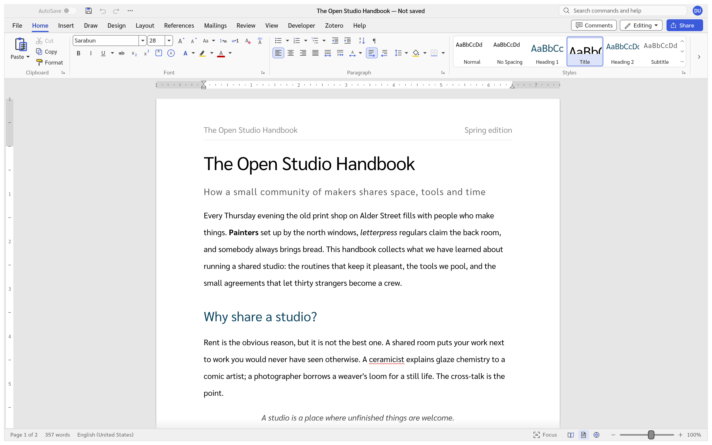
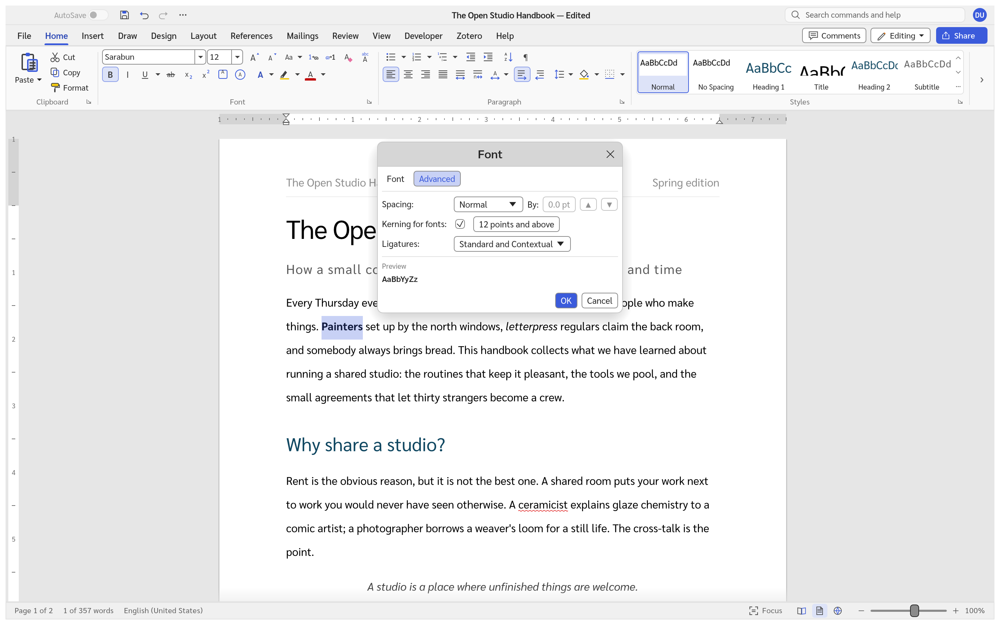
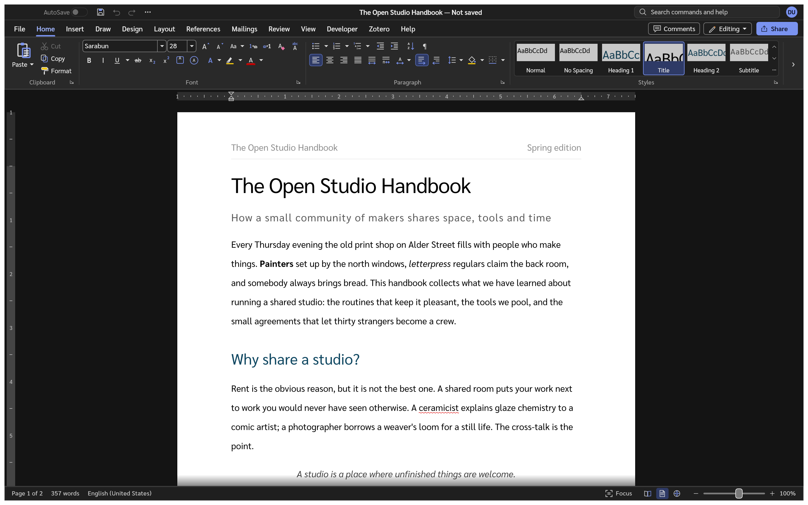
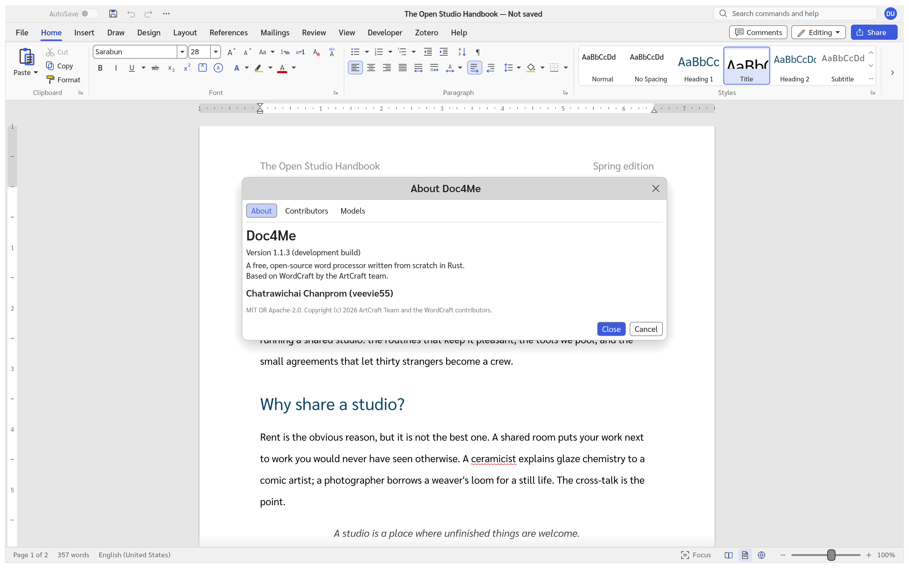

# Doc4Me

**English** · [ภาษาไทย](README.md)

Doc4Me is a clean-room, open-source word processor written in Rust. It aims for complete parity
with Microsoft Word, then goes further on speed, openness and agent control: every feature is a
command that scripts and AI agents can run, over a local control channel or MCP.

The current version is **1.1.3**, still in **alpha**. See [ROADMAP.md](ROADMAP.md) for progress.
The latest recorded Windows measurement (11 November 2026) is **92.7%**, or **94.5% excluding 22 deferred checks**.
All 220 corpus documents open and round-trip; page counts match for 181/220 and page boundaries for 99/220.
Pagination and translation quality still have limits; see the [measurement](docs/readiness.md) and [remaining gaps](docs/gaps.md).



## Download

Windows x64 builds (an MSI installer and a portable zip) are on the
[Releases](https://github.com/chatraweechai/doc4me/releases) page. They are not code-signed yet, so
Windows SmartScreen may ask before it runs them. The MSI installs over earlier Doc4Me versions.

Windows ARM64, macOS, Linux, FreeBSD, and the Web App have separate workflows to build the source you choose.
Local packaging scripts are in [`packaging/`](packaging/).

### Build with GitHub Actions

Open this repository's [Actions](https://github.com/veevie55/doc4me/actions), select a workflow, then choose **Run workflow**.
Keep **Use workflow from: main** to use the current build instructions. Set **ref** to `main` for the latest code,
`v1.1.3` for the released source, or the branch, tag, or commit SHA you want to build.

| Workflow | Target | Files under the run's Artifacts |
|---|---|---|
| [Build Windows ARM64](.github/workflows/build-windows-arm64.yml) | Windows ARM64 | MSI and portable ZIP |
| [Build macOS](.github/workflows/build-macos.yml) | Universal (Apple Silicon + Intel), or one architecture | DMG and CLI ZIP |
| [Build Linux](.github/workflows/build-linux.yml) | x86_64, glibc 2.35 or newer | AppImage, DEB, RPM, and tar.gz |
| [Build BSD (FreeBSD)](.github/workflows/build-bsd.yml) | FreeBSD 14.5 x86_64 | App and CLI tar.gz |
| [Build Web App](.github/workflows/build-web.yml) | Browsers with WebAssembly | Static web app ZIP |

**Every workflow starts only when someone chooses Run workflow.** Pushing code or tags does not start a build,
deploy a site, or publish a release. These five workflows keep their files in the run's **Artifacts** for 14 days,
with `SOURCE_COMMIT.txt` recording the actual source commit. Windows ARM64 is unsigned; macOS uses ad-hoc
signing without notarization. Extract the Web App ZIP and serve it over HTTP(S); see the
[hosting instructions](packaging/web/README.md).

The separate [Windows x64 installer](.github/workflows/windows-x64-installer.yml) is also manual.
Its **commit** field accepts an earlier `main` commit's full 40-character SHA; enable **release** only when
you intend to publish a GitHub Release. See [docs/releasing.md](docs/releasing.md) for platform requirements.

## Highlights

- Opens and saves `.docx`, RTF, ODT, HTML, Markdown, LaTeX and plain text; reads `.doc`; exports
  PDF and page images (PNG, JPG/JPEG).
- A Word-style ribbon, styles, lists, tables, equations, SmartArt, charts, comments and tracked
  changes, references and citations (with Zotero), mail merge and Reading Mode.
- Interface in 91 languages, English, Thai, Russian, Hungarian, Turkish and Italian among them (some are AI-drafted and await native-speaker review; right-to-left and Indic languages warn before use, as the interface doesn't shape them correctly yet). Thai comes
  with dictionary word breaks, a Thai spelling checker, Thai list numbers and line spacing measured
  as Word for Windows measures it; see the [Thai page](README.md).
- Since 1.1.3: Dictate recognises speech, Thai included, on the computer
  (whisper.cpp; the free speech model is downloaded once); Translate (MyMemory or your own
  LibreTranslate server), Online Pictures (Creative Commons pictures from Openverse, credited),
  Ink Equation and Get Add-ins.
- Since 1.1.3: the desktop app bundles fonts with the same metrics as Word's core fonts (Carlito for Calibri, Caladea for Cambria, Arimo for Arial, Tinos for Times New Roman, Cousine for Courier New; OFL 1.1), used when the computer lacks the original, so lines and pages break closer to Word.
- Light and dark themes; in the dark theme the page stays white.
- `doc4me-cli` converts and edits documents without a window, and `doc4me-cli mcp` serves every
  command to AI agents ([docs/mcp.md](docs/mcp.md)).

### Kerning and ligatures

The Font dialog's Advanced page sets "Kerning for fonts", ligatures, and character spacing.
In 1.1.3, the spacing buttons step by 0.1 pt; these settings are stored in `.docx`. Without them, text gets Word's defaults: no kerning, and no ligatures in Latin text
(complex scripts such as Arabic and Thai always use their font's ligatures).



### Dark theme



### About Doc4Me 1.1.3

The About dialog shows the version and developer. The screenshots on this page were regenerated from
the actual app with [`ui_shot`](crates/ui-egui/examples/ui_shot.rs); their scripts are in
[`docs/images/shots/`](docs/images/shots/).



## Build from source

Install Rust 1.90 or newer, CMake, a C++ compiler, and libclang (Dictate builds whisper.cpp), and on Linux
the ALSA headers (`libasound2-dev` on Debian and Ubuntu, `alsa-lib-devel` on Fedora), then:

```sh
cargo run --release -p doc4me                 # the app
cargo run --release -p doc4me -- --sample     # the app with the sample document
cargo run --release -p doc4me-cli -- convert in.docx out.pdf
```

Before sending a change, run `cargo xtask ci` (format, clippy, tests, assets, layering and the
WebAssembly build). How the code is organised: [docs/architecture.md](docs/architecture.md);
rules for contributors and agents: [AGENTS.md](AGENTS.md); releases:
[docs/releasing.md](docs/releasing.md); what changed: [CHANGELOG.md](CHANGELOG.md).

## Licence

Doc4Me is licensed under either of [MIT](LICENSE-MIT) or [Apache-2.0](LICENSE-APACHE), at your
option. The bundled fonts are under the SIL Open Font License and the Thai word-break data under
the [Unicode licence](LICENSE-UNICODE); see [NOTICE](NOTICE) and [ATTRIBUTION.md](ATTRIBUTION.md)
for every third-party component.

Doc4Me is an independent project, not affiliated with or endorsed by Microsoft. It contains no
Microsoft icons, images, templates or other assets. The screenshots above are of Doc4Me itself.
