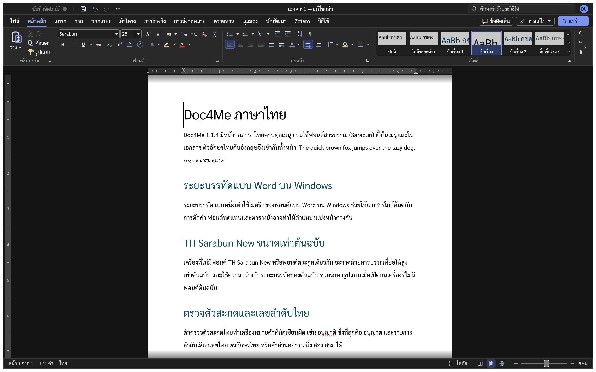
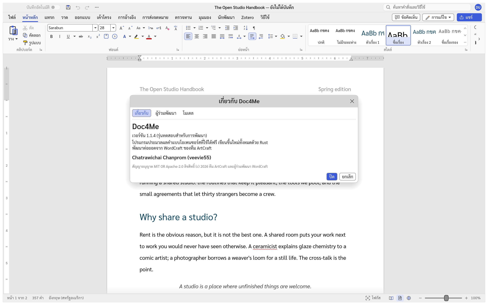

# Doc4Me

[English](README.en.md) · **ภาษาไทย**

Doc4Me เป็นโปรแกรมประมวลผลคำแบบโอเพนซอร์สที่เขียนด้วยภาษา Rust และพัฒนาแบบ clean room
ตั้งเป้าให้ทำได้ครบเท่า Microsoft Word แล้วไปให้ไกลกว่านั้นในเรื่องความเร็ว ความเปิดกว้าง
และการสั่งงานด้วยเอเจนต์ ทุกความสามารถเป็นคำสั่งที่สคริปต์และเอเจนต์ AI เรียกใช้ได้ ผ่านช่องทางควบคุมในเครื่องหรือ MCP

Doc4Me ยังอยู่ในระยะ **alpha** ดูความคืบหน้าที่ [ROADMAP.md](ROADMAP.md)
ผลวัด Windows ทางการล่าสุด (run 44017934254): **94.5%** หรือ **96.4% เมื่อไม่นับ 22 รายการ deferred**
คลังเอกสาร 219 ไฟล์เปิดและบันทึกกลับได้ครบ จำนวนหน้าตรง 214/219 และขอบเขตหน้าตรง 118/219
ดู [ผลวัด readiness](docs/readiness.th.md) และ [การประเมิน blocker ภาษาไทย](docs/readiness/blockers-2026-11-14.th.md) สำหรับรายการที่ยังไม่ผ่านและหลักฐาน


## ภาษาไทยใน Doc4Me

- ส่วนติดต่อผู้ใช้ภาษาไทยครบทุกเมนู ใช้ฟอนต์สารบรรณ (Sarabun) เป็นฟอนต์หลักทั้งในเมนูและในเอกสาร
- ตัดคำไทยด้วยพจนานุกรม ทั้งตอนขึ้นบรรทัดใหม่ ดับเบิลคลิกเลือกคำ และนับจำนวนคำ
- ตัวตรวจตัวสะกดไทยทำเครื่องหมายคำที่มักเขียนผิด เช่น อนุญาติ (ที่ถูกคือ อนุญาต)
- รายการลำดับเลือกเลขไทย ตัวอักษรไทย หรือคำอ่านอย่าง หนึ่ง สอง สาม ได้
- ระยะห่างบรรทัด 1 เท่าใช้เมตริกของฟอนต์แบบ Word บน Windows ช่วยให้ใกล้ต้นฉบับ; ฟอนต์ การตัดคำและตารางยังอาจทำให้แบ่งหน้าต่างกัน
- เอกสารที่ใช้ TH Sarabun New หรือ TH SarabunPSK แสดงขนาดเท่าต้นฉบับแม้เครื่องไม่มีฟอนต์นั้น ฟอนต์ไทยอื่นที่เครื่องไม่มีแสดงด้วย Sarabun ขนาดของ Sarabun เอง และถ้าเป็น TH SarabunIT๙ โปรแกรมจะแจ้งเตือนตอนเปิดไฟล์
- ปุ่มจัดกระจายและจัดกระจายแบบไทยในกลุ่มย่อหน้า ของแท็บหน้าหลัก
- ปุ่มแปลงเป็นเลขไทย และแปลงเป็นเลขอารบิก ในกลุ่มฟอนต์ ของแท็บหน้าหลัก แปลงตัวเลขในส่วนที่เลือก (0–9 ↔ ๐–๙) โดยคงรูปแบบตัวอักษรเดิม

## ดาวน์โหลด

Release ที่เจ้าของ repository เผยแพร่ (เช่น ตัวติดตั้ง MSI และไฟล์ zip แบบไม่ต้องติดตั้งสำหรับ Windows) อยู่ในหน้า
[Releases](https://github.com/veevie55/doc4me/releases) และ build เองได้จาก workflow ด้านล่าง ไฟล์เหล่านี้ยังไม่ได้ลงลายเซ็นดิจิทัล
Windows SmartScreen จึงอาจถามก่อนเปิด ตัวติดตั้ง MSI ติดตั้งทับ Doc4Me ที่ติดตั้งไว้ก่อนหน้าได้

Windows x86, Windows x64, Windows ARM64, macOS, Linux, FreeBSD และ Web App มี workflow แยกสำหรับสร้างไฟล์จากซอร์สที่คุณเลือก
หรือ build บนเครื่องจาก [`packaging/`](packaging/) ได้

### Build ด้วย GitHub Actions

เปิด [Actions ของ repository นี้](https://github.com/veevie55/doc4me/actions) เลือก workflow แล้วกด **Run workflow**
เลือก **Use workflow from: main** เพื่อใช้ขั้นตอน build ปัจจุบัน และใส่ช่อง **ref** เป็น `main` สำหรับโค้ดล่าสุด,
หรือชื่อ branch/commit ที่ต้องการ

| Workflow | เป้าหมาย | ไฟล์ที่ดาวน์โหลดจาก Artifacts |
|---|---|---|
| [Build Windows x86](.github/workflows/build-windows-x86.yml) | แอป Windows x86 32 บิต (i686 MSVC; ใช้บน Windows 64 บิตที่รองรับได้ด้วย) | MSI และ portable ZIP |
| [Build Windows x64](.github/workflows/build-windows-x64.yml) | Windows 64 บิต (x86_64 MSVC) | MSI และ portable ZIP |
| [Build Windows ARM64](.github/workflows/build-windows-arm64.yml) | Windows ARM64 | MSI และ portable ZIP |
| [Build macOS](.github/workflows/build-macos.yml) | Universal (Apple Silicon + Intel), หรือเลือกสถาปัตยกรรมเดียว | DMG และ CLI ZIP |
| [Build Linux](.github/workflows/build-linux.yml) | x86_64, glibc 2.35 ขึ้นไป | AppImage, DEB, RPM และ tar.gz |
| [Build BSD (FreeBSD)](.github/workflows/build-bsd.yml) | FreeBSD 14.5 x86_64 | tar.gz ของโปรแกรมและ CLI |
| [Build Web App](.github/workflows/build-web.yml) | เบราว์เซอร์ที่รองรับ WebAssembly | ZIP ของเว็บแบบ static |
| [Build Web App on GitHub Pages](.github/workflows/build-web-pages.yml) | เว็บไซต์สาธารณะของ Doc4Me | deploy ไปที่ [veevie55.github.io/doc4me](https://veevie55.github.io/doc4me/) |

**ทุก workflow เริ่มได้จากคำสั่ง Run workflow เท่านั้น** การ push โค้ดหรือ tag ไม่เริ่ม build, deploy หรือออก Release
ไฟล์ build ของ workflow สร้างแพ็กเกจทั้งเจ็ดรายการอยู่ใน **Artifacts** ของ run นั้น 14 วัน พร้อม `SOURCE_COMMIT.txt` ระบุ commit ที่ใช้จริง
workflow Pages ใช้ `ref` ที่เลือกเพื่อ build แล้วแทนที่เว็บไซต์ปัจจุบันเมื่อ deploy สำเร็จ; เลือก **Use workflow from: main** เพื่อใช้ workflow ล่าสุด
workflow Windows สำหรับแพ็กเกจและ readiness ใช้ชุดฟอนต์ OFL ที่ pin เดียวกัน และตรวจ hash ของฟอนต์เพิ่มเติมก่อน build; ดูรายละเอียด revision และใบอนุญาตใน [docs/releasing.md](docs/releasing.md)
ผลวัด Windows ล่าสุด (run [44017934254](https://github.com/veevie55/doc4me/actions/runs/44017934254)): readiness 94.5% รวม /96.4% ไม่รวม 22 deferred, จำนวนหน้า 214/219 และขอบเขตหน้า 118/219; ยังมี page-count 5 รายการและ boundary 101 รายการที่ไม่ผ่าน ตาม [รายงาน](docs/readiness.th.md) และ [การวิเคราะห์ blocker ไทย/อังกฤษ](docs/readiness/blockers-2026-11-14.th.md).
Windows ARM64 ยังไม่ลงลายเซ็นดิจิทัล และ macOS ลงลายเซ็นแบบ ad-hoc โดยยังไม่ notarize
Web App ใช้ ZIP ที่แตกแล้วให้บริการผ่าน HTTP(S) ได้ หรือสั่ง workflow Pages เพื่อเผยแพร่เว็บไซต์; ดู [วิธีนำขึ้นโฮสต์](packaging/web/README.md)

ไม่มี workflow ใดออก GitHub Release อัตโนมัติ เจ้าของ repository เผยแพร่ Release เองจากไฟล์ใน Artifacts
รายละเอียดและข้อกำหนดของแต่ละแพลตฟอร์มอยู่ที่ [docs/releasing.md](docs/releasing.md)

## ความสามารถหลัก

- เปิดและบันทึก `.docx`, RTF, ODT, HTML, Markdown, LaTeX และข้อความธรรมดา อ่าน `.doc` และส่งออกเป็น PDF หรือภาพของหน้า (PNG, JPG/JPEG)
- แถบคำสั่งแบบ Word สไตล์ รายการ ตาราง สมการ SmartArt แผนภูมิ ข้อคิดเห็นและการติดตามการเปลี่ยนแปลง
  การอ้างอิงและบรรณานุกรม (ใช้กับ Zotero ได้) จดหมายเวียน และโหมดอ่าน
- ส่วนติดต่อผู้ใช้ 91 ภาษา รวมภาษาไทย อังกฤษ รัสเซีย ฮังการี ตุรกี อิตาลี (บางภาษาเป็นฉบับร่างที่แปลด้วย AI และยังไม่ผ่านการตรวจทานจากเจ้าของภาษา ภาษาที่เขียนจากขวาไปซ้ายและอักษรอินเดียจะแสดงคำเตือนก่อนใช้ เพราะส่วนติดต่อยังจัดรูปอักษรเหล่านี้ได้ไม่ถูกต้อง)
- พิมพ์ด้วยเสียง (Dictate) รองรับภาษาไทย แปลงเสียงเป็นข้อความบนเครื่องด้วย whisper.cpp
  (ดาวน์โหลดโมเดลเสียงฟรีครั้งแรกครั้งเดียว), แปลเอกสาร (MyMemory หรือเซิร์ฟเวอร์ LibreTranslate ของคุณเอง),
  รูปภาพออนไลน์ (ภาพสัญญาอนุญาต Creative Commons จาก Openverse พร้อมเครดิต), สมการด้วยลายมือ และ Get Add-ins
- รุ่นเดสก์ท็อปฝังฟอนต์ที่ขนาดตัวอักษรเท่าฟอนต์หลักของ Word (Carlito แทน Calibri, Caladea แทน Cambria, Arimo แทน Arial, Tinos แทน Times New Roman, Cousine แทน Courier New; สัญญาอนุญาต OFL 1.1) ใช้เมื่อเครื่องไม่มีฟอนต์ต้นฉบับ เอกสารจึงตัดบรรทัดและแบ่งหน้าใกล้ Word ขึ้น
- คำสั่งตารางสำหรับเลือกเซลล์ แถว และคอลัมน์ ปรับเส้นขอบ เพิ่มหรือลบแถว/คอลัมน์ ซ้ำหัวตาราง และแยกตาราง พร้อมคัดลอกตาราง รูปภาพ รูปร่าง กล่องข้อความ และวัตถุอื่นภายใน Doc4Me โดยรักษาข้อมูลประกอบที่รองรับ ดู [การตรวจตารางและคลิปบอร์ด](docs/readiness/table-clipboard-audit-2026-11-13.md) สำหรับขอบเขตและข้อจำกัด
- ธีมสว่างและธีมมืด ในธีมมืดหน้ากระดาษยังเป็นสีขาว
- `doc4me-cli` แปลงและแก้ไขเอกสารได้โดยไม่ต้องเปิดหน้าต่าง และ `doc4me-cli mcp` ให้เอเจนต์ AI
  เรียกใช้ทุกคำสั่งได้ ([docs/mcp.md](docs/mcp.md))

### เคิร์นนิงและลิเกเจอร์

หน้าขั้นสูงของกล่องโต้ตอบฟอนต์ตั้งค่า "เคิร์นนิงสำหรับฟอนต์" ลิเกเจอร์ และระยะห่างอักขระได้
ปุ่มเพิ่ม/ลดระยะห่างปรับทีละ 0.1 pt และบันทึกค่าไว้ใน `.docx`
ข้อความที่ไม่ได้ตั้งค่านี้ใช้ค่าเริ่มต้นแบบ Word คือไม่เคิร์นนิง และไม่ใช้ลิเกเจอร์กับอักษรละติน
(อักษรที่มีการประกอบรูป เช่น อาหรับและไทย ใช้ลิเกเจอร์ของฟอนต์เสมอ)


### ธีมมืด



### เกี่ยวกับ Doc4Me

หน้าต่างเกี่ยวกับแสดงชื่อโปรแกรมและชื่อผู้พัฒนา ภาพในหน้านี้สร้างใหม่จากโปรแกรมจริงด้วย
[`ui_shot`](crates/ui-egui/examples/ui_shot.rs); สคริปต์ต้นฉบับอยู่ใน [`docs/images/shots/`](docs/images/shots/)



## Build จากซอร์สโค้ด

ติดตั้ง Rust เวอร์ชัน 1.90 ขึ้นไป, CMake, คอมไพเลอร์ C++ และ libclang (การพูดเป็นข้อความ build whisper.cpp) บน Linux ต้องมี header ของ ALSA (`libasound2-dev` บน Debian/Ubuntu, `alsa-lib-devel` บน Fedora) ด้วย แล้วรัน

```sh
cargo run --release -p doc4me                 # เปิดโปรแกรม
cargo run --release -p doc4me -- --sample     # เปิดโปรแกรมพร้อมเอกสารตัวอย่าง
cargo run --release -p doc4me-cli -- convert in.docx out.pdf
```

ก่อนส่งการแก้ไข ให้รัน `cargo xtask ci` (จัดรูปแบบโค้ด clippy เทสต์ asset การแบ่งชั้นของโค้ด และ build
WebAssembly) โครงสร้างของโค้ดดูที่ [docs/architecture.md](docs/architecture.md) กติกาสำหรับผู้ร่วมพัฒนาและเอเจนต์
ดูที่ [AGENTS.md](AGENTS.md) การ build และเผยแพร่ดูที่ [docs/releasing.md](docs/releasing.md) และสิ่งที่เปลี่ยนแปลง
ดูที่ [CHANGELOG.md](CHANGELOG.md) คำแปลและอภิธานศัพท์ของส่วนติดต่อผู้ใช้ภาษาไทยดูที่
[docs/localization-th.md](docs/localization-th.md)

## สัญญาอนุญาต

Doc4Me ใช้สัญญาอนุญาต [MIT](LICENSE-MIT) หรือ [Apache-2.0](LICENSE-APACHE) เลือกได้ตามต้องการ
ฟอนต์ที่มากับโปรแกรมใช้ SIL Open Font License และข้อมูลตัดคำไทยใช้ [สัญญาอนุญาตของ Unicode](LICENSE-UNICODE)
ส่วนประกอบจากภายนอกทั้งหมดดูที่ [NOTICE](NOTICE) และ [ATTRIBUTION.md](ATTRIBUTION.md)

Doc4Me เป็นโครงการอิสระ ไม่มีส่วนเกี่ยวข้องกับ Microsoft และไม่ได้รับการรับรองจาก Microsoft ไม่มีไอคอน ภาพ
แม่แบบ หรือ asset อื่นใดของ Microsoft ภาพหน้าจอในหน้านี้เป็นภาพของ Doc4Me เอง
