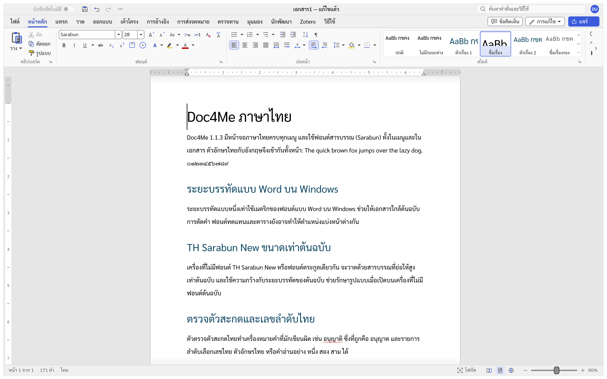
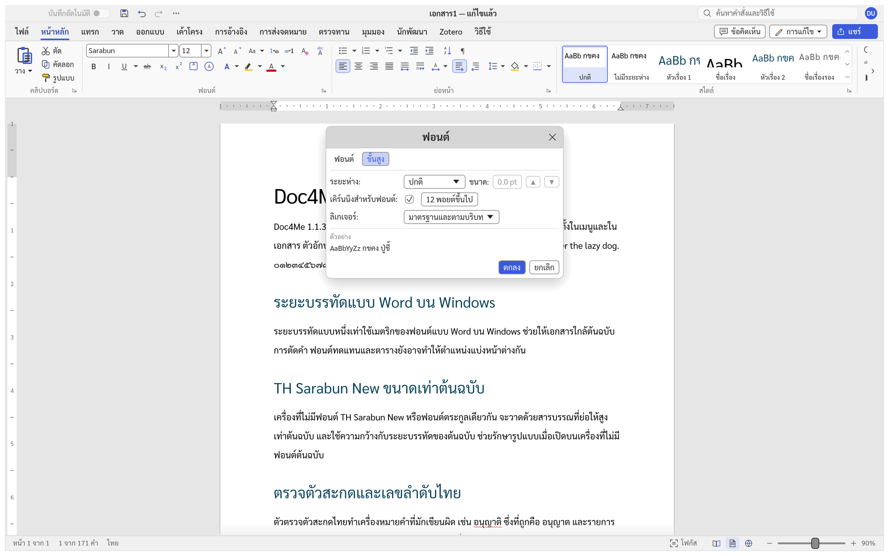
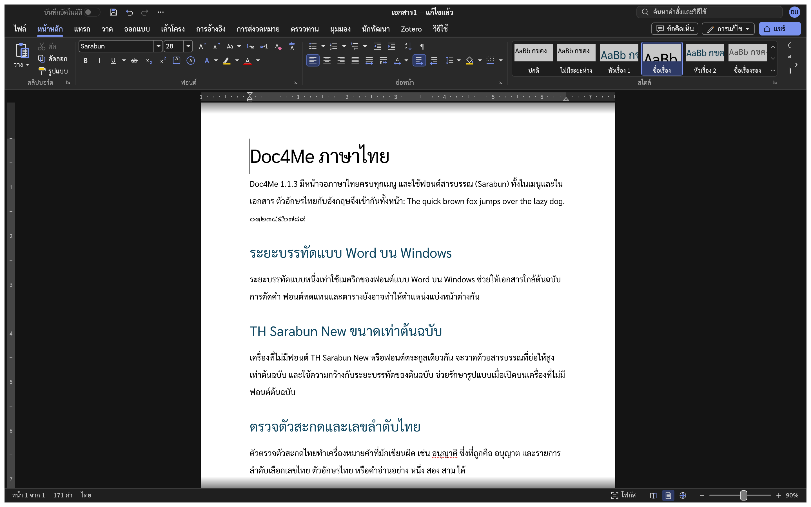
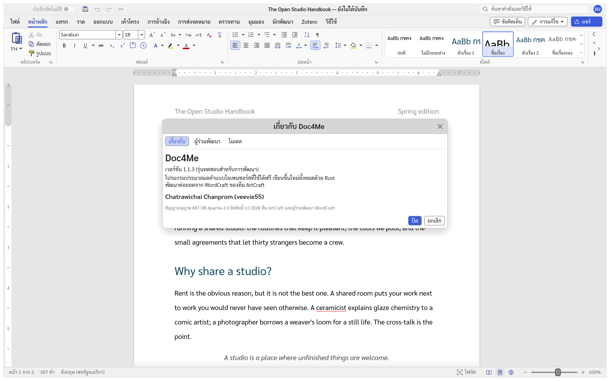

# Doc4Me

[English](README.en.md) · **ภาษาไทย**

Doc4Me เป็นโปรแกรมประมวลผลคำแบบโอเพนซอร์สที่เขียนด้วยภาษา Rust และพัฒนาแบบ clean room
ตั้งเป้าให้ทำได้ครบเท่า Microsoft Word แล้วไปให้ไกลกว่านั้นในเรื่องความเร็ว ความเปิดกว้าง
และการสั่งงานด้วยเอเจนต์ ทุกความสามารถเป็นคำสั่งที่สคริปต์และเอเจนต์ AI เรียกใช้ได้ ผ่านช่องทางควบคุมในเครื่องหรือ MCP

เวอร์ชันปัจจุบันคือ **1.1.3** และยังอยู่ในระยะ **alpha** ดูความคืบหน้าที่ [ROADMAP.md](ROADMAP.md)
ผลวัด Windows ที่บันทึกล่าสุด (11 พฤศจิกายน 2026): **92.7%** หรือ **94.5% เมื่อไม่นับ 22 รายการ deferred**
คลังเอกสาร 220 ไฟล์เปิดและบันทึกกลับได้ครบ จำนวนหน้าตรง 181/220 และขอบเขตหน้าตรง 99/220
การจัดหน้าและความแม่นยำของคำแปลยังมีข้อจำกัด; ดู [ผลวัดและเกณฑ์](docs/readiness.md) และ [สิ่งที่ยังขาด](docs/gaps.md)



## ภาษาไทยใน Doc4Me

- ส่วนติดต่อผู้ใช้ภาษาไทยครบทุกเมนู ใช้ฟอนต์สารบรรณ (Sarabun) เป็นฟอนต์หลักทั้งในเมนูและในเอกสาร
- ตัดคำไทยด้วยพจนานุกรม ทั้งตอนขึ้นบรรทัดใหม่ ดับเบิลคลิกเลือกคำ และนับจำนวนคำ
- ตัวตรวจตัวสะกดไทยทำเครื่องหมายคำที่มักเขียนผิด เช่น อนุญาติ (ที่ถูกคือ อนุญาต)
- รายการลำดับเลือกเลขไทย ตัวอักษรไทย หรือคำอ่านอย่าง หนึ่ง สอง สาม ได้
- ระยะห่างบรรทัด 1 เท่าใช้เมตริกของฟอนต์แบบ Word บน Windows ช่วยให้ใกล้ต้นฉบับ; ฟอนต์ การตัดคำและตารางยังอาจทำให้แบ่งหน้าต่างกัน
- เอกสารที่ใช้ TH Sarabun New หรือ TH SarabunPSK แสดงขนาดเท่าต้นฉบับแม้เครื่องไม่มีฟอนต์นั้น ฟอนต์ไทยอื่นที่เครื่องไม่มีแสดงด้วย Sarabun ขนาดของ Sarabun เอง และถ้าเป็น TH SarabunIT๙ โปรแกรมจะแจ้งเตือนตอนเปิดไฟล์ (ตั้งแต่ 1.1.3)
- ปุ่มจัดกระจายและจัดกระจายแบบไทยในกลุ่มย่อหน้า ของแท็บหน้าหลัก (ตั้งแต่ 1.1.1)
- ปุ่มแปลงเป็นเลขไทย และแปลงเป็นเลขอารบิก ในกลุ่มฟอนต์ ของแท็บหน้าหลัก แปลงตัวเลขในส่วนที่เลือก (0–9 ↔ ๐–๙) โดยคงรูปแบบตัวอักษรเดิม (ตั้งแต่ 1.1.3)

## ดาวน์โหลด

ไฟล์โปรแกรมสำหรับ Windows x64 (ตัวติดตั้ง MSI และไฟล์ zip แบบไม่ต้องติดตั้ง) อยู่ในหน้า
[Releases](https://github.com/chatraweechai/doc4me/releases) ไฟล์เหล่านี้ยังไม่ได้ลงลายเซ็นดิจิทัล
Windows SmartScreen จึงอาจถามก่อนเปิด ตัวติดตั้ง MSI ติดตั้งทับ Doc4Me เวอร์ชันก่อนหน้าได้

Windows ARM64, macOS, Linux, FreeBSD และ Web App มี workflow แยกสำหรับสร้างไฟล์จากซอร์สที่คุณเลือก
หรือ build บนเครื่องจาก [`packaging/`](packaging/) ได้

### Build ด้วย GitHub Actions

เปิด [Actions ของ repository นี้](https://github.com/veevie55/doc4me/actions) เลือก workflow แล้วกด **Run workflow**
เลือก **Use workflow from: main** เพื่อใช้ขั้นตอน build ปัจจุบัน และใส่ช่อง **ref** เป็น `main` สำหรับโค้ดล่าสุด,
`v1.1.3` สำหรับซอร์สของรุ่นที่ออกแล้ว หรือชื่อ branch/tag/commit SHA ที่ต้องการ

| Workflow | เป้าหมาย | ไฟล์ที่ดาวน์โหลดจาก Artifacts |
|---|---|---|
| [Build Windows ARM64](.github/workflows/build-windows-arm64.yml) | Windows ARM64 | MSI และ portable ZIP |
| [Build macOS](.github/workflows/build-macos.yml) | Universal (Apple Silicon + Intel), หรือเลือกสถาปัตยกรรมเดียว | DMG และ CLI ZIP |
| [Build Linux](.github/workflows/build-linux.yml) | x86_64, glibc 2.35 ขึ้นไป | AppImage, DEB, RPM และ tar.gz |
| [Build BSD (FreeBSD)](.github/workflows/build-bsd.yml) | FreeBSD 14.5 x86_64 | tar.gz ของโปรแกรมและ CLI |
| [Build Web App](.github/workflows/build-web.yml) | เบราว์เซอร์ที่รองรับ WebAssembly | ZIP ของเว็บแบบ static |

**ทุก workflow เริ่มได้จากคำสั่ง Run workflow เท่านั้น** การ push โค้ดหรือ tag ไม่เริ่ม build, deploy หรือออก Release
ไฟล์ build ของทั้งห้า workflow อยู่ใน **Artifacts** ของ run นั้น 14 วัน พร้อม `SOURCE_COMMIT.txt` ระบุ commit ที่ใช้จริง
Windows ARM64 ยังไม่ลงลายเซ็นดิจิทัล และ macOS ลงลายเซ็นแบบ ad-hoc โดยยังไม่ notarize
Web App ต้องแตก ZIP แล้วให้บริการผ่าน HTTP(S); ดู [วิธีนำขึ้นโฮสต์](packaging/web/README.md)

[Windows x64 installer](.github/workflows/windows-x64-installer.yml) ยังคงแยกต่างหากและรันด้วยมือเช่นกัน
ช่อง **commit** ของ workflow นี้รับ SHA เต็ม 40 ตัวของ commit บน `main`; ติ๊ก **release** เฉพาะเมื่อต้องการเผยแพร่ Release
รายละเอียดและข้อกำหนดของแต่ละแพลตฟอร์มอยู่ที่ [docs/releasing.md](docs/releasing.md)

## ความสามารถหลัก

- เปิดและบันทึก `.docx`, RTF, ODT, HTML, Markdown, LaTeX และข้อความธรรมดา อ่าน `.doc` และส่งออกเป็น PDF หรือภาพของหน้า (PNG, JPG/JPEG)
- แถบคำสั่งแบบ Word สไตล์ รายการ ตาราง สมการ SmartArt แผนภูมิ ข้อคิดเห็นและการติดตามการเปลี่ยนแปลง
  การอ้างอิงและบรรณานุกรม (ใช้กับ Zotero ได้) จดหมายเวียน และโหมดอ่าน
- ส่วนติดต่อผู้ใช้ 91 ภาษา รวมภาษาไทย อังกฤษ รัสเซีย ฮังการี ตุรกี อิตาลี (บางภาษาเป็นฉบับร่างที่แปลด้วย AI และยังไม่ผ่านการตรวจทานจากเจ้าของภาษา ภาษาที่เขียนจากขวาไปซ้ายและอักษรอินเดียจะแสดงคำเตือนก่อนใช้ เพราะส่วนติดต่อยังจัดรูปอักษรเหล่านี้ได้ไม่ถูกต้อง)
- ตั้งแต่ 1.1.3: พิมพ์ด้วยเสียง (Dictate) รองรับภาษาไทย แปลงเสียงเป็นข้อความบนเครื่องด้วย whisper.cpp
  (ดาวน์โหลดโมเดลเสียงฟรีครั้งแรกครั้งเดียว), แปลเอกสาร (MyMemory หรือเซิร์ฟเวอร์ LibreTranslate ของคุณเอง),
  รูปภาพออนไลน์ (ภาพสัญญาอนุญาต Creative Commons จาก Openverse พร้อมเครดิต), สมการด้วยลายมือ และ Get Add-ins
- ตั้งแต่ 1.1.3: รุ่นเดสก์ท็อปฝังฟอนต์ที่ขนาดตัวอักษรเท่าฟอนต์หลักของ Word (Carlito แทน Calibri, Caladea แทน Cambria, Arimo แทน Arial, Tinos แทน Times New Roman, Cousine แทน Courier New; สัญญาอนุญาต OFL 1.1) ใช้เมื่อเครื่องไม่มีฟอนต์ต้นฉบับ เอกสารจึงตัดบรรทัดและแบ่งหน้าใกล้ Word ขึ้น
- ธีมสว่างและธีมมืด ในธีมมืดหน้ากระดาษยังเป็นสีขาว
- `doc4me-cli` แปลงและแก้ไขเอกสารได้โดยไม่ต้องเปิดหน้าต่าง และ `doc4me-cli mcp` ให้เอเจนต์ AI
  เรียกใช้ทุกคำสั่งได้ ([docs/mcp.md](docs/mcp.md))

### เคิร์นนิงและลิเกเจอร์

หน้าขั้นสูงของกล่องโต้ตอบฟอนต์ตั้งค่า "เคิร์นนิงสำหรับฟอนต์" ลิเกเจอร์ และระยะห่างอักขระได้
ปุ่มเพิ่ม/ลดระยะห่างปรับทีละ 0.1 pt ใน 1.1.3 และบันทึกค่าไว้ใน `.docx`
ข้อความที่ไม่ได้ตั้งค่านี้ใช้ค่าเริ่มต้นแบบ Word คือไม่เคิร์นนิง และไม่ใช้ลิเกเจอร์กับอักษรละติน
(อักษรที่มีการประกอบรูป เช่น อาหรับและไทย ใช้ลิเกเจอร์ของฟอนต์เสมอ)



### ธีมมืด



### เกี่ยวกับ Doc4Me 1.1.3

หน้าต่างเกี่ยวกับแสดงเวอร์ชันและชื่อผู้พัฒนา ภาพในหน้านี้สร้างใหม่จากโปรแกรมจริงด้วย
[`ui_shot`](crates/ui-egui/examples/ui_shot.rs); สคริปต์ต้นฉบับอยู่ใน [`docs/images/shots/`](docs/images/shots/)



## Build จากซอร์สโค้ด

ติดตั้ง Rust เวอร์ชัน 1.90 ขึ้นไป, CMake, คอมไพเลอร์ C++ และ libclang (การพูดเป็นข้อความ build whisper.cpp) บน Linux ต้องมี header ของ ALSA (`libasound2-dev` บน Debian/Ubuntu, `alsa-lib-devel` บน Fedora) ด้วย แล้วรัน

```sh
cargo run --release -p doc4me                 # เปิดโปรแกรม
cargo run --release -p doc4me -- --sample     # เปิดโปรแกรมพร้อมเอกสารตัวอย่าง
cargo run --release -p doc4me-cli -- convert in.docx out.pdf
```

ก่อนส่งการแก้ไข ให้รัน `cargo xtask ci` (จัดรูปแบบโค้ด clippy เทสต์ asset การแบ่งชั้นของโค้ด และ build
WebAssembly) โครงสร้างของโค้ดดูที่ [docs/architecture.md](docs/architecture.md) กติกาสำหรับผู้ร่วมพัฒนาและเอเจนต์
ดูที่ [AGENTS.md](AGENTS.md) การออกเวอร์ชันดูที่ [docs/releasing.md](docs/releasing.md) และสิ่งที่เปลี่ยนแปลง
ดูที่ [CHANGELOG.md](CHANGELOG.md) คำแปลและอภิธานศัพท์ของส่วนติดต่อผู้ใช้ภาษาไทยดูที่
[docs/localization-th.md](docs/localization-th.md)

## สัญญาอนุญาต

Doc4Me ใช้สัญญาอนุญาต [MIT](LICENSE-MIT) หรือ [Apache-2.0](LICENSE-APACHE) เลือกได้ตามต้องการ
ฟอนต์ที่มากับโปรแกรมใช้ SIL Open Font License และข้อมูลตัดคำไทยใช้ [สัญญาอนุญาตของ Unicode](LICENSE-UNICODE)
ส่วนประกอบจากภายนอกทั้งหมดดูที่ [NOTICE](NOTICE) และ [ATTRIBUTION.md](ATTRIBUTION.md)

Doc4Me เป็นโครงการอิสระ ไม่มีส่วนเกี่ยวข้องกับ Microsoft และไม่ได้รับการรับรองจาก Microsoft ไม่มีไอคอน ภาพ
แม่แบบ หรือ asset อื่นใดของ Microsoft ภาพหน้าจอในหน้านี้เป็นภาพของ Doc4Me เอง
