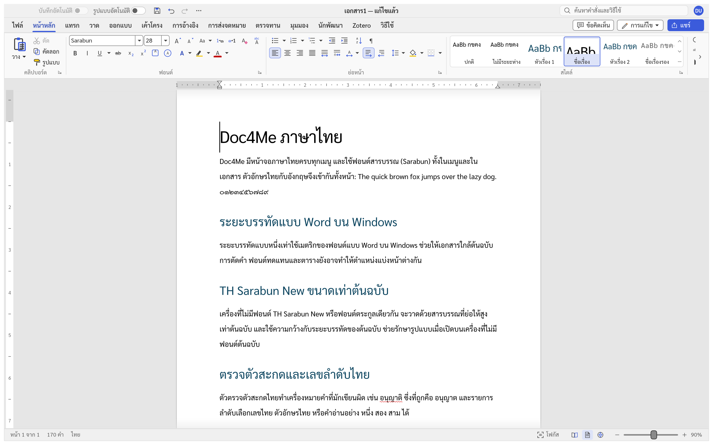
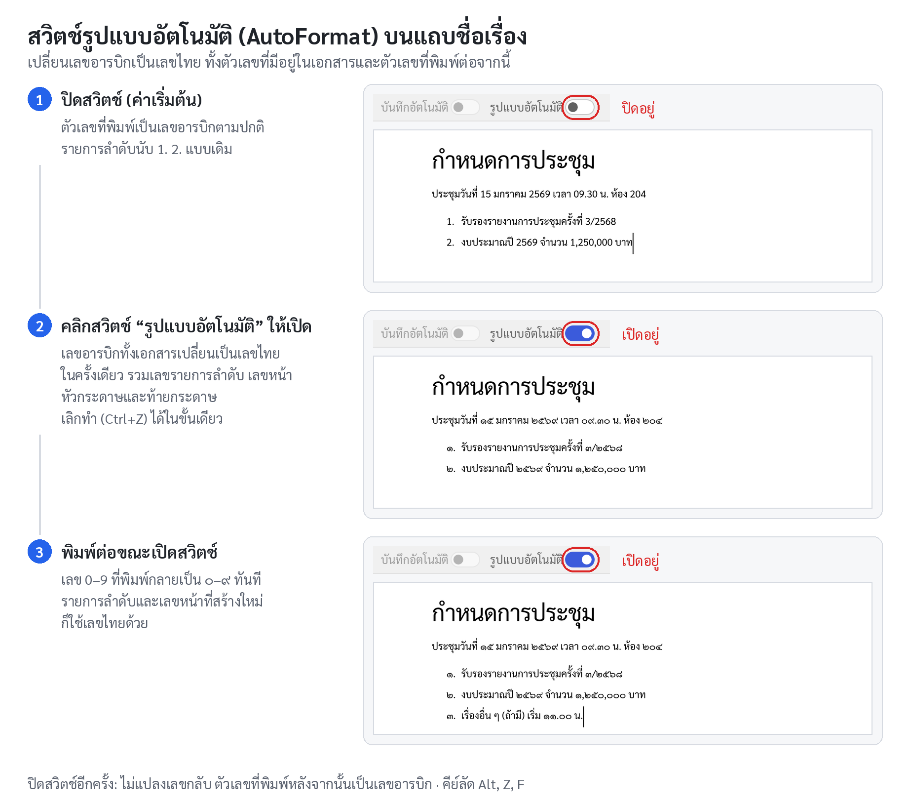
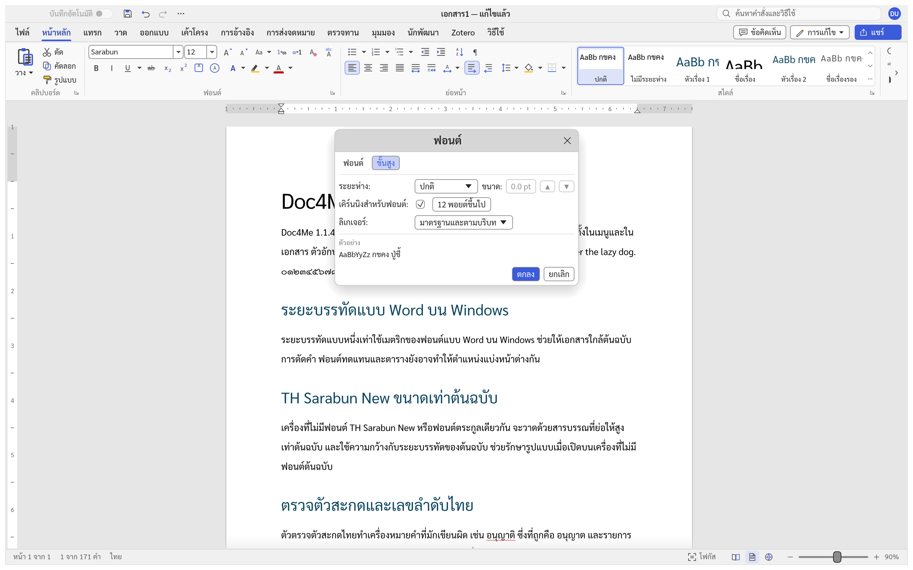
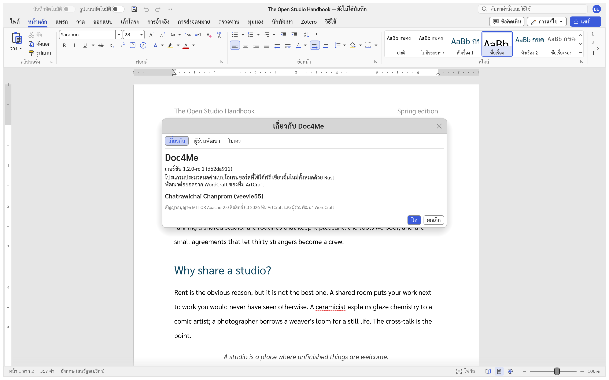

# Doc4Me

Doc4Me เป็นโปรแกรมประมวลผลคำแบบโอเพนซอร์สที่เขียนด้วยภาษา Rust และพัฒนาแบบ clean room
ตั้งเป้าให้ทำได้ครบเท่า Microsoft Word แล้วไปให้ไกลกว่านั้นในเรื่องความเร็ว ความเปิดกว้าง
และการสั่งงานด้วยเอเจนต์ ทุกความสามารถเป็นคำสั่งที่สคริปต์และเอเจนต์ AI เรียกใช้ได้ ผ่านช่องทางควบคุมในเครื่องหรือ MCP

Doc4Me ยังอยู่ในระยะ **alpha**
ผลวัด Windows ทางการล่าสุด (run 45548125682): **97.3%** หรือ **100.0% เมื่อไม่นับ 47 รายการ deferred**
คลังเอกสาร 219 ไฟล์เปิดและบันทึกกลับได้ครบ จำนวนหน้าตรง 218/219 และขอบเขตหน้าตรง 195/219



## ภาษาไทยใน Doc4Me

- ส่วนติดต่อผู้ใช้ภาษาไทยครบทุกเมนู ใช้ฟอนต์สารบรรณ (Sarabun) เป็นฟอนต์หลักทั้งในเมนูและในเอกสาร
- ตัดคำไทยด้วยพจนานุกรม ทั้งตอนขึ้นบรรทัดใหม่ ดับเบิลคลิกเลือกคำ และนับจำนวนคำ
- ตัวตรวจตัวสะกดไทยทำเครื่องหมายคำที่มักเขียนผิด เช่น อนุญาติ (ที่ถูกคือ อนุญาต)
- รายการลำดับเลือกเลขไทย ตัวอักษรไทย หรือคำอ่านอย่าง หนึ่ง สอง สาม ได้
- ระยะห่างบรรทัด 1 เท่าใช้เมตริกของฟอนต์แบบ Word บน Windows ช่วยให้ใกล้ต้นฉบับ; ฟอนต์ การตัดคำและตารางยังอาจทำให้แบ่งหน้าต่างกัน
- เอกสารที่ใช้ TH Sarabun New หรือ TH SarabunPSK แสดงขนาดเท่าต้นฉบับแม้เครื่องไม่มีฟอนต์นั้น ฟอนต์ไทยอื่นที่เครื่องไม่มีแสดงด้วย Sarabun ขนาดของ Sarabun เอง และถ้าเป็น TH SarabunIT๙ โปรแกรมจะแจ้งเตือนตอนเปิดไฟล์
- ปุ่มจัดกระจายและจัดกระจายแบบไทยในกลุ่มย่อหน้า ของแท็บหน้าหลัก
- ปุ่มแปลงเป็นเลขไทย และแปลงเป็นเลขอารบิก ในกลุ่มฟอนต์ ของแท็บหน้าหลัก แปลงตัวเลขในส่วนที่เลือก (0–9 ↔ ๐–๙) โดยคงรูปแบบตัวอักษรเดิม
- สวิตช์รูปแบบอัตโนมัติบนแถบชื่อเรื่อง เปลี่ยนเลขอารบิกทั้งเอกสารเป็นเลขไทย และให้ตัวเลขที่พิมพ์ต่อจากนั้นเป็นเลขไทยเอง (ดูหัวข้อถัดไป)

### สวิตช์รูปแบบอัตโนมัติ (เลขไทยอัตโนมัติ)

สวิตช์ **รูปแบบอัตโนมัติ** (AutoFormat) อยู่บนแถบชื่อเรื่อง ถัดจากสวิตช์บันทึกอัตโนมัติ ค่าเริ่มต้นคือปิด
คลิกเพื่อเปิดหรือปิด หรือกด Alt แล้วกด Z, F ก็ได้ โปรแกรมเดสก์ท็อปจำค่าที่ตั้งไว้สำหรับการเปิดครั้งต่อไป

1. **ตอนปิด** ตัวเลขที่พิมพ์เป็นเลขอารบิก (0–9) ตามปกติ และรายการลำดับนับเป็น 1. 2. 3.
2. **เมื่อเปิด** Doc4Me เปลี่ยนเลขอารบิกทุกตัวในเอกสารเป็นเลขไทย (๐–๙) ในครั้งเดียว
   รวมถึงหัวกระดาษ ท้ายกระดาษ เลขรายการลำดับ และเลขหน้า การเปลี่ยนนี้เป็นขั้นเดียว
   จึงกดเลิกทำ (Ctrl+Z) เพื่อคืนตัวเลขเดิมได้ โดยสวิตช์ยังเปิดอยู่
3. **ขณะเปิด** เลข 0–9 ที่พิมพ์จะกลายเป็น ๐–๙ ทันที การพิมพ์ "1. " ต้นย่อหน้ายังเริ่มรายการลำดับเลขไทยได้
   และรายการลำดับ (รวมถึงรายการที่วางมาจากที่อื่น) กับเลขหน้าที่สร้างหลังจากนั้นก็นับเป็นเลขไทยด้วย
4. **เมื่อปิดอีกครั้ง** ตัวเลขที่เปลี่ยนแล้วจะไม่ถูกแปลงกลับ แต่ตัวเลขที่พิมพ์หลังจากนั้นเป็นเลขอารบิก
   ถ้าต้องการแปลงกลับ ให้เลือกข้อความแล้วใช้ปุ่มแปลงเป็นเลขอารบิก ในกลุ่มฟอนต์

เอกสารที่จำกัดการแก้ไขไว้จะไม่ถูกเปลี่ยนตัวเลขที่มีอยู่ มีผลเฉพาะตัวเลขที่พิมพ์ใหม่



## ความสามารถหลัก

- เปิดและบันทึก `.docx`, RTF, ODT, HTML, Markdown, LaTeX และข้อความธรรมดา อ่าน `.doc` และส่งออกเป็น PDF หรือภาพของหน้า (PNG, JPG/JPEG)
- แถบคำสั่งแบบ Word สไตล์ รายการ ตาราง สมการ SmartArt แผนภูมิ ข้อคิดเห็นและการติดตามการเปลี่ยนแปลง
  การอ้างอิงและบรรณานุกรม (ใช้กับ Zotero ได้) จดหมายเวียน และโหมดอ่าน
- ส่วนติดต่อผู้ใช้ 91 ภาษา รวมภาษาไทย อังกฤษ รัสเซีย ฮังการี ตุรกี อิตาลี (บางภาษาเป็นฉบับร่างที่แปลด้วย AI และยังไม่ผ่านการตรวจทานจากเจ้าของภาษา ภาษาที่เขียนจากขวาไปซ้ายและอักษรอินเดียจะแสดงคำเตือนก่อนใช้ เพราะส่วนติดต่อยังจัดรูปอักษรเหล่านี้ได้ไม่ถูกต้อง)
- ตรวจคำสะกดและแนะนำคำแก้ไขได้ในภาษาอังกฤษ ไทย โปแลนด์ โปรตุเกส อิตาลี โครเอเชีย ตุรกี รัสเซีย และเช็ก พร้อมตรวจไวยากรณ์ในอังกฤษ โปแลนด์ โปรตุเกส อิตาลี โครเอเชีย ตุรกี รัสเซีย และเช็ก ภาษาอังกฤษกับไทยใช้ตัวตรวจคำสะกดที่มากับโปรแกรม ส่วนภาษาอื่นที่ต้องใช้พจนานุกรมต้องติดตั้ง Hunspell ของภาษานั้น (ตั้งตัวแปร `DOC4ME_DICTIONARIES` ให้ชี้ไปยังโฟลเดอร์ที่มีไฟล์ `.aff` และ `.dic` ได้); หากไม่มีพจนานุกรม โปรแกรมจะไม่ขีดเส้นใต้คำในภาษานั้น ส่วนบัลแกเรีย โปรตุเกส อิตาลี ตุรกี และรัสเซียมีรูปแบบตัดคำเฉพาะภาษา
- พิมพ์ด้วยเสียง (Dictate) รองรับภาษาไทย แปลงเสียงเป็นข้อความบนเครื่องด้วย whisper.cpp
  (ดาวน์โหลดโมเดลเสียงฟรีครั้งแรกครั้งเดียว), แปลเอกสาร (MyMemory หรือเซิร์ฟเวอร์ LibreTranslate ของคุณเอง),
  รูปภาพออนไลน์ (ภาพสัญญาอนุญาต Creative Commons จาก Openverse พร้อมเครดิต), สมการด้วยลายมือ และ Get Add-ins
- รุ่นเดสก์ท็อปฝังฟอนต์ที่ขนาดตัวอักษรเท่าฟอนต์หลักของ Word (Carlito แทน Calibri, Caladea แทน Cambria, Arimo แทน Arial, Tinos แทน Times New Roman, Cousine แทน Courier New; สัญญาอนุญาต OFL 1.1) ใช้เมื่อเครื่องไม่มีฟอนต์ต้นฉบับ เอกสารจึงตัดบรรทัดและแบ่งหน้าใกล้ Word ขึ้น
- คำสั่งตารางสำหรับเลือกเซลล์ แถว และคอลัมน์ ปรับเส้นขอบ เพิ่มหรือลบแถว/คอลัมน์ ซ้ำหัวตาราง และแยกตาราง พร้อมคัดลอกตาราง รูปภาพ รูปร่าง กล่องข้อความ และวัตถุอื่นภายใน Doc4Me โดยรักษาข้อมูลประกอบที่รองรับ ดู [การตรวจตารางและคลิปบอร์ด](docs/readiness/table-clipboard-audit-2026-11-13.md) สำหรับขอบเขตและข้อจำกัด
- ธีมสว่างและธีมมืด ในธีมมืดหน้ากระดาษยังเป็นสีขาว
- รุ่นเดสก์ท็อปเก็บสำเนากู้คืนของเอกสารที่ยังไม่ได้บันทึกไว้ในเครื่อง และเปิดให้กู้คืนหลังโปรแกรมปิดผิดปกติ ไม่เก็บสำเนาของเอกสารที่ตั้งรหัสผ่านไว้ ดู [การกู้คืนเอกสาร](docs/recovery.md)
- `doc4me-cli` แปลงและแก้ไขเอกสารได้โดยไม่ต้องเปิดหน้าต่าง และ `doc4me-cli mcp` ให้เอเจนต์ AI
  เรียกใช้ทุกคำสั่งได้ ([docs/mcp.md](docs/mcp.md))

### เคิร์นนิงและลิเกเจอร์

หน้าขั้นสูงของกล่องโต้ตอบฟอนต์ตั้งค่า "เคิร์นนิงสำหรับฟอนต์" ลิเกเจอร์ และระยะห่างอักขระได้
ปุ่มเพิ่ม/ลดระยะห่างปรับทีละ 0.1 pt และบันทึกค่าไว้ใน `.docx`
ข้อความที่ไม่ได้ตั้งค่านี้ใช้ค่าเริ่มต้นแบบ Word คือไม่เคิร์นนิง และไม่ใช้ลิเกเจอร์กับอักษรละติน
(อักษรที่มีการประกอบรูป เช่น อาหรับและไทย ใช้ลิเกเจอร์ของฟอนต์เสมอ)



### ธีมมืด


### เกี่ยวกับ Doc4Me

หน้าต่างเกี่ยวกับแสดงชื่อโปรแกรมและชื่อผู้พัฒนา ภาพในหน้านี้สร้างใหม่จากโปรแกรมจริงด้วย
[`ui_shot`](crates/ui-egui/examples/ui_shot.rs); สคริปต์ต้นฉบับอยู่ใน [`docs/images/shots/`](docs/images/shots/)


ภาพข้างบนเป็น build ในเครื่องที่ไม่มีเลข commit จึงแสดง "รุ่นทดสอบสำหรับการพัฒนา" ส่วนภาพข้างล่างเป็น build จากโค้ด
ที่ใส่เวอร์ชัน `v1.2.0-rc.1` และเลือกช่อง **about** เป็น `version-commit` หน้าต่างจึงแสดงเลขเวอร์ชันพร้อมเลข commit ที่ใช้ build
(`d52da911`) โปรแกรมตัด `v` ข้างหน้าออกเมื่อแสดงผล



## Build จากซอร์สโค้ด

ติดตั้ง Rust เวอร์ชัน 1.90 ขึ้นไป, CMake, คอมไพเลอร์ C++ และ libclang (การพูดเป็นข้อความ build whisper.cpp) บน Linux ต้องมี header ของ ALSA (`libasound2-dev` บน Debian/Ubuntu, `alsa-lib-devel` บน Fedora) ด้วย แล้วรัน

```sh
cargo run --release -p doc4me                 # เปิดโปรแกรม
cargo run --release -p doc4me -- --sample     # เปิดโปรแกรมพร้อมเอกสารตัวอย่าง
cargo run --release -p doc4me-cli -- convert in.docx out.pdf
```

ก่อนส่งการแก้ไข ให้รัน `cargo xtask ci` (จัดรูปแบบโค้ด clippy เทสต์ asset การแบ่งชั้นของโค้ด และ build
WebAssembly) การ build และเผยแพร่ดูที่ [docs/releasing.md](docs/releasing.md)

## สัญญาอนุญาต

Doc4Me ใช้สัญญาอนุญาต [MIT](LICENSE-MIT) หรือ [Apache-2.0](LICENSE-APACHE) เลือกได้ตามต้องการ
ฟอนต์ที่มากับโปรแกรมใช้ SIL Open Font License และข้อมูลตัดคำไทยใช้ [สัญญาอนุญาตของ Unicode](LICENSE-UNICODE)
ส่วนประกอบจากภายนอกทั้งหมดดูที่ [NOTICE](NOTICE)

Doc4Me เป็นโครงการอิสระ ไม่มีส่วนเกี่ยวข้องกับ Microsoft และไม่ได้รับการรับรองจาก Microsoft ไม่มีไอคอน ภาพ
แม่แบบ หรือ asset อื่นใดของ Microsoft ภาพหน้าจอในหน้านี้เป็นภาพของ Doc4Me เอง
