# Changelog และรายการความสามารถของ Doc4Me

อัปเดตเมื่อ **28 November 2026 20:51 น. (Asia/Bangkok)** · ปลายทาง `main` · command catalog ของ Doc4Me **776 รายการ** · latest verified code push `1eb5219c18d71a31e5284d8da17459b63477fe0f`

เอกสารนี้รวมบันทึกการเปลี่ยนแปลง รายการความสามารถที่เปิดผ่าน command catalog และภาพประกอบของ Doc4Me รายการคำสั่งจัดตามตำแหน่งใน UI โดยระบุ command ID, คีย์ลัด, พารามิเตอร์ และชนิดการทำงาน

การเปรียบเทียบ catalog ณ รอบนี้อ่าน JSON จาก `doc4me-cli commands --json` และ `wordcraft-cli commands --json`: Khiankrub มี **655** IDs, Doc4Me มี **776** IDs, และไม่มี ID ของ Khiankrub ที่ขาดใน Doc4Me (Doc4Me มีคำสั่งเพิ่มอีก **121** IDs).

## ภาพประกอบ

ภาพหน้าจอต่อไปนี้เป็นภาพประกอบที่มากับเอกสารของโครงการ

| ภาพประกอบ |
|---|
| 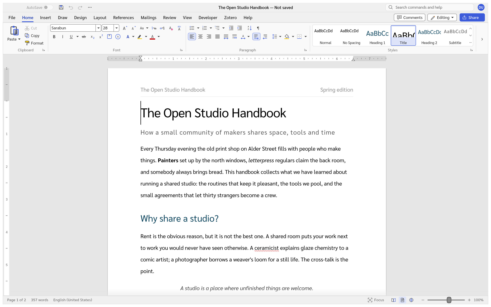 |
| 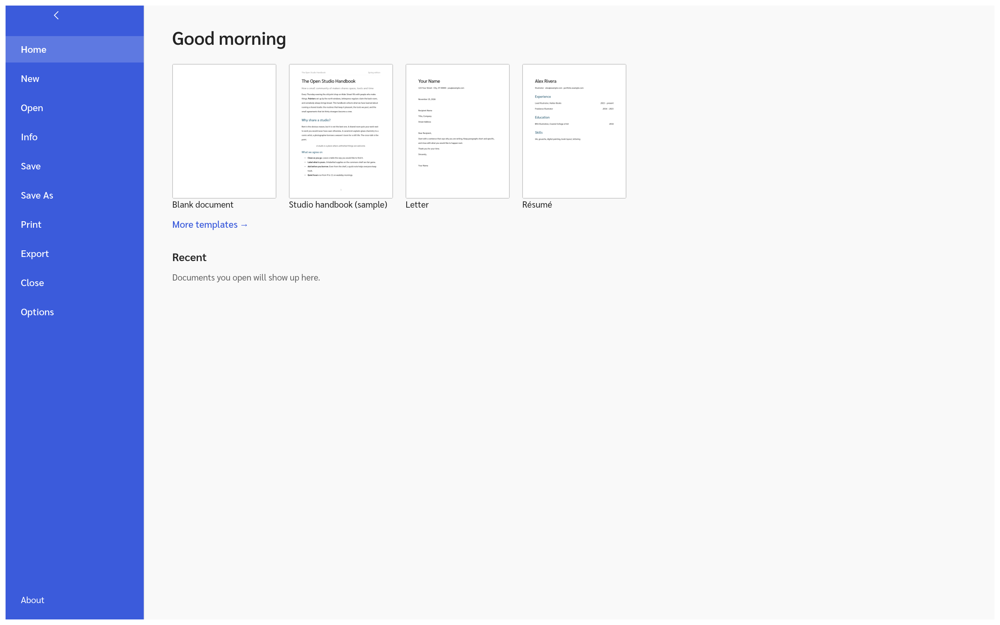 |
| 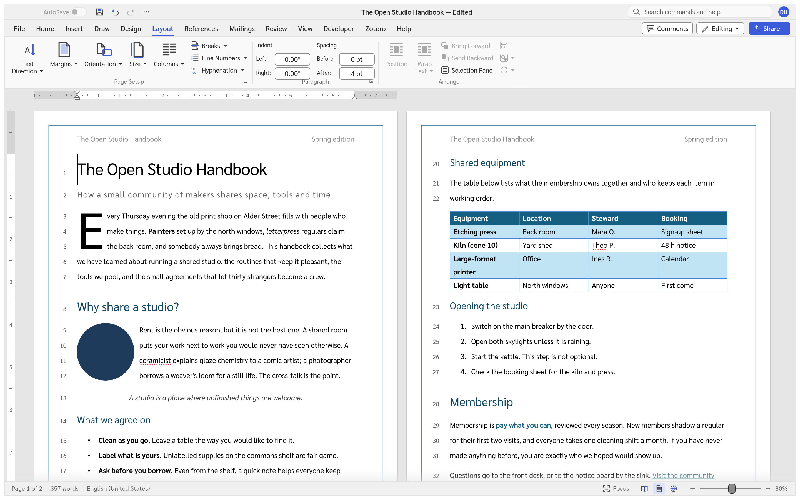 |
| 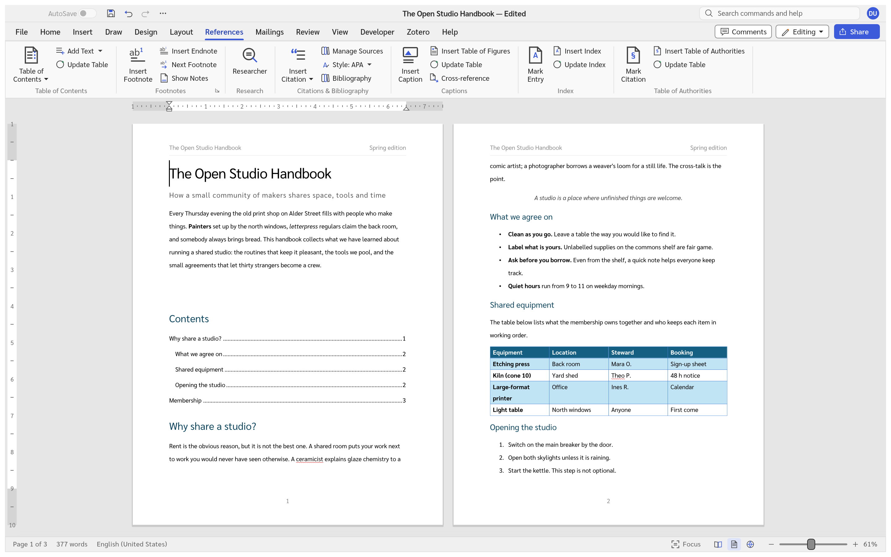 |
| 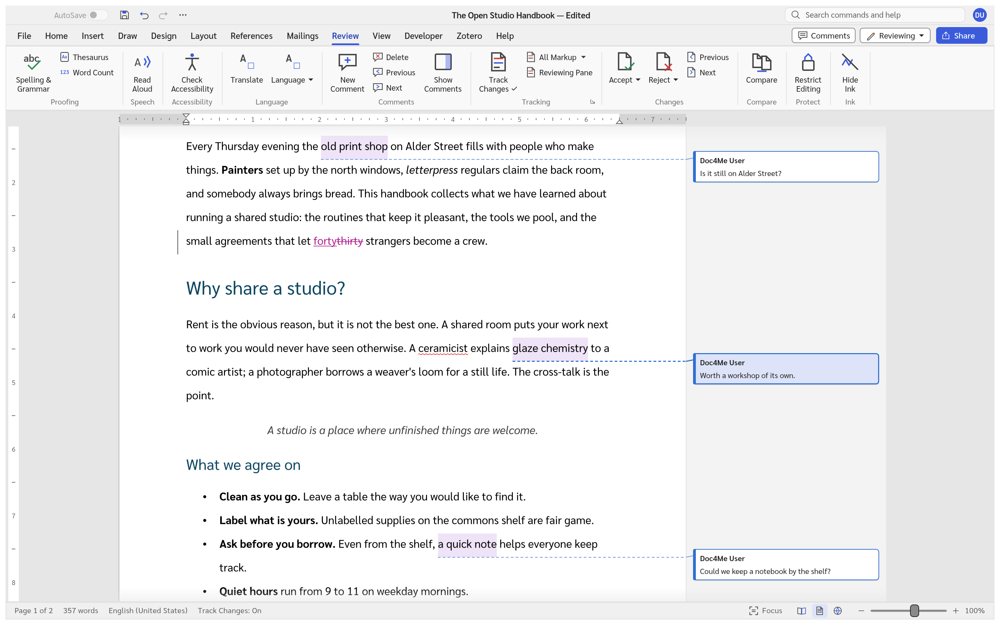 |
| 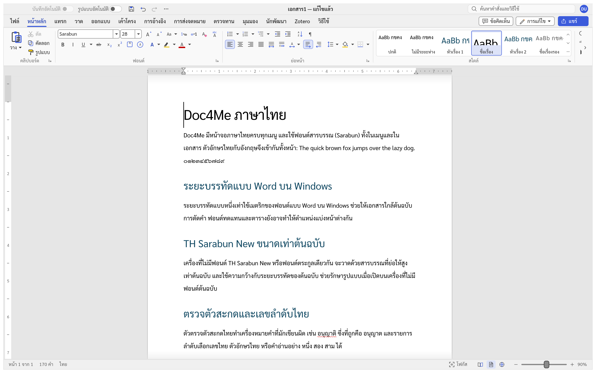 |
| 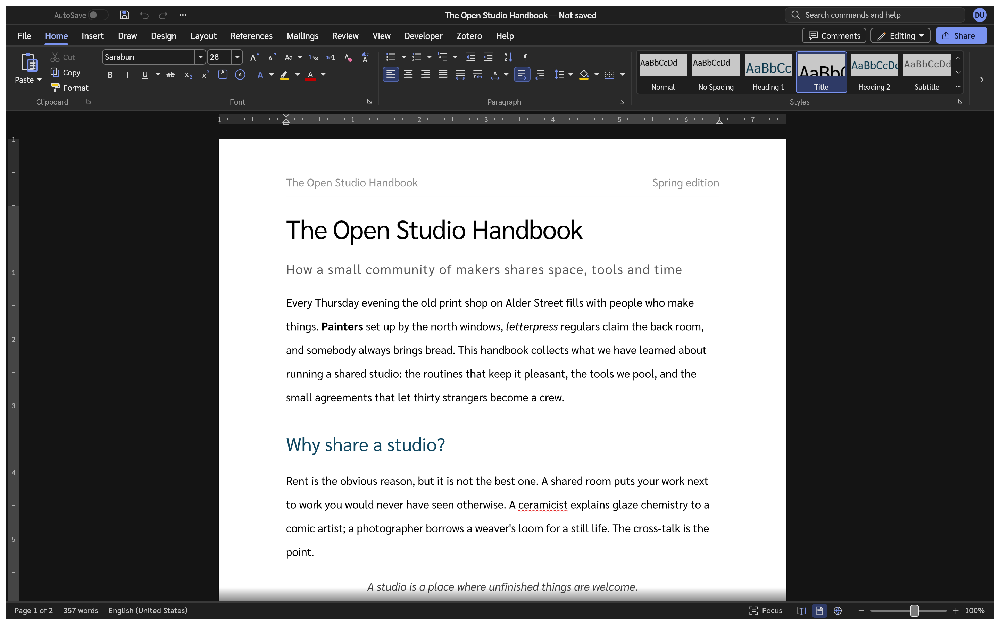 |

## วงจรการทำงานของเอกสาร

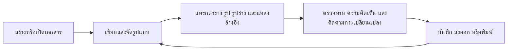

## ประวัติการเปลี่ยนแปลงที่ส่งขึ้น `main`

| Commit | เวลา commit (ICT) | รายการ | สถานะ push |
|---|---|---|---|
| `380a1b7` | 2026-11-28 12:05:51 | Add a session-only view mode | ยืนยันแล้วบน `origin/main` |
| `efee91f` | 2026-11-28 12:30:36 | Port remaining Khiankrub navigation and list features | ยืนยันแล้วบน `origin/main` |
| `ddc07f1` | 2026-11-28 13:12:14 | Port remaining Khiankrub list and page number features | ยืนยันแล้วบน `origin/main` |
| `093da12` | 2026-11-28 13:30:56 | Port full style editor from Khiankrub | ยืนยันแล้วบน `origin/main` |
| `c8e344e` | 2026-11-28 13:54:31 | Add Undo History to the Quick Access Toolbar | ยืนยันแล้วบน `origin/main` |
| `d42436e` | 2026-11-28 13:58:17 | Add native Full Screen view command | ยืนยันแล้วบน `origin/main` |
| `46962fe` | 2026-11-28 14:05:10 | Add document renaming | ยืนยันแล้วบน `origin/main` |
| `868a07c` | 2026-11-28 14:13:47 | Add drag and drop for selected text | ยืนยันแล้วบน `origin/main` |
| `2f95c82` | 2026-11-28 14:25:12 | Add table selection and mouse operations | ยืนยันแล้วบน `origin/main` |
| `a3e7f4b` | 2026-11-28 14:27:56 | Add copy by dragging selected objects | ยืนยันแล้วบน `origin/main` |
| `0768b4a` | 2026-11-28 14:33:26 | Add save as picture | ยืนยันแล้วบน `origin/main` |
| `b26606c` | 2026-11-28 14:56:25 | Port search, internal links, and line endpoint tools | ยืนยันแล้วบน `origin/main` ใน push 2026-11-28 16:20 ICT |
| `fd75ccb` | 2026-11-28 16:20:21 ICT | พอร์ต 22 ช่องว่างที่เหลือและปรับ UI ให้เข้ากับ Doc4Me | push 2026-11-28 16:20 ICT; `origin/main` ยืนยัน SHA `fd75ccb4bee4622a59df53d736350d4fee9dc429` |
| `6215d03` | 2026-11-28 20:19:45 ICT | เพิ่มการตั้ง region/หน่วย/รูปแบบตัวเลขตาม locale, table ruler และ tab-stop ruler; ปรับการ import เอกสารให้รับ region | push 2026-11-28 20:19 ICT; `origin/main` ยืนยัน SHA `6215d03b08568a2042a5433ca60486b203e45511` |
| `bd5a2c7` | 2026-11-28 20:26:18 ICT | เพิ่ม middle-click auto-scroll บน canvas ใน Windows/Linux; กดล้อเริ่ม/หยุด, Escape และปุ่มอื่นยกเลิก, ระยะจากจุดยึดกำหนดความเร็ว | push 2026-11-28 20:26 ICT; `origin/main` ยืนยัน SHA `bd5a2c7476d1aa29136baae2c01d50e4d26bed20` |
| `5eaaeec` | 2026-11-28 20:31:30 ICT | เพิ่ม Crop mode, crop handles/preview และขนาดใหม่ใน undo action เดียว | push 2026-11-28 20:31 ICT; `origin/main` ยืนยัน SHA `5eaaeec921bf336cc07d6cde5dfb1583ea2a9861` |
| `e315da4` | 2026-11-28 20:36:27 ICT | เพิ่ม alignment guides/snapping ขณะย้ายหรือ resize วัตถุ; เพิ่มตัวเลือกปิดใน Advanced และ Alt สำหรับ free move | push 2026-11-28 20:36 ICT; `origin/main` ยืนยัน SHA `e315da4d578d2abb2604f137e55bc5396404c680` |
| `5570d26` | 2026-11-28 20:46:10 ICT | เพิ่ม Define New Bullet dialog พร้อมตัวอักษร ฟอนต์ ขนาด น้ำหนัก สี แนวจัดวาง และ preview; คงพฤติกรรม command แบบ `char` อย่างเดียว | push 2026-11-28 20:46 ICT; `origin/main` ยืนยัน SHA `5570d26b981a3d01b8218a4f5802b66540ae261f` |
| `1eb5219` | 2026-11-28 20:51:09 ICT | เรียงตัวเลขในตารางตามภาษาของ cell ด้วย parser ที่เข้าใจทศนิยม ตัวคั่นหลักพัน และสกุลเงิน | push 2026-11-28 20:51 ICT; `origin/main` ยืนยัน SHA `1eb5219c18d71a31e5284d8da17459b63477fe0f` |

เวลาที่แสดงเป็นเขตเวลาไทย (Asia/Bangkok); commit `fd75ccb` ส่งขึ้น `main` เวลา 2026-11-28 16:20 ICT และตรวจยืนยันด้วย `git ls-remote origin refs/heads/main` ได้ SHA `fd75ccb4bee4622a59df53d736350d4fee9dc429`.

### รายการความสามารถที่เพิ่มใน `6215d03`

- **Region และหน่วย:** เอกสารใหม่ใช้กระดาษตามภูมิภาคของระบบ; File › Options ตั้ง region ได้ และเลือกหน่วยอัตโนมัติตาม region หรือคงหน่วยที่เลือกเอง.
- **ตัวเลขและระยะ:** ช่องระยะใน ribbon, dialogs, rulers และ readouts แสดงหน่วย/ทศนิยมตามภูมิภาค พร้อมอ่านค่าจากตัวคั่นทศนิยมของ locale.
- **Table ruler:** ลากขอบตารางเพื่อปรับคอลัมน์/แถว มี preview; Ctrl ปรับตามสัดส่วน และปรับขอบซ้าย/indent/alignment ได้จาก ruler.
- **Tab stops:** selector ที่มุม ruler วนชนิด tab; คลิกเพื่อวาง, ลากเพื่อย้าย, ลากออกเพื่อลบ, Alt ปิดการ snap, และ double-click เปิด Tabs dialog. การปล่อยหนึ่งครั้งสร้าง undo action เดียว.
- **นำเข้าเอกสาร:** TXT, Markdown และ HTML ใช้ region/page defaults ของ session และมี region detection สำหรับ desktop/web/CLI.
- **Canvas scrolling:** middle-click ที่ canvas แสดง marker; pointer ที่ห่างจาก anchor มากขึ้นจะ scroll เร็วขึ้น. คลิกกลางซ้ำ, Escape, ปุ่มอื่น, ล้อเลื่อน หรือออกจากหน้าต่างเพื่อหยุด; gesture ไม่ย้าย caret หรือเปิดเมนูของวัตถุ.
- **Crop mode:** เลือกรูปแล้วคลิกขวา › Crop เพื่อแสดง handles; ลากขอบหรือมุมเพื่อตัด/คืนภาพ พร้อม preview บริเวณที่ถูกซ่อน. ปล่อยเมาส์บันทึก crop และขนาดครั้งเดียว; Escape/Enter ออกจากโหมดและเก็บ crop ปัจจุบัน.
- **Alignment guides:** ลากหรือ resize รูป/shape ให้ snap กับขอบและกึ่งกลางหน้ากระดาษ, margins และวัตถุลอยอื่น; เส้นนำทางแสดงแนวที่ตรงกัน. Alt ปิด snap ชั่วคราว; View › Gridlines ใช้ drawing grid; File › Options › Advanced ปิด guides ได้.
- **Define New Bullet:** Home › Paragraph › Bullets › Define New Bullet เลือกอักขระ, ฟอนต์, ขนาด, bold/italic, สี และแนวชิดซ้าย/กลาง/ขวา พร้อม preview. กด OK สร้าง list definition ของตัวเองให้ย่อหน้าที่เลือก จึงไม่เปลี่ยนรายการอื่นที่ใช้เครื่องหมายเดียวกัน; command `para.defineBullet` เมื่อส่งเพียง `char` ยังทำงาน toggle แบบเดิม.
- **Sort ตารางตาม locale:** ตัวเลขเรียงตามภาษาของ cell เช่น `1,5` ในภาษาโปแลนด์ หรือ `1,250.50` ในภาษาอังกฤษ; รองรับ space/จุด/จุลภาค/apostrophe คั่นหลักพัน, สัญลักษณ์สกุลเงิน, `%` และเครื่องหมายลบแบบ en dash.

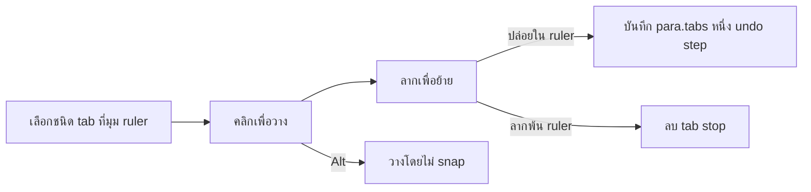

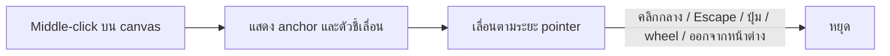

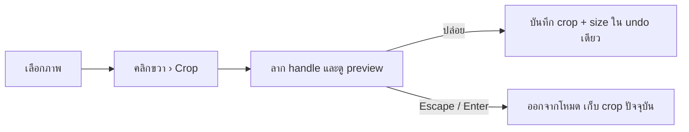

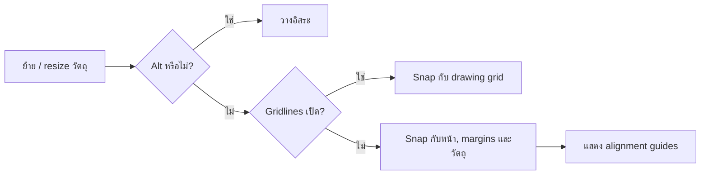

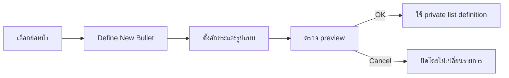

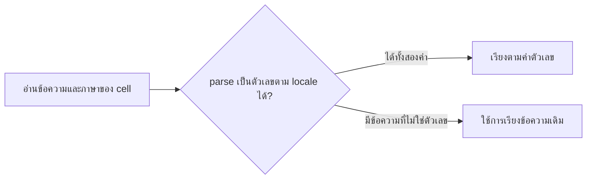

รายละเอียดช่องว่างพฤติกรรมที่ยังต้องพอร์ตจาก Khiankrub อยู่ใน [รายงานตรวจสอบช่องว่าง](docs/khiankrub-feature-gap-audit.md); command catalog 776 รายการยังคงเป็นรายการคำสั่ง ณ push นี้.

## รายการความสามารถทั้งหมด

รายการด้านล่างมาจาก command catalog ที่รันได้จริงของ Doc4Me ณ เวลาระบุด้านบน ครอบคลุมคำสั่ง UI และ automation ที่ลงทะเบียนทั้งหมด ส่วนฟีเจอร์ระดับ UI ที่ไม่มี command ID ระบุไว้ใน [รายงานตรวจสอบช่องว่าง Khiankrub](docs/khiankrub-feature-gap-audit.md)

Agents — 6 รายการ

| ความสามารถ | Command ID | คีย์ลัด | รายละเอียด / พารามิเตอร์ | ประเภท |
|---|---|---|---|---|
| Document Text | <code>document.text</code> | — | <code>{}</code> | อ่านข้อมูล / ควบคุม UI |
| Inspect Document | <code>document.inspect</code> | — | <code>{&quot;text&quot;?: bool}</code> | อ่านข้อมูล / ควบคุม UI |
| Layout Summary | <code>document.layout</code> | — | <code>{}</code> | อ่านข้อมูล / ควบคุม UI |
| Paragraph Details | <code>document.paragraph</code> | — | <code>{&quot;path&quot;: [n], &quot;story&quot;?: Story}</code> | อ่านข้อมูล / ควบคุม UI |
| Replace Document Text | <code>document.setText</code> | — | <code>{&quot;text&quot;: string}</code> | เปลี่ยนสถานะ |
| Selection | <code>document.selection</code> | — | <code>{}</code> | อ่านข้อมูล / ควบคุม UI |

AutoCorrect Options › AutoFormat — 2 รายการ

| ความสามารถ | Command ID | คีย์ลัด | รายละเอียด / พารามิเตอร์ | ประเภท |
|---|---|---|---|---|
| AutoFormat | <code>format.autoFormat</code> | Mod+Alt+K | <code>{&quot;review&quot;?: bool (keep the changes for format.autoFormatReview)} — the selected paragraphs, or the whole document</code> | เปลี่ยนสถานะ |
| Review AutoFormat Changes | <code>format.autoFormatReview</code> | — | <code>{&quot;action&quot;?: &quot;acceptAll&#124;rejectAll&#124;reject&#124;next&#124;previous&quot; (reject: the change at the caret, or `index`), &quot;index&quot;?: int} → {changes: [{index, block, before, after}]} (no action: the list)</code> | เปลี่ยนสถานะ |

Chart Design › Chart Layouts › Add Chart Element — 3 รายการ

| ความสามารถ | Command ID | คีย์ลัด | รายละเอียด / พารามิเตอร์ | ประเภท |
|---|---|---|---|---|
| Chart Title | <code>chart.title</code> | — | <code>{&quot;text&quot;?: string&#124;null} (no text: switch the title on or off)</code> | เปลี่ยนสถานะ |
| Data Labels | <code>chart.dataLabels</code> | — | <code>{&quot;on&quot;?: bool} (no value: switch the data labels on or off)</code> | เปลี่ยนสถานะ |
| Legend | <code>chart.legend</code> | — | <code>{&quot;pos&quot;?: &quot;right&#124;left&#124;top&#124;bottom&#124;none&quot;} (no pos: switch the legend on or off)</code> | เปลี่ยนสถานะ |

Chart Design › Data — 1 รายการ

| ความสามารถ | Command ID | คีย์ลัด | รายละเอียด / พารามิเตอร์ | ประเภท |
|---|---|---|---|---|
| Edit Data | <code>chart.editData</code> | — | <code>{&quot;data&quot;: {&quot;categories&quot;?: [string], &quot;series&quot;?: [{&quot;name&quot;: string, &quot;values&quot;: [number&#124;null]}]}}</code> | เปลี่ยนสถานะ |

Chart Design › Type — 1 รายการ

| ความสามารถ | Command ID | คีย์ลัด | รายละเอียด / พารามิเตอร์ | ประเภท |
|---|---|---|---|---|
| Change Chart Type | <code>chart.type</code> | — | <code>{&quot;type&quot;: &quot;column&#124;columnStacked&#124;bar&#124;barStacked&#124;line&#124;area&#124;pie&#124;doughnut&#124;scatter&quot;}</code> | เปลี่ยนสถานะ |

Customize Ribbon › All Commands — 1 รายการ

| ความสามารถ | Command ID | คีย์ลัด | รายละเอียด / พารามิเตอร์ | ประเภท |
|---|---|---|---|---|
| Insert Database | <code>insert.database</code> | — | <code>{&quot;csv&quot;?: string, &quot;path&quot;?: string (.csv/.tsv/.txt, or a .xlsx/.xlsm/.ods workbook), &quot;data&quot;?: base64, &quot;sheet&quot;?: name &#124; number, &quot;headers&quot;?: bool (the first row names the fields; default true), &quot;fields&quot;?: [name] (the columns, in order; default all), &quot;from&quot;?: n, &quot;to&quot;?: n (the records; default all), &quot;preview&quot;?: true (only the source&#x27;s {&quot;fields&quot;, &quot;records&quot;})} → {&quot;rows&quot;, &quot;cols&quot;}: the data as a table at the caret, field names in a header row; a workbook with several sheets and none chosen returns {&quot;sheets&quot;, &quot;chooseSheet&quot;: true}</code> | เปลี่ยนสถานะ |

Design › Document Formatting — 8 รายการ

| ความสามารถ | Command ID | คีย์ลัด | รายละเอียด / พารามิเตอร์ | ประเภท |
|---|---|---|---|---|
| Colors | <code>design.themeColors</code> | — | <code>{}</code> | เปลี่ยนสถานะ |
| Effects | <code>design.effects</code> | — | <code>{}</code> | เปลี่ยนสถานะ |
| Fonts | <code>design.themeFonts</code> | — | <code>{&quot;heading&quot;: string, &quot;body&quot;?: string}</code> | เปลี่ยนสถานะ |
| Paragraph Spacing | <code>design.paragraphSpacing</code> | — | <code>{&quot;value&quot;: &quot;default&#124;none&#124;compact&#124;tight&#124;open&#124;relaxed&#124;double&quot;}</code> | เปลี่ยนสถานะ |
| Set as Default | <code>design.setDefault</code> | — | <code>{}</code> | อ่านข้อมูล / ควบคุม UI |
| Style Set | <code>design.styleSet</code> | — | <code>{&quot;name&quot;: &quot;default&#124;basic&#124;lines&#124;shaded&#124;casual&#124;centered&#124;minimalist&#124;title&quot;}</code> | เปลี่ยนสถานะ |
| Theme List | <code>design.themes</code> | — | <code>{}</code> | อ่านข้อมูล / ควบคุม UI |
| Themes | <code>design.theme</code> | — | <code>{&quot;name&quot;: string}</code> | เปลี่ยนสถานะ |

Design › Page Background — 3 รายการ

| ความสามารถ | Command ID | คีย์ลัด | รายละเอียด / พารามิเตอร์ | ประเภท |
|---|---|---|---|---|
| Page Borders | <code>design.pageBorders</code> | — | <code>{&quot;kind&quot;?: &quot;box&#124;none&quot;, &quot;width&quot;?: pt, &quot;color&quot;?: &quot;RRGGBB&quot;, &quot;style&quot;?: &quot;single&#124;double&#124;dotted&#124;dashed&#124;thick&#124;triple&#124;dotDash&#124;wave&quot;, &quot;sides&quot;?: {&quot;top&quot;&#124;&quot;left&quot;&#124;&quot;bottom&quot;&#124;&quot;right&quot;: {&quot;style&quot;?, &quot;width&quot;?: pt, &quot;color&quot;?: &quot;RRGGBB&quot;} &#124; null} (exactly these sides, instead of `kind`), &quot;applyTo&quot;?: &quot;section&#124;document&quot;}</code> | เปลี่ยนสถานะ |
| Page Color | <code>design.pageColor</code> | — | <code>{&quot;color&quot;: &quot;RRGGBB&quot; &#124; null}</code> | เปลี่ยนสถานะ |
| Watermark | <code>design.watermark</code> | — | <code>{&quot;text&quot;?: string, &quot;remove&quot;?: bool, &quot;diagonal&quot;?: bool, &quot;color&quot;?: &quot;RRGGBB&quot;}</code> | เปลี่ยนสถานะ |

Developer › Controls — 16 รายการ

| ความสามารถ | Command ID | คีย์ลัด | รายละเอียด / พารามิเตอร์ | ประเภท |
|---|---|---|---|---|
| Building Block Gallery Content Control | <code>developer.buildingBlock</code> | — | <code>{&quot;title&quot;?: string, &quot;tag&quot;?: string}</code> | เปลี่ยนสถานะ |
| Check Box Content Control | <code>developer.checkBox</code> | — | <code>{&quot;title&quot;?: string, &quot;tag&quot;?: string, &quot;checked&quot;?: bool}</code> | เปลี่ยนสถานะ |
| Choose List Item | <code>developer.chooseItem</code> | — | <code>{&quot;control&quot;?: tag or title, &quot;at&quot;?: pos, &quot;index&quot;?: number, &quot;value&quot;?: string, &quot;text&quot;?: string}</code> | เปลี่ยนสถานะ |
| Combo Box Content Control | <code>developer.comboBox</code> | — | <code>{&quot;title&quot;?: string, &quot;tag&quot;?: string, &quot;items&quot;?: [string &#124; {&quot;display&quot;: string, &quot;value&quot;?: string}]}</code> | เปลี่ยนสถานะ |
| Content Control at Selection | <code>developer.control</code> | — | <code>{&quot;control&quot;?: tag or title, &quot;at&quot;?: pos}</code> | อ่านข้อมูล / ควบคุม UI |
| Date Picker Content Control | <code>developer.datePicker</code> | — | <code>{&quot;title&quot;?: string, &quot;tag&quot;?: string, &quot;format&quot;?: &quot;M/d/yyyy&quot;, &quot;date&quot;?: &quot;YYYY-MM-DD&quot;}</code> | เปลี่ยนสถานะ |
| Design Mode | <code>developer.designMode</code> | — | <code>{&quot;value&quot;?: bool}</code> | อ่านข้อมูล / ควบคุม UI |
| Drop-Down List Content Control | <code>developer.dropDown</code> | — | <code>{&quot;title&quot;?: string, &quot;tag&quot;?: string, &quot;items&quot;?: [string &#124; {&quot;display&quot;: string, &quot;value&quot;?: string}]}</code> | เปลี่ยนสถานะ |
| Picture Content Control | <code>developer.picture</code> | — | <code>{&quot;title&quot;?: string, &quot;tag&quot;?: string}</code> | เปลี่ยนสถานะ |
| Plain Text Content Control | <code>developer.plainText</code> | — | <code>{&quot;title&quot;?: string, &quot;tag&quot;?: string}</code> | เปลี่ยนสถานะ |
| Properties | <code>developer.properties</code> | — | <code>{&quot;control&quot;?: tag or title, &quot;title&quot;?: string, &quot;tag&quot;?: string, &quot;lockDelete&quot;?: bool, &quot;lockEdit&quot;?: bool, &quot;temporary&quot;?: bool, &quot;multiLine&quot;?: bool, &quot;placeholder&quot;?: string, &quot;items&quot;?: [string &#124; {&quot;display&quot;, &quot;value&quot;}], &quot;format&quot;?: &quot;M/d/yyyy&quot;, &quot;checkedSymbol&quot;?: char, &quot;uncheckedSymbol&quot;?: char}</code> | เปลี่ยนสถานะ |
| Remove Content Control | <code>developer.removeControl</code> | — | <code>{&quot;control&quot;?: tag or title, &quot;at&quot;?: pos}</code> | เปลี่ยนสถานะ |
| Repeating Section Content Control | <code>developer.repeatingSection</code> | — | <code>{&quot;title&quot;?: string, &quot;tag&quot;?: string}</code> | เปลี่ยนสถานะ |
| Rich Text Content Control | <code>developer.richText</code> | — | <code>{&quot;title&quot;?: string, &quot;tag&quot;?: string}</code> | เปลี่ยนสถานะ |
| Set Date | <code>developer.setDate</code> | — | <code>{&quot;control&quot;?: tag or title, &quot;at&quot;?: pos, &quot;date&quot;: &quot;YYYY-MM-DD&quot;}</code> | เปลี่ยนสถานะ |
| Toggle Check Box | <code>developer.toggleCheckBox</code> | — | <code>{&quot;control&quot;?: tag or title, &quot;at&quot;?: pos, &quot;value&quot;?: bool}</code> | เปลี่ยนสถานะ |

Developer › Controls › Legacy Tools — 10 รายการ

| ความสามารถ | Command ID | คีย์ลัด | รายละเอียด / พารามิเตอร์ | ประเภท |
|---|---|---|---|---|
| Fill In Form Field | <code>developer.formFieldValue</code> | — | <code>{&quot;field&quot;?: bookmark name, &quot;at&quot;?: pos, &quot;value&quot;: string (text) &#124; bool (check box) &#124; index or entry (drop-down)} — what filling in the form does (allowed when the document is protected for filling in forms)</code> | เปลี่ยนสถานะ |
| Form Field at Selection | <code>developer.formFieldInfo</code> | — | <code>{&quot;field&quot;?: bookmark name, &quot;at&quot;?: pos}</code> | อ่านข้อมูล / ควบคุม UI |
| Form Field Help Text | <code>developer.formFieldHelp</code> | — | <code>{&quot;field&quot;?: bookmark name, &quot;at&quot;?: pos, &quot;status&quot;?: {&quot;text&quot;, &quot;autoText&quot;?: bool} &#124; null (status bar), &quot;help&quot;?: {&quot;text&quot;, &quot;autoText&quot;?: bool} &#124; null (F1)}</code> | เปลี่ยนสถานะ |
| Form Field Options | <code>developer.formFieldOptions</code> | — | <code>{&quot;field&quot;?: bookmark name, &quot;at&quot;?: pos, &quot;name&quot;?: bookmark (up to 20 characters), &quot;enabled&quot;?: bool, &quot;calcOnExit&quot;?: bool, &quot;entryMacro&quot;?: string, &quot;exitMacro&quot;?: string, &quot;textType&quot;?: &quot;regular&#124;number&#124;date&#124;currentDate&#124;currentTime&#124;calculated&quot;, &quot;default&quot;?: string (text) &#124; bool (check box) &#124; index or entry (drop-down), &quot;maxLength&quot;?: 0-32767 (0: unlimited), &quot;format&quot;?: &quot;0.00&quot; &#124; &quot;M/d/yyyy&quot; &#124; &quot;Uppercase&#124;Lowercase&#124;First capital&#124;Title case&quot;, &quot;size&quot;?: points &#124; null (auto; check box), &quot;entries&quot;?: [string] (drop-down, up to 25), &quot;help&quot;?: {&quot;text&quot;, &quot;autoText&quot;?: bool} &#124; null, &quot;status&quot;?: {&quot;text&quot;, &quot;autoText&quot;?: bool} &#124; null} — the form field named, at `at`, or at the caret; returns it</code> | เปลี่ยนสถานะ |
| Form Field Shading | <code>developer.formFieldShading</code> | — | <code>{&quot;value&quot;?: bool}</code> | อ่านข้อมูล / ควบคุม UI |
| Format Frame | <code>format.frame</code> | — | <code>{&quot;w&quot;?: n &#124; null (null: as wide as the text), &quot;h&quot;?: n &#124; null, &quot;hRule&quot;?: &quot;auto&#124;atLeast&#124;exact&quot;, &quot;wrap&quot;?: &quot;around&#124;none&#124;notBeside&#124;auto&#124;tight&#124;through&quot;, &quot;hRel&quot;?: &quot;column&#124;margin&#124;page&quot;, &quot;x&quot;?: n, &quot;hAlign&quot;?: &quot;start&#124;center&#124;end&#124;inside&#124;outside&quot; &#124; null, &quot;hSpace&quot;?: n, &quot;vRel&quot;?: &quot;paragraph&#124;margin&#124;page&quot;, &quot;y&quot;?: n, &quot;vAlign&quot;?: &quot;start&#124;center&#124;end&#124;inside&#124;outside&quot; &#124; null, &quot;vInline&quot;?: bool, &quot;vSpace&quot;?: n, &quot;anchorLock&quot;?: bool, &quot;remove&quot;?: bool} → {&quot;frame&quot;: Frame &#124; null} (no parameters: the frame at the selection)</code> | เปลี่ยนสถานะ |
| Insert Form Field | <code>developer.formField</code> | — | <code>{&quot;type&quot;: &quot;text&#124;checkBox&#124;dropDown&quot;, &quot;name&quot;?: bookmark (up to 20 characters), &quot;enabled&quot;?: bool, &quot;calcOnExit&quot;?: bool, &quot;entryMacro&quot;?: string, &quot;exitMacro&quot;?: string, &quot;textType&quot;?: &quot;regular&#124;number&#124;date&#124;currentDate&#124;currentTime&#124;calculated&quot;, &quot;default&quot;?: string (text) &#124; bool (check box) &#124; index or entry (drop-down), &quot;maxLength&quot;?: 0-32767 (0: unlimited), &quot;format&quot;?: &quot;0.00&quot; &#124; &quot;M/d/yyyy&quot; &#124; &quot;Uppercase&#124;Lowercase&#124;First capital&#124;Title case&quot;, &quot;size&quot;?: points &#124; null (auto; check box), &quot;entries&quot;?: [string] (drop-down, up to 25), &quot;help&quot;?: {&quot;text&quot;, &quot;autoText&quot;?: bool} &#124; null, &quot;status&quot;?: {&quot;text&quot;, &quot;autoText&quot;?: bool} &#124; null} — at the caret, with a bookmark of its name (Text1, Check1, Dropdown1… when none is given)</code> | เปลี่ยนสถานะ |
| Insert Frame | <code>developer.insertFrame</code> | — | <code>{} → {&quot;frame&quot;: Frame}</code> | เปลี่ยนสถานะ |
| Next Form Field | <code>developer.nextFormField</code> | — | <code>{&quot;back&quot;?: bool} — selects the next (previous) enabled form field (Tab and Shift+Tab in a protected form)</code> | อ่านข้อมูล / ควบคุม UI |
| Reset Form Fields | <code>developer.resetFormFields</code> | — | <code>{}</code> | เปลี่ยนสถานะ |

Draw › Convert — 3 รายการ

| ความสามารถ | Command ID | คีย์ลัด | รายละเอียด / พารามิเตอร์ | ประเภท |
|---|---|---|---|---|
| Convert to Shapes | <code>draw.convertInk</code> | — | <code>{}</code> | เปลี่ยนสถานะ |
| Ink to Math | <code>draw.inkToMath</code> | — | <code>{}</code> | เปลี่ยนสถานะ |
| Ink to Shape | <code>draw.inkToShape</code> | — | <code>{&quot;value&quot;?: bool}  (no value: convert the lasso-selected strokes, or turn Ink to Shape on or off)</code> | อ่านข้อมูล / ควบคุม UI |

Draw › Pens — 6 รายการ

| ความสามารถ | Command ID | คีย์ลัด | รายละเอียด / พารามิเตอร์ | ประเภท |
|---|---|---|---|---|
| Add Pen | <code>draw.addPen</code> | — | <code>{&quot;kind&quot;?: &quot;pen&#124;pencil&#124;highlighter&quot;, &quot;color&quot;?: &quot;RRGGBB&quot;, &quot;width&quot;?: pt}  (adds the pen to the gallery and picks it up)</code> | อ่านข้อมูล / ควบคุม UI |
| Draw Ink | <code>draw.stroke</code> | — | <code>{&quot;page&quot;: n, &quot;points&quot;: [[x, y], …] (page points, at most 5000), &quot;tool&quot;?: &quot;pen&#124;pencil&#124;highlighter&quot;, &quot;color&quot;?: &quot;RRGGBB&quot;, &quot;width&quot;?: pt}</code> | เปลี่ยนสถานะ |
| Highlighter | <code>draw.highlighter</code> | — | <code>{&quot;color&quot;?: &quot;RRGGBB&quot;, &quot;width&quot;?: pt}</code> | อ่านข้อมูล / ควบคุม UI |
| Pen | <code>draw.pen</code> | — | <code>{&quot;color&quot;?: &quot;RRGGBB&quot;, &quot;width&quot;?: pt}</code> | อ่านข้อมูล / ควบคุม UI |
| Pencil | <code>draw.pencil</code> | — | <code>{&quot;color&quot;?: &quot;RRGGBB&quot;, &quot;width&quot;?: pt}</code> | อ่านข้อมูล / ควบคุม UI |
| Remove Pen | <code>draw.removePen</code> | — | <code>{&quot;index&quot;: n}</code> | อ่านข้อมูล / ควบคุม UI |

Draw › Replay — 1 รายการ

| ความสามารถ | Command ID | คีย์ลัด | รายละเอียด / พารามิเตอร์ | ประเภท |
|---|---|---|---|---|
| Ink Replay | <code>draw.replay</code> | — | <code>{&quot;value&quot;?: bool}  (starts or stops Ink Replay; returns the strokes in the order they were drawn)</code> | อ่านข้อมูล / ควบคุม UI |

Draw › Tools — 7 รายการ

| ความสามารถ | Command ID | คีย์ลัด | รายละเอียด / พารามิเตอร์ | ประเภท |
|---|---|---|---|---|
| Delete Selected Ink | <code>draw.lassoDelete</code> | — | <code>{}</code> | เปลี่ยนสถานะ |
| Erase Ink | <code>draw.erase</code> | — | <code>{&quot;page&quot;: n, &quot;x&quot;: pt, &quot;y&quot;: pt}</code> | เปลี่ยนสถานะ |
| Eraser | <code>draw.eraser</code> | — | <code>{&quot;page&quot;?: n, &quot;x&quot;?: pt, &quot;y&quot;?: pt}  (no point: use the eraser; a point: delete the ink stroke there)</code> | อ่านข้อมูล / ควบคุม UI |
| Lasso Select | <code>draw.lasso</code> | — | <code>{&quot;page&quot;?: n, &quot;points&quot;?: [[x, y], …], &quot;clear&quot;?: bool}  (no points: use the lasso; points: select the ink inside that loop; clear: drop the selection)</code> | อ่านข้อมูล / ควบคุม UI |
| Move Selected Ink | <code>draw.lassoMove</code> | — | <code>{&quot;dx&quot;: pt, &quot;dy&quot;: pt}</code> | เปลี่ยนสถานะ |
| Recolor Selected Ink | <code>draw.lassoColor</code> | — | <code>{&quot;color&quot;: &quot;RRGGBB&quot;}</code> | เปลี่ยนสถานะ |
| Select | <code>draw.select</code> | — | <code>{}</code> | อ่านข้อมูล / ควบคุม UI |

Editing — 16 รายการ

| ความสามารถ | Command ID | คีย์ลัด | รายละเอียด / พารามิเตอร์ | ประเภท |
|---|---|---|---|---|
| Backspace | <code>text.backspace</code> | Backspace | <code>{}</code> | เปลี่ยนสถานะ |
| Copy Text | <code>edit.copyText</code> | Shift+F2 | <code>{}</code> | อ่านข้อมูล / ควบคุม UI |
| Delete | <code>text.delete</code> | Delete | <code>{}</code> | เปลี่ยนสถานะ |
| Delete Next Word | <code>text.deleteWordForward</code> | Mod+Delete / Alt+Delete | <code>{}</code> | เปลี่ยนสถานะ |
| Delete Previous Word | <code>text.deleteWordBack</code> | Mod+Backspace / Alt+Backspace | <code>{}</code> | เปลี่ยนสถานะ |
| Line Break | <code>text.lineBreak</code> | Shift+Enter | <code>{}</code> | เปลี่ยนสถานะ |
| Move Text | <code>edit.moveText</code> | F2 | <code>{}</code> | อ่านข้อมูล / ควบคุม UI |
| New Paragraph | <code>text.newParagraph</code> | Enter | <code>{}</code> | เปลี่ยนสถานะ |
| Paste Spike | <code>edit.pasteSpike</code> | Mod+Shift+F3 | <code>{}</code> | เปลี่ยนสถานะ |
| Shift+Tab | <code>text.backTab</code> | Shift+Tab | <code>{}</code> | เปลี่ยนสถานะ |
| Spike | <code>edit.spike</code> | Mod+F3 | <code>{}</code> | เปลี่ยนสถานะ |
| Tab | <code>text.tab</code> | Tab | <code>{}</code> | เปลี่ยนสถานะ |
| Tab Character | <code>text.tabCharacter</code> | Mod+Tab | <code>{}</code> | เปลี่ยนสถานะ |
| Toggle Unicode Character | <code>text.toggleUnicode</code> | Alt+X | <code>{}</code> | เปลี่ยนสถานะ |
| Type Character Code | <code>text.typeCode</code> | — | <code>{&quot;code&quot;: string (decimal digits), &quot;ansi&quot;?: 874 &#124; 1250–1258, &quot;oem&quot;?: 437 &#124; 737 &#124; 850 &#124; 852 &#124; 857 &#124; 866}</code> | เปลี่ยนสถานะ |
| Type Text | <code>text.insert</code> | — | <code>{&quot;text&quot;: string}</code> | เปลี่ยนสถานะ |

Editing › Selection — 3 รายการ

| ความสามารถ | Command ID | คีย์ลัด | รายละเอียด / พารามิเตอร์ | ประเภท |
|---|---|---|---|---|
| Column Selection | <code>select.column</code> | Mod+Shift+F8 | <code>{&quot;anchor&quot;: Pos, &quot;focus&quot;: Pos} &#124; {&quot;from&quot;: {&quot;page&quot;: n, &quot;x&quot;: pt, &quot;y&quot;: pt}, &quot;to&quot;: {&quot;page&quot;: n, &quot;x&quot;: pt, &quot;y&quot;: pt}, &quot;story&quot;?: StoryRef} &#124; {&quot;on&quot;?: bool} (no corners: toggle column selection mode, where the arrow keys extend the block)</code> | อ่านข้อมูล / ควบคุม UI |
| Extend Selection | <code>select.extend</code> | F8 | <code>{}</code> | อ่านข้อมูล / ควบคุม UI |
| Shrink Selection | <code>select.shrink</code> | Shift+F8 | <code>{}</code> | อ่านข้อมูล / ควบคุม UI |

Equation — 14 รายการ

| ความสามารถ | Command ID | คีย์ลัด | รายละเอียด / พารามิเตอร์ | ประเภท |
|---|---|---|---|---|
| Change Structure | <code>equation.structure</code> | — | <code>{&quot;action&quot;: string (see equation.structureActions), &quot;level&quot;?: n}</code> | เปลี่ยนสถานะ |
| Change to Display | <code>equation.display</code> | — | <code>{&quot;value&quot;?: bool}</code> | เปลี่ยนสถานะ |
| Delete Back in Equation | <code>equation.backspace</code> | — | <code>{}</code> | เปลี่ยนสถานะ |
| Delete in Equation | <code>equation.delete</code> | — | <code>{}</code> | เปลี่ยนสถานะ |
| Edit Equation | <code>equation.edit</code> | — | <code>{&quot;pos&quot;?: {&quot;path&quot;: [[node, child]…], &quot;off&quot;: n}}</code> | อ่านข้อมูล / ควบคุม UI |
| Enter in Equation | <code>equation.enter</code> | — | <code>{}</code> | เปลี่ยนสถานะ |
| Equation Info | <code>equation.get</code> | — | <code>{}</code> | อ่านข้อมูล / ควบคุม UI |
| Equation Number | <code>equation.number</code> | — | <code>{&quot;value&quot;?: bool}</code> | เปลี่ยนสถานะ |
| Justification | <code>equation.justify</code> | — | <code>{&quot;jc&quot;: &quot;centerGroup&#124;center&#124;left&#124;right&quot;}</code> | เปลี่ยนสถานะ |
| Leave Equation | <code>equation.exit</code> | — | <code>{&quot;before&quot;?: bool}</code> | อ่านข้อมูล / ควบคุม UI |
| Move in Equation | <code>equation.move</code> | — | <code>{&quot;dir&quot;: &quot;left&#124;right&#124;up&#124;down&#124;home&#124;end&#124;next&#124;prev&quot;}</code> | อ่านข้อมูล / ควบคุม UI |
| Set Equation | <code>equation.set</code> | — | <code>{&quot;linear&quot;?: string, &quot;latex&quot;?: string}</code> | เปลี่ยนสถานะ |
| Structure Actions | <code>equation.structureActions</code> | — | <code>{}</code> | อ่านข้อมูล / ควบคุม UI |
| Type in Equation | <code>equation.type</code> | — | <code>{&quot;text&quot;: string}</code> | เปลี่ยนสถานะ |

Equation › Conversions — 2 รายการ

| ความสามารถ | Command ID | คีย์ลัด | รายละเอียด / พารามิเตอร์ | ประเภท |
|---|---|---|---|---|
| Convert | <code>equation.convert</code> | — | <code>{&quot;to&quot;: &quot;professional&#124;linear&quot;, &quot;all&quot;?: bool}</code> | เปลี่ยนสถานะ |
| Input Format | <code>equation.inputFormat</code> | — | <code>{&quot;format&quot;: &quot;unicode&#124;latex&quot;}</code> | อ่านข้อมูล / ควบคุม UI |

Equation › Structures — 2 รายการ

| ความสามารถ | Command ID | คีย์ลัด | รายละเอียด / พารามิเตอร์ | ประเภท |
|---|---|---|---|---|
| Equation Gallery | <code>equation.gallery</code> | — | <code>{}</code> | อ่านข้อมูล / ควบคุม UI |
| Insert Structure | <code>equation.insertStructure</code> | — | <code>{&quot;id&quot;?: string (see equation.gallery), &quot;linear&quot;?: string, &quot;latex&quot;?: string}</code> | เปลี่ยนสถานะ |

Equation › Symbols — 1 รายการ

| ความสามารถ | Command ID | คีย์ลัด | รายละเอียด / พารามิเตอร์ | ประเภท |
|---|---|---|---|---|
| Insert Symbol | <code>equation.insertSymbol</code> | — | <code>{&quot;char&quot;: string}</code> | เปลี่ยนสถานะ |

Equation › Tools — 1 รายการ

| ความสามารถ | Command ID | คีย์ลัด | รายละเอียด / พารามิเตอร์ | ประเภท |
|---|---|---|---|---|
| Normal Text | <code>equation.normalText</code> | — | <code>{&quot;value&quot;?: bool}</code> | อ่านข้อมูล / ควบคุม UI |

Equation › Tools › Equation Options — 1 รายการ

| ความสามารถ | Command ID | คีย์ลัด | รายละเอียด / พารามิเตอร์ | ประเภท |
|---|---|---|---|---|
| Recognized Functions | <code>equation.functions</code> | — | <code>{&quot;add&quot;?: name (letters A–Z, up to 24), &quot;remove&quot;?: name, &quot;reset&quot;?: true} → {&quot;functions&quot;: [name]}: the names an equation sets upright as functions when it builds up (sin, log…)</code> | อ่านข้อมูล / ควบคุม UI |

File — 11 รายการ

| ความสามารถ | Command ID | คีย์ลัด | รายละเอียด / พารามิเตอร์ | ประเภท |
|---|---|---|---|---|
| Close | <code>file.close</code> | Mod+W / Mod+F4 | <code>{}</code> | อ่านข้อมูล / ควบคุม UI |
| Exit | <code>file.exit</code> | Alt+F4 | <code>{}</code> | อ่านข้อมูล / ควบคุม UI |
| Info | <code>file.info</code> | — | <code>{}</code> | อ่านข้อมูล / ควบคุม UI |
| New | <code>file.new</code> | Mod+N | <code>{&quot;template&quot;?: &quot;blank&#124;sample&#124;letter&#124;resume&#124;report&quot;}</code> | อ่านข้อมูล / ควบคุม UI |
| Open | <code>file.open</code> | Mod+O / Mod+F12 / Mod+Alt+F2 | <code>{&quot;path&quot;: string, &quot;data&quot;?: base64 (the file&#x27;s bytes; `path` then only names it), &quot;password&quot;?: string (for a password-protected Word document)}</code> | อ่านข้อมูล / ควบคุม UI |
| Options | <code>file.options</code> | — | <code>{&quot;pane&quot;?: &quot;general&#124;display&#124;proofing&#124;save&#124;typography&#124;language&#124;accessibility&#124;advanced&#124;trustCenter&#124;agents&quot;, &quot;author&quot;?: string, &quot;initials&quot;?: string, &quot;units&quot;?: &quot;inches&#124;centimeters&#124;millimeters&#124;points&#124;picas&quot;, &quot;typingReplacesSelection&quot;?: bool, &quot;insertKeyOvertype&quot;?: bool, &quot;overtype&quot;?: bool, &quot;marks&quot;?: {&quot;tabs&quot;?: bool, &quot;spaces&quot;?: bool, &quot;paragraphs&quot;?: bool, &quot;hidden&quot;?: bool}, &quot;checkSpelling&quot;?: bool, &quot;markGrammar&quot;?: bool, &quot;ignoreUppercase&quot;?: bool, &quot;ignoreNumbers&quot;?: bool, &quot;ignoreInternet&quot;?: bool, &quot;addWords&quot;?: [string], &quot;removeWords&quot;?: [string], &quot;pasteSame&quot;&#124;&quot;pasteBetween&quot;&#124;&quot;pasteOther&quot;?: &quot;keep&#124;merge&#124;text&quot; (Paste within this document, between documents, from other programs), &quot;logicalCursor&quot;?: bool, &quot;rtlDefault&quot;?: bool (Bidirectional text), &quot;grammarRules&quot;?: {&quot;capitalization&quot;&#124;&quot;repeated&quot;&#124;&quot;wordForms&quot;&#124;&quot;punctuation&quot;&#124;&quot;spacing&quot;?: bool} (Writing Style › Settings)} — with any setting it changes them and opens nothing; without, it opens File › Options (at `pane`). Returns the settings.</code> | อ่านข้อมูล / ควบคุม UI |
| Print | <code>file.print</code> | Mod+P / Mod+Shift+F12 / Mod+F2 / Mod+Alt+I | <code>{}</code> | อ่านข้อมูล / ควบคุม UI |
| Save | <code>file.save</code> | Mod+S / Shift+F12 / Alt+Shift+F2 | <code>{&quot;path&quot;?: string, &quot;password&quot;?: string (encrypt this and later saves with it, as file.encrypt does), &quot;markup&quot;?: bool (Print Markup for a PDF, PNG, HTML, Markdown or text copy: comments shown; default file.printMarkup)}</code> | อ่านข้อมูล / ควบคุม UI |
| Save As | <code>file.saveAs</code> | F12 | <code>{&quot;path&quot;: string, &quot;password&quot;?: string, &quot;markup&quot;?: bool (as file.save)}</code> | อ่านข้อมูล / ควบคุม UI |
| Share | <code>file.share</code> | — | <code>{}</code> | อ่านข้อมูล / ควบคุม UI |
| Show Repairs | <code>file.showRepairs</code> | — | <code>{} → {&quot;repairs&quot;: [{&quot;message&quot;: string with {what}, &quot;what&quot;: string}]}: what opening the document had to repair or leave out (opening a damaged file shows them)</code> | อ่านข้อมูล / ควบคุม UI |

File › Export — 3 รายการ

| ความสามารถ | Command ID | คีย์ลัด | รายละเอียด / พารามิเตอร์ | ประเภท |
|---|---|---|---|---|
| Export Page as JPEG | <code>file.exportJpeg</code> | — | <code>{&quot;path&quot;: string (.jpg is added unless it ends in .jpg or .jpeg), &quot;page&quot;?: n (1-based), &quot;scale&quot;?: px per pt, &quot;quality&quot;?: 1-100 (default 90), &quot;markup&quot;?: bool (the page with its comments in balloons beside it; default file.printMarkup)}</code> | อ่านข้อมูล / ควบคุม UI |
| Export Page as PNG | <code>file.exportPng</code> | — | <code>{&quot;path&quot;: string, &quot;page&quot;?: n (1-based), &quot;scale&quot;?: px per pt, &quot;markup&quot;?: bool (the page with its comments in balloons beside it; default file.printMarkup)}</code> | อ่านข้อมูล / ควบคุม UI |
| Export PDF | <code>file.exportPdf</code> | — | <code>{&quot;path&quot;: string, &quot;markup&quot;?: bool (Print Markup: tracked changes marked up and each page scaled down beside the comments in balloons; default file.printMarkup)}</code> | อ่านข้อมูล / ควบคุม UI |

File › Info — 9 รายการ

| ความสามารถ | Command ID | คีย์ลัด | รายละเอียด / พารามิเตอร์ | ประเภท |
|---|---|---|---|---|
| Check Compatibility | <code>file.compatibility</code> | — | <code>{}</code> | อ่านข้อมูล / ควบคุม UI |
| Edit Links to Files | <code>file.editLinks</code> | — | <code>{&quot;link&quot;?: n (from 0, as listed), &quot;action&quot;?: &quot;lock&#124;unlock&#124;changeSource&#124;refresh&#124;breakLink&quot;, &quot;source&quot;?: path (changeSource)} → {&quot;links&quot;: [{&quot;kind&quot;, &quot;source&quot;, &quot;locked&quot;, &quot;pos&quot;}]}: the document&#x27;s fields that take content from other files (INCLUDETEXT, INCLUDEPICTURE, INCLUDE, LINK, IMPORT)</code> | เปลี่ยนสถานะ |
| Inspect Document | <code>file.inspect</code> | — | <code>{&quot;remove&quot;?: [&quot;comments&quot;, &quot;revisions&quot;, &quot;properties&quot;, &quot;hidden&quot;, &quot;headers&quot;]}</code> | เปลี่ยนสถานะ |
| Properties | <code>file.properties</code> | — | <code>{&quot;title&quot;?, &quot;subject&quot;?, &quot;author&quot;?, &quot;keywords&quot;?, &quot;comments&quot;?, &quot;category&quot;?, &quot;custom&quot;?: {name: string &#124; null (removes)}}</code> | เปลี่ยนสถานะ |
| Protect Document | <code>file.protect</code> | — | <code>{&quot;mode&quot;: &quot;none&#124;readOnly&#124;comments&#124;trackedChanges&quot;}</code> | เปลี่ยนสถานะ |
| Recover Unsaved Documents | <code>file.recover</code> | — | <code>{&quot;restore&quot;?: recoveryId, &quot;discard&quot;?: recoveryId, &quot;refresh&quot;?: true}; desktop only</code> | เปลี่ยนสถานะ |
| Rename Document | <code>file.rename</code> | — | <code>{&quot;name&quot;: string (document name without its extension)}</code> | อ่านข้อมูล / ควบคุม UI |
| Update Field | <code>fields.updateLinked</code> | Mod+Shift+F7 | <code>{}: update the selected linked field, or every unlocked linked field when the selection has none</code> | เปลี่ยนสถานะ |
| Version History | <code>file.versions</code> | — | <code>{&quot;save&quot;?: label, &quot;restore&quot;?: index}</code> | อ่านข้อมูล / ควบคุม UI |

File › Info › Protect Document — 1 รายการ

| ความสามารถ | Command ID | คีย์ลัด | รายละเอียด / พารามิเตอร์ | ประเภท |
|---|---|---|---|---|
| Encrypt with Password | <code>file.encrypt</code> | — | <code>{&quot;password&quot;: string (Word documents are saved encrypted with it) &#124; null or &quot;&quot; (saved unencrypted)}</code> | อ่านข้อมูล / ควบคุม UI |

File › Info › XML — 2 รายการ

| ความสามารถ | Command ID | คีย์ลัด | รายละเอียด / พารามิเตอร์ | ประเภท |
|---|---|---|---|---|
| Schema Library | <code>file.schemaLibrary</code> | — | <code>{&quot;action&quot;?: &quot;list&#124;add&#124;remove&quot;, &quot;store&quot;?: &quot;customXml/item1.xml&quot;, &quot;schema&quot;?: absolute HTTP(S) or URN URI} → this document&#x27;s schema references; add/remove only changes its datastore-properties part; no params opens Schema Library</code> | เปลี่ยนสถานะ |
| XML Element Attributes | <code>file.xmlElementAttributes</code> | — | <code>{} → custom XML stores, bounded element paths and attributes; {&quot;store&quot;, &quot;path&quot;, &quot;name&quot;, &quot;value&quot;?: string&#124;null} edits or removes one attribute; no params opens XML Element Attributes</code> | เปลี่ยนสถานะ |

File › New — 2 รายการ

| ความสามารถ | Command ID | คีย์ลัด | รายละเอียด / พารามิเตอร์ | ประเภท |
|---|---|---|---|---|
| Letter Wizard | <code>file.letterWizard</code> | — | <code>{&quot;senderName&quot;?, &quot;returnAddress&quot;?, &quot;date&quot;?, &quot;mailingInstructions&quot;?, &quot;recipientName&quot;?, &quot;recipientAddress&quot;?, &quot;attention&quot;?, &quot;subject&quot;?, &quot;salutation&quot;?, &quot;body&quot;?, &quot;closing&quot;?, &quot;senderJobTitle&quot;?, &quot;senderCompany&quot;?, &quot;senderInitials&quot;?, &quot;enclosures&quot;?, &quot;cc&quot;?: string (lines separated by \n)} → a new letter from these; none of them opens the Letter Wizard</code> | อ่านข้อมูล / ควบคุม UI |
| New from Template | <code>file.newFromTemplate</code> | — | <code>{&quot;path&quot;: string}</code> | อ่านข้อมูล / ควบคุม UI |

File › Open — 2 รายการ

| ความสามารถ | Command ID | คีย์ลัด | รายละเอียด / พารามิเตอร์ | ประเภท |
|---|---|---|---|---|
| Copy File | <code>file.copyFile</code> | — | <code>{&quot;fileName&quot;: path, &quot;directory&quot;: folder, &quot;overwrite&quot;?: bool (default false)} → {&quot;path&quot;}: a copy of the file in the folder, under the same name</code> | อ่านข้อมูล / ควบคุม UI |
| Find Files | <code>file.findFiles</code> | — | <code>{&quot;path&quot;: folder, &quot;name&quot;?: pattern (* and ?; default every document), &quot;text&quot;?: string (the document holds it, without regard to case), &quot;subfolders&quot;?: bool (default false)} → {&quot;files&quot;: [{&quot;path&quot;, &quot;size&quot;, &quot;modified&quot; (seconds since 1970)}], &quot;complete&quot;: bool (false when a limit stopped the search)}</code> | อ่านข้อมูล / ควบคุม UI |

File › Options — 3 รายการ

| ความสามารถ | Command ID | คีย์ลัด | รายละเอียด / พารามิเตอร์ | ประเภท |
|---|---|---|---|---|
| Customize Keyboard | <code>tools.customizeKeyboard</code> | — | <code>{&quot;command&quot;?: id (its keys), &quot;key&quot;?: &quot;Mod+Shift+K&quot; (the command it runs), &quot;assign&quot;?: {&quot;command&quot;: id, &quot;key&quot;: string}, &quot;remove&quot;?: {&quot;command&quot;: id, &quot;key&quot;: string}, &quot;reset&quot;?: true (built-in keys only)} → {custom: {assigned: {key: id}, removed: [key]}, …}; no params opens the dialog</code> | อ่านข้อมูล / ควบคุม UI |
| Customize Ribbon | <code>tools.customizeRibbon</code> | — | <code>{&quot;hide&quot;?: tab, &quot;show&quot;?: tab, &quot;newTab&quot;?: {&quot;name&quot;?, &quot;after&quot;?: tab}, &quot;newGroup&quot;?: {&quot;tab&quot;, &quot;name&quot;?}, &quot;add&quot;?: {&quot;tab&quot;, &quot;group&quot;, &quot;command&quot;, &quot;after&quot;?: id}, &quot;remove&quot;?: {&quot;tab&quot;, &quot;group&quot;?, &quot;command&quot;?}, &quot;rename&quot;?: {&quot;tab&quot;, &quot;group&quot;?, &quot;to&quot;}, &quot;move&quot;?: {&quot;tab&quot;, &quot;group&quot;?, &quot;command&quot;?, &quot;by&quot;: int}, &quot;qatAdd&quot;?: id, &quot;qatRemove&quot;?: id, &quot;qatMove&quot;?: {&quot;command&quot;, &quot;by&quot;: int}, &quot;reset&quot;?: true &#124; &quot;ribbon&quot; &#124; &quot;qat&quot;, &quot;layout&quot;?: object} → {tabs: [{name, custom?, hidden?, groups?: [{name, commands}]}], qat: [id]}; only custom tabs and groups can be renamed or removed (built-in tabs can be hidden and moved); no params opens the dialog</code> | อ่านข้อมูล / ควบคุม UI |
| Typography | <code>file.typography</code> | — | <code>{&quot;charSpacing&quot;?: &quot;doNotCompress&#124;compressPunctuation&#124;compressPunctuationAndJapaneseKana&quot;, &quot;kinsoku&quot;?: &quot;standard&#124;strict&#124;custom&quot;, &quot;noLineStart&quot;?: string, &quot;noLineEnd&quot;?: string} — with any setting it changes them; without, it opens File › Options › Typography. Returns the settings (with the lists in effect).</code> | เปลี่ยนสถานะ |

File › Options › Advanced — 9 รายการ

| ความสามารถ | Command ID | คีย์ลัด | รายละเอียด / พารามิเตอร์ | ประเภท |
|---|---|---|---|---|
| Bidirectional Text | <code>file.bidiOptions</code> | — | <code>{&quot;cursorMovement&quot;?: &quot;logical&#124;visual&quot;, &quot;defaultDirection&quot;?: &quot;ltr&#124;rtl&quot; (new blank documents)} — without either, opens File › Options › Advanced</code> | อ่านข้อมูล / ควบคุม UI |
| Compatibility Options | <code>file.compatibilityOptions</code> | — | <code>{&quot;doNotUseHtmlParagraphAutoSpacing&quot;?: bool (space after and before add up instead of the larger winning), &quot;splitPageBreakAndParagraphMark&quot;?: bool (a page break ending a paragraph takes its mark to the next page)} → the options and the compatibility mode (15: Word 2013 and later)</code> | เปลี่ยนสถานะ |
| File Locations | <code>file.fileLocations</code> | — | <code>{&quot;documents&quot;?: folder &#124; null, &quot;pictures&quot;?: folder &#124; null} — the folders Open and Save As, and Insert Picture, start in (null: the system&#x27;s choice); without either, opens File › Options › Advanced</code> | อ่านข้อมูล / ควบคุม UI |
| Font Substitution | <code>file.fontSubstitution</code> | — | <code>{&quot;convert&quot;?: [font name] (replace these missing fonts with their substitutes, Convert Permanently)} → {&quot;fonts&quot;: [{&quot;font&quot;, &quot;substitute&quot;}], &quot;converted&quot;}</code> | เปลี่ยนสถานะ |
| Numerals | <code>view.numeral</code> | — | <code>{&quot;value&quot;?: &quot;arabic&#124;hindi&#124;context&#124;system&quot;}</code> | อ่านข้อมูล / ควบคุม UI |
| Overtype | <code>text.overtype</code> | — | <code>{&quot;value&quot;?: bool (default: toggle)}</code> | อ่านข้อมูล / ควบคุม UI |
| Web Options | <code>file.cssLinks</code> | — | <code>{&quot;linkStyles&quot;?: bool} — whether web-page exports rely on CSS for font formatting; saved in word/webSettings.xml. Without a value, opens Web options. External stylesheet URLs are not supported.</code> | เปลี่ยนสถานะ |
| Web Options | <code>file.webOptions</code> | — | <code>{&quot;allowPng&quot;?: bool, &quot;relyOnCss&quot;?: bool, &quot;relyOnVml&quot;?: bool, &quot;organizeInFolder&quot;?: bool, &quot;longFileNames&quot;?: bool, &quot;optimizeForBrowser&quot;?: bool, &quot;pixelsPerInch&quot;?: 19–480 &#124; null, &quot;targetScreen&quot;?: &quot;800x600&#124;1024x768&#124;…&quot; &#124; null, &quot;encoding&quot;?: string &#124; null} — the document&#x27;s Web Options (saved in the .docx); without any, opens File › Options › Advanced. Returns them.</code> | เปลี่ยนสถานะ |
| XML Options | <code>file.xmlOptions</code> | — | <code>{&quot;showNamespaces&quot;?: bool, &quot;confirmSchemaRemoval&quot;?: bool} → custom XML editor preferences; no params opens XML Options</code> | เปลี่ยนสถานะ |

File › Options › General — 1 รายการ

| ความสามารถ | Command ID | คีย์ลัด | รายละเอียด / พารามิเตอร์ | ประเภท |
|---|---|---|---|---|
| User Name | <code>file.setAuthor</code> | — | <code>{&quot;name&quot;: string (author of new tracked changes and comments)}</code> | อ่านข้อมูล / ควบคุม UI |

File › Options › Proofing — 3 รายการ

| ความสามารถ | Command ID | คีย์ลัด | รายละเอียด / พารามิเตอร์ | ประเภท |
|---|---|---|---|---|
| AutoCorrect Options | <code>tools.autocorrect</code> | — | <code>{&quot;enabled&quot;?: bool (all of AutoCorrect), &quot;replaceText&quot;&#124;&quot;capSentences&quot;&#124;&quot;capCells&quot;&#124;&quot;capDays&quot;&#124;&quot;smartQuotes&quot;&#124;&quot;fractions&quot;&#124;&quot;ordinals&quot;&#124;&quot;dashes&quot;&#124;&quot;links&quot;&#124;&quot;bullets&quot;&#124;&quot;numbering&quot;&#124;&quot;borderLines&quot;?: bool, &quot;autoFormat&quot;?: {&quot;headings&quot;&#124;&quot;lists&quot;&#124;&quot;bullets&quot;&#124;&quot;otherStyles&quot;&#124;&quot;quotes&quot;&#124;&quot;ordinals&quot;&#124;&quot;fractions&quot;&#124;&quot;dashes&quot;&#124;&quot;emphasis&quot;&#124;&quot;links&quot;&#124;&quot;preserveStyles&quot;?: bool} (the AutoFormat tab), &quot;add&quot;?: {&quot;from&quot;: string, &quot;to&quot;: string} (adds or replaces an entry), &quot;delete&quot;?: string (an entry&#x27;s &quot;from&quot;, built in or added), &quot;addException&quot;?: string, &quot;deleteException&quot;?: string} → options, entries and exceptions</code> | อ่านข้อมูล / ควบคุม UI |
| AutoCorrect Options | <code>tools.smartTags</code> | — | <code>{&quot;links&quot;?: bool} → whether typed Internet addresses become hyperlinks (the modern AutoCorrect equivalent of the retired Smart Tags URL option); no params opens the focused options dialog</code> | อ่านข้อมูล / ควบคุม UI |
| Check Spelling as You Type | <code>review.proofing</code> | — | <code>{}</code> | อ่านข้อมูล / ควบคุม UI |

File › Options › Save — 4 รายการ

| ความสามารถ | Command ID | คีย์ลัด | รายละเอียด / พารามิเตอร์ | ประเภท |
|---|---|---|---|---|
| Embed Fonts in the File | <code>file.embedFonts</code> | — | <code>{&quot;embed&quot;?: bool, &quot;subset&quot;?: bool, &quot;systemFonts&quot;?: bool} — embeds used fonts in Word files and respects each font&#x27;s embedding licence</code> | เปลี่ยนสถานะ |
| Font Embedding Settings | <code>file.fontEmbedding</code> | — | <code>{} → {&quot;embed&quot;: bool, &quot;subset&quot;: bool, &quot;systemFonts&quot;: bool} (file.embedFonts changes these options)</code> | อ่านข้อมูล / ควบคุม UI |
| Privacy Options | <code>file.privacyOptions</code> | — | <code>{&quot;removePersonalInfo&quot;?: bool (save comment and revision authors as &quot;Author&quot;, no creator or last-modified-by), &quot;removeDateTime&quot;?: bool (save comments and tracked changes without dates)} — at least one; the open document keeps its real names and dates</code> | เปลี่ยนสถานะ |
| Privacy Settings | <code>file.privacy</code> | — | <code>{} → {&quot;removePersonalInfo&quot;: bool, &quot;removeDateTime&quot;: bool} (file.privacyOptions changes them)</code> | อ่านข้อมูล / ควบคุม UI |

File › Print — 2 รายการ

| ความสามารถ | Command ID | คีย์ลัด | รายละเอียด / พารามิเตอร์ | ประเภท |
|---|---|---|---|---|
| Print Markup | <code>file.printMarkup</code> | — | <code>{&quot;value&quot;?: bool (omit to toggle)} — PDFs, prints and copies show comments (balloons beside each page; a list at the end of HTML, Markdown and text) and tracked changes</code> | อ่านข้อมูล / ควบคุม UI |
| Print to PDF | <code>file.printPdf</code> | — | <code>{&quot;path&quot;: string, &quot;range&quot;?: &quot;all&quot; &#124; &quot;current&quot; &#124; &quot;selection&quot; (the pages the selection touches) &#124; &quot;custom&quot;, &quot;pages&quot;?: &quot;1-3,5&quot; (implies custom), &quot;parity&quot;?: &quot;all&quot; &#124; &quot;odd&quot; &#124; &quot;even&quot;, &quot;copies&quot;?: 1-999, &quot;collate&quot;?: bool (default true)}</code> | อ่านข้อมูล / ควบคุม UI |

File › Save As — 1 รายการ

| ความสามารถ | Command ID | คีย์ลัด | รายละเอียด / พารามิเตอร์ | ประเภท |
|---|---|---|---|---|
| Save as Template | <code>file.saveTemplate</code> | — | <code>{&quot;path&quot;: string}</code> | อ่านข้อมูล / ควบคุม UI |

Format › Current Selection › Format Selection — 1 รายการ

| ความสามารถ | Command ID | คีย์ลัด | รายละเอียด / พารามิเตอร์ | ประเภท |
|---|---|---|---|---|
| Format Chart | <code>chart.format</code> | — | <code>{&quot;part&quot;: &quot;chartArea&#124;plotArea&#124;title&#124;legend&#124;categoryAxis&#124;valueAxis&#124;gridlines&#124;series1…&quot;, &quot;edit&quot;: &quot;fill&#124;fillColor&#124;fillTransparency&#124;border&#124;borderColor&#124;borderWidth&#124;borderTransparency&#124;compound&#124;dash&#124;roundedCorners&#124;shadow&#124;shadowColor&#124;shadowTransparency&#124;shadowBlur&#124;shadowAngle&#124;shadowDistance&#124;glowSize&#124;glowColor&#124;glowTransparency&#124;softEdge&#124;textFill&#124;textColor&#124;textTransparency&#124;textOutline&#124;textOutlineColor&#124;textOutlineWidth&#124;fontSize&#124;reset&quot;, &quot;value&quot;: &quot;auto&#124;none&#124;solid, RRGGBB, a number (pt, %, degrees), true&#124;false; fontSize auto&quot;}</code> | เปลี่ยนสถานะ |

Header &amp; Footer — 3 รายการ

| ความสามารถ | Command ID | คีย์ลัด | รายละเอียด / พารามิเตอร์ | ประเภท |
|---|---|---|---|---|
| Close Header and Footer | <code>insert.closeHeader</code> | — | <code>{}</code> | อ่านข้อมูล / ควบคุม UI |
| Header &amp; Footer State | <code>hf.state</code> | — | <code>{} → {editing, header, section (0-based), sections, slot: &quot;default&#124;first&#124;even&quot;, linked, canLink, differentFirst, differentOddEven, showDocumentText, headerFromTop, footerFromBottom, pageNumberFormat, pageNumberStart}</code> | อ่านข้อมูล / ควบคุม UI |
| Remove Empty New Headers and Footers | <code>insert.removeEmptyHeaders</code> | — | <code>{}</code> | เปลี่ยนสถานะ |

Header &amp; Footer › Navigation — 3 รายการ

| ความสามารถ | Command ID | คีย์ลัด | รายละเอียด / พารามิเตอร์ | ประเภท |
|---|---|---|---|---|
| Link to Previous | <code>layout.linkToPrevious</code> | Alt+Shift+R | <code>{&quot;footer&quot;?: bool}</code> | เปลี่ยนสถานะ |
| Next Section | <code>hf.next</code> | — | <code>{}</code> | อ่านข้อมูล / ควบคุม UI |
| Previous Section | <code>hf.previous</code> | — | <code>{}</code> | อ่านข้อมูล / ควบคุม UI |

Header &amp; Footer › Options — 4 รายการ

| ความสามารถ | Command ID | คีย์ลัด | รายละเอียด / พารามิเตอร์ | ประเภท |
|---|---|---|---|---|
| Different First Page | <code>layout.differentFirstPage</code> | — | <code>{}</code> | เปลี่ยนสถานะ |
| Different Odd &amp; Even Pages | <code>layout.differentOddEven</code> | — | <code>{}</code> | เปลี่ยนสถานะ |
| Show Document Text | <code>hf.showDocumentText</code> | — | <code>{&quot;value&quot;?: bool (false hides body text while editing a header or footer; default toggles)}</code> | อ่านข้อมูล / ควบคุม UI |
| Turn on Landscape Pages | <code>hf.turnOnLandscape</code> | — | <code>{&quot;value&quot;?: bool} (true: turn headers and footers on landscape pages of a portrait report for binding; default: toggle)</code> | เปลี่ยนสถานะ |

Header &amp; Footer › Page Number — 2 รายการ

| ความสามารถ | Command ID | คีย์ลัด | รายละเอียด / พารามิเตอร์ | ประเภท |
|---|---|---|---|---|
| Hide Page Number on This Page | <code>hf.hidePageNumber</code> | — | <code>{&quot;page&quot;: number (0-based, Print Layout), &quot;hide&quot;?: bool (default: toggle)} — hides the page number on that page only (a section of its own with Different First Page; numbering continues), or shows it again</code> | เปลี่ยนสถานะ |
| Page Number on Page | <code>hf.pageNumberState</code> | — | <code>{&quot;page&quot;: number} → {&quot;state&quot;: &quot;shown&#124;hidden&#124;none&quot;}</code> | อ่านข้อมูล / ควบคุม UI |

Header &amp; Footer › Position — 1 รายการ

| ความสามารถ | Command ID | คีย์ลัด | รายละเอียด / พารามิเตอร์ | ประเภท |
|---|---|---|---|---|
| Header/Footer Position | <code>hf.position</code> | — | <code>{&quot;header&quot;?: pt, &quot;footer&quot;?: pt}</code> | เปลี่ยนสถานะ |

Help — 4 รายการ

| ความสามารถ | Command ID | คีย์ลัด | รายละเอียด / พารามิเตอร์ | ประเภท |
|---|---|---|---|---|
| About | <code>help.about</code> | — | <code>{}</code> | อ่านข้อมูล / ควบคุม UI |
| Help | <code>help.show</code> | F1 | <code>{}</code> | อ่านข้อมูล / ควบคุม UI |
| Search commands and help | <code>help.wordPerfect</code> | — | <code>{}</code> | อ่านข้อมูล / ควบคุม UI |
| Search Options | <code>help.wordPerfectOptions</code> | — | <code>{}</code> | อ่านข้อมูล / ควบคุม UI |

Home › Clipboard — 8 รายการ

| ความสามารถ | Command ID | คีย์ลัด | รายละเอียด / พารามิเตอร์ | ประเภท |
|---|---|---|---|---|
| Clipboard Pane | <code>edit.clipboardPane</code> | — | <code>{&quot;value&quot;?: bool}</code> | อ่านข้อมูล / ควบคุม UI |
| Copy | <code>edit.copy</code> | Mod+C | <code>{}</code> | อ่านข้อมูล / ควบคุม UI |
| Copy Formatting | <code>edit.copyFormat</code> | Mod+Alt+C / Mod+Shift+C | <code>{}</code> | อ่านข้อมูล / ควบคุม UI |
| Cut | <code>edit.cut</code> | Mod+X | <code>{}</code> | เปลี่ยนสถานะ |
| Drag Selected Text | <code>edit.dropText</code> | — | <code>{&quot;page&quot;: n, &quot;x&quot;: pt, &quot;y&quot;: pt, &quot;copy&quot;?: bool} (move or copy the selection to a page point; the clipboard is untouched; the dropped text stays selected)</code> | เปลี่ยนสถานะ |
| Format Painter | <code>edit.formatPainter</code> | — | <code>{&quot;sticky&quot;?: bool}</code> | อ่านข้อมูล / ควบคุม UI |
| Paste | <code>edit.paste</code> | Mod+V | <code>{&quot;text&quot;?: string, &quot;html&quot;?: string, &quot;rtf&quot;?: string}</code> | เปลี่ยนสถานะ |
| Paste Formatting | <code>edit.pasteFormat</code> | Mod+Alt+V | <code>{}</code> | เปลี่ยนสถานะ |

Home › Clipboard › Clipboard Pane — 5 รายการ

| ความสามารถ | Command ID | คีย์ลัด | รายละเอียด / พารามิเตอร์ | ประเภท |
|---|---|---|---|---|
| Clear All | <code>edit.clearClipboard</code> | — | <code>{}</code> | อ่านข้อมูล / ควบคุม UI |
| Clipboard Items | <code>edit.clipboardItems</code> | — | <code>{}</code> | อ่านข้อมูล / ควบคุม UI |
| Delete Clipboard Item | <code>edit.deleteClipboardItem</code> | — | <code>{&quot;index&quot;: n (0 = newest)}</code> | อ่านข้อมูล / ควบคุม UI |
| Paste All | <code>edit.pasteAllClipboard</code> | — | <code>{}</code> | เปลี่ยนสถานะ |
| Paste Clipboard Item | <code>edit.pasteClipboardItem</code> | — | <code>{&quot;index&quot;: n (0 = newest)}</code> | เปลี่ยนสถานะ |

Home › Clipboard › Paste — 3 รายการ

| ความสามารถ | Command ID | คีย์ลัด | รายละเอียด / พารามิเตอร์ | ประเภท |
|---|---|---|---|---|
| Paste Special | <code>edit.pasteSpecial</code> | — | <code>{&quot;as&quot;?: &quot;formatted&quot;&#124;&quot;rtf&quot;&#124;&quot;html&quot;&#124;&quot;text&quot;, &quot;text&quot;?: string, &quot;html&quot;?: string, &quot;rtf&quot;?: string}</code> | เปลี่ยนสถานะ |
| Paste: Keep Text Only | <code>edit.pasteText</code> | Mod+Shift+V / Mod+Shift+Alt+V | <code>{&quot;text&quot;?: string}</code> | เปลี่ยนสถานะ |
| Paste: Merge Formatting | <code>edit.pasteMerge</code> | — | <code>{&quot;text&quot;?: string}</code> | เปลี่ยนสถานะ |

Home › Editing — 3 รายการ

| ความสามารถ | Command ID | คีย์ลัด | รายละเอียด / พารามิเตอร์ | ประเภท |
|---|---|---|---|---|
| Find | <code>edit.find</code> | Mod+F | <code>{&quot;text&quot;: string, &quot;matchCase&quot;?: bool, &quot;wholeWord&quot;?: bool, &quot;matchPrefix&quot;?: bool, &quot;matchSuffix&quot;?: bool, &quot;ignorePunct&quot;?: bool, &quot;ignoreSpace&quot;?: bool, &quot;fuzzy&quot;?: bool (Sounds like (Japanese)), &quot;wildcards&quot;?: bool, &quot;special&quot;?: bool (^p ^t ^# … codes, default true), &quot;regex&quot;?: bool}</code> | อ่านข้อมูล / ควบคุม UI |
| Find and Replace | <code>edit.findReplace</code> | — | <code>{&quot;tab&quot;?: &quot;find&#124;replace&#124;goto&quot; (default replace)}</code> | อ่านข้อมูล / ควบคุม UI |
| Replace | <code>edit.replace</code> | Mod+H | <code>{&quot;text&quot;: string, &quot;with&quot;: string, …options of edit.replaceAll}</code> | เปลี่ยนสถานะ |

Home › Editing › Find — 5 รายการ

| ความสามารถ | Command ID | คีย์ลัด | รายละเอียด / พารามิเตอร์ | ประเภท |
|---|---|---|---|---|
| Advanced Find | <code>edit.advancedFind</code> | — | <code>{&quot;text&quot;?: string, …options of edit.find, &quot;in&quot;?: &quot;main&#124;selection&quot;, &quot;highlight&quot;?: bool}</code> | อ่านข้อมูล / ควบคุม UI |
| Find Next | <code>edit.findNext</code> | F3 / Shift+F4 | <code>{&quot;text&quot;?: string, &quot;matchCase&quot;?: bool, &quot;wholeWord&quot;?: bool, &quot;regex&quot;?: bool}</code> | อ่านข้อมูล / ควบคุม UI |
| Find Previous | <code>edit.findPrevious</code> | — | <code>{&quot;text&quot;?: string, &quot;matchCase&quot;?: bool, &quot;wholeWord&quot;?: bool, &quot;regex&quot;?: bool}</code> | อ่านข้อมูล / ควบคุม UI |
| Go To | <code>edit.goto</code> | Mod+G / Mod+Alt+G / F5 | <code>{&quot;page&quot;?: n, &quot;bookmark&quot;?: string, &quot;paragraph&quot;?: n, &quot;to&quot;?: &quot;p3&quot; &#124; &quot;s2&quot; &#124; &quot;l10&quot; &#124; &quot;s2p3&quot; &#124; &quot;p3l4&quot; &#124; &quot;+2&quot; &#124; &quot;-1&quot; &#124; &quot;%50&quot; (Word&#x27;s Go To destinations; a bare number is a page)}</code> | อ่านข้อมูล / ควบคุม UI |
| Japanese Find Options | <code>edit.fuzzyOptions</code> | — | <code>{&quot;width&quot;?: bool, &quot;kana&quot;?: bool, &quot;smallKana&quot;?: bool, &quot;longVowel&quot;?: bool} — what Sounds like (Japanese) matches (full/half width, hiragana/katakana, small kana, prolonged sound marks and dashes); without settings it opens Advanced Find at its search options. Returns them.</code> | อ่านข้อมูล / ควบคุม UI |

Home › Editing › Replace — 1 รายการ

| ความสามารถ | Command ID | คีย์ลัด | รายละเอียด / พารามิเตอร์ | ประเภท |
|---|---|---|---|---|
| Replace All | <code>edit.replaceAll</code> | — | <code>{&quot;text&quot;: string, &quot;with&quot;: string (^p ^t ^&amp; ^c …; \\1 with wildcards), …options of edit.find}</code> | เปลี่ยนสถานะ |

Home › Editing › Select — 4 รายการ

| ความสามารถ | Command ID | คีย์ลัด | รายละเอียด / พารามิเตอร์ | ประเภท |
|---|---|---|---|---|
| Add Object to Selection | <code>select.addObject</code> | — | <code>{&quot;pos&quot;?: Pos, &quot;index&quot;?: n, &quot;objects&quot;?: [Pos &#124; n]}  (n: its Selection Pane index; with no object selected yet, the first one becomes the selection)</code> | อ่านข้อมูล / ควบคุม UI |
| Select All | <code>select.all</code> | Mod+A | <code>{}</code> | อ่านข้อมูล / ควบคุม UI |
| Select Objects | <code>select.objects</code> | — | <code>{&quot;index&quot;?: n}</code> | อ่านข้อมูล / ควบคุม UI |
| Select Text with Similar Formatting | <code>select.similar</code> | — | <code>{}</code> | อ่านข้อมูล / ควบคุม UI |

Home › Editor — 1 รายการ

| ความสามารถ | Command ID | คีย์ลัด | รายละเอียด / พารามิเตอร์ | ประเภท |
|---|---|---|---|---|
| Editor | <code>review.editor</code> | — | <code>{}</code> | อ่านข้อมูล / ควบคุม UI |

Home › Font — 31 รายการ

| ความสามารถ | Command ID | คีย์ลัด | รายละเอียด / พารามิเตอร์ | ประเภท |
|---|---|---|---|---|
| Add Font… | <code>font.add</code> | — | <code>{&quot;path&quot;?: string, &quot;data&quot;?: base64, &quot;name&quot;?: string (file name for &quot;data&quot;)} — a TTF, OTF, TTC, WOFF or WOFF2 file; none: pick a file</code> | อ่านข้อมูล / ควบคุม UI |
| Added Fonts | <code>font.list</code> | — | <code>{&quot;all&quot;?: bool (also every available family)}</code> | อ่านข้อมูล / ควบคุม UI |
| Bold | <code>format.bold</code> | Mod+B | <code>{&quot;value&quot;?: bool}</code> | เปลี่ยนสถานะ |
| Change Case | <code>format.changeCase</code> | Shift+F3 | <code>{&quot;mode&quot;?: &quot;sentence&#124;lower&#124;upper&#124;title&#124;toggle&quot;}</code> | เปลี่ยนสถานะ |
| Character Border | <code>format.border</code> | — | <code>{&quot;value&quot;?: bool}</code> | เปลี่ยนสถานะ |
| Character Shading | <code>format.shading</code> | — | <code>{&quot;color&quot;: &quot;RRGGBB&quot; &#124; null}</code> | เปลี่ยนสถานะ |
| Clear All Formatting | <code>format.clear</code> | — | <code>{}</code> | เปลี่ยนสถานะ |
| Convert to Arabic Digits | <code>format.arabicDigits</code> | — | <code>{}</code> | เปลี่ยนสถานะ |
| Convert to Thai Digits | <code>format.thaiDigits</code> | — | <code>{}</code> | เปลี่ยนสถานะ |
| Decrease Font Size | <code>format.shrinkFont</code> | Mod+Shift+, / Mod+Shift+&lt; | <code>{}</code> | เปลี่ยนสถานะ |
| Enclose Characters | <code>format.enclose</code> | — | <code>{&quot;shape&quot;: &quot;circle&#124;square&#124;triangle&#124;diamond&quot; &#124; null, &quot;style&quot;?: &quot;shrink&#124;enlarge&quot;, &quot;text&quot;?: string}</code> | เปลี่ยนสถานะ |
| Font | <code>format.font</code> | — | <code>{&quot;name&quot;?: string, &quot;eastAsia&quot;?: string}</code> | เปลี่ยนสถานะ |
| Font Color | <code>format.color</code> | — | <code>{&quot;color&quot;: &quot;RRGGBB&quot; &#124; &quot;auto&quot;}</code> | เปลี่ยนสถานะ |
| Font Dialog | <code>format.fontDialog</code> | Mod+D / Mod+Shift+F | <code>{}</code> | อ่านข้อมูล / ควบคุม UI |
| Font Size | <code>format.size</code> | Mod+Shift+P | <code>{&quot;size&quot;: number}</code> | เปลี่ยนสถานะ |
| Formatting at Selection | <code>format.state</code> | — | <code>{}</code> | อ่านข้อมูล / ควบคุม UI |
| Grow Font 1 Point | <code>format.growFont1</code> | Mod+] | <code>{}</code> | เปลี่ยนสถานะ |
| Increase Font Size | <code>format.growFont</code> | Mod+Shift+. / Mod+Shift+&gt; | <code>{}</code> | เปลี่ยนสถานะ |
| Italic | <code>format.italic</code> | Mod+I | <code>{&quot;value&quot;?: bool}</code> | เปลี่ยนสถานะ |
| Load System Installed Fonts… | <code>font.loadSystem</code> | — | <code>{}</code> | อ่านข้อมูล / ควบคุม UI |
| Phonetic Guide | <code>format.phonetic</code> | — | <code>{&quot;ruby&quot;?: string &#124; null, &quot;align&quot;?: &quot;center&#124;distributeLetter&#124;distributeSpace&#124;left&#124;right&#124;rightVertical&quot;, &quot;size&quot;?: number, &quot;offset&quot;?: number}</code> | เปลี่ยนสถานะ |
| Remove Added Font | <code>font.remove</code> | — | <code>{&quot;family&quot;: string}</code> | อ่านข้อมูล / ควบคุม UI |
| Reset Character Formatting | <code>format.resetChar</code> | Mod+Space | <code>{}</code> | เปลี่ยนสถานะ |
| Shrink Font 1 Point | <code>format.shrinkFont1</code> | Mod+[ | <code>{}</code> | เปลี่ยนสถานะ |
| Strikethrough | <code>format.strikethrough</code> | — | <code>{&quot;value&quot;?: bool}</code> | เปลี่ยนสถานะ |
| Subscript | <code>format.subscript</code> | Mod+Shift+- | <code>{}</code> | เปลี่ยนสถานะ |
| Superscript | <code>format.superscript</code> | Mod+Shift+= | <code>{}</code> | เปลี่ยนสถานะ |
| Symbol Font | <code>format.symbolFont</code> | Mod+Shift+Q | <code>{}</code> | เปลี่ยนสถานะ |
| Text Effects | <code>format.textEffects</code> | — | <code>{&quot;style&quot;?: &quot;solid&quot;&#124;&quot;outlined&quot;&#124;&quot;hollow&quot;&#124;&quot;gradient&quot;&#124;&quot;shadowed&quot;&#124;&quot;glowing&quot;&#124;&quot;reflected&quot;&#124;&quot;sunset&quot;, &quot;clear&quot;?: bool, &quot;fill&quot;?: &quot;RRGGBB&quot;&#124;&quot;none&quot; (hollow)&#124;{&quot;color&quot;: &quot;RRGGBB&quot;, &quot;transparency&quot;?: %}&#124;{&quot;gradient&quot;: [&quot;RRGGBB&quot;, …], &quot;angle&quot;?: deg}&#124;null (the run&#x27;s colour), &quot;outline&quot;?: &quot;RRGGBB&quot;&#124;&quot;none&quot;&#124;{&quot;color&quot;?: &quot;RRGGBB&quot;&#124;null, &quot;width&quot;?: pt, &quot;transparency&quot;?: %}&#124;null, &quot;shadow&quot;?: preset&#124;{&quot;color&quot;?, &quot;transparency&quot;?, &quot;blur&quot;?, &quot;distance&quot;?, &quot;angle&quot;?}&#124;null, &quot;glow&quot;?: pt&#124;{&quot;color&quot;?, &quot;size&quot;?, &quot;transparency&quot;?}&#124;null, &quot;reflection&quot;?: bool&#124;&quot;none&quot;&#124;{&quot;transparency&quot;?: %, &quot;size&quot;?: %, &quot;distance&quot;?: pt}&#124;null}  (an omitted key is left as it is; with a shape selected or the caret in a text box, the box&#x27;s whole text)</code> | เปลี่ยนสถานะ |
| Text Highlight Color | <code>format.highlight</code> | Mod+Alt+H | <code>{&quot;color&quot;: &quot;yellow&#124;brightGreen&#124;turquoise&#124;pink&#124;blue&#124;red&#124;darkBlue&#124;teal&#124;green&#124;violet&#124;darkRed&#124;darkYellow&#124;gray50&#124;gray25&#124;black&#124;none&quot;}</code> | เปลี่ยนสถานะ |
| Underline | <code>format.underline</code> | Mod+U | <code>{&quot;value&quot;?: bool, &quot;style&quot;?: &quot;single&#124;double&#124;thick&#124;dotted&#124;dash&#124;dotDash&#124;dotDotDash&#124;wave&#124;words&quot;}</code> | เปลี่ยนสถานะ |

Home › Font › Font — 7 รายการ

| ความสามารถ | Command ID | คีย์ลัด | รายละเอียด / พารามิเตอร์ | ประเภท |
|---|---|---|---|---|
| All Caps | <code>format.allCaps</code> | Mod+Shift+A | <code>{}</code> | เปลี่ยนสถานะ |
| Double Strikethrough | <code>format.doubleStrikethrough</code> | — | <code>{}</code> | เปลี่ยนสถานะ |
| Emboss | <code>format.emboss</code> | — | <code>{}</code> | เปลี่ยนสถานะ |
| Engrave | <code>format.engrave</code> | — | <code>{}</code> | เปลี่ยนสถานะ |
| Hidden | <code>format.hidden</code> | Mod+Shift+H | <code>{}</code> | เปลี่ยนสถานะ |
| Set Character Formatting | <code>format.set</code> | — | <code>{&quot;props&quot;: CharProps}</code> | เปลี่ยนสถานะ |
| Small Caps | <code>format.smallCaps</code> | Mod+Shift+K | <code>{}</code> | เปลี่ยนสถานะ |

Home › Font › Font › Advanced — 3 รายการ

| ความสามารถ | Command ID | คีย์ลัด | รายละเอียด / พารามิเตอร์ | ประเภท |
|---|---|---|---|---|
| Character Position | <code>format.position</code> | — | <code>{&quot;points&quot;: number}</code> | เปลี่ยนสถานะ |
| Character Scale | <code>format.scale</code> | — | <code>{&quot;percent&quot;: number}</code> | เปลี่ยนสถานะ |
| Character Spacing | <code>format.spacing</code> | — | <code>{&quot;points&quot;: number}</code> | เปลี่ยนสถานะ |

Home › Font › Text Effects — 2 รายการ

| ความสามารถ | Command ID | คีย์ลัด | รายละเอียด / พารามิเตอร์ | ประเภท |
|---|---|---|---|---|
| Outline | <code>format.outline</code> | — | <code>{}</code> | เปลี่ยนสถานะ |
| Shadow | <code>format.shadow</code> | — | <code>{}</code> | เปลี่ยนสถานะ |

Home › Font › Underline — 2 รายการ

| ความสามารถ | Command ID | คีย์ลัด | รายละเอียด / พารามิเตอร์ | ประเภท |
|---|---|---|---|---|
| Double Underline | <code>format.doubleUnderline</code> | Mod+Shift+D | <code>{}</code> | เปลี่ยนสถานะ |
| Underline Words Only | <code>format.wordUnderline</code> | Mod+Shift+W | <code>{}</code> | เปลี่ยนสถานะ |

Home › Paragraph — 25 รายการ

| ความสามารถ | Command ID | คีย์ลัด | รายละเอียด / พารามิเตอร์ | ประเภท |
|---|---|---|---|---|
| Align Left | <code>para.alignLeft</code> | Mod+L | <code>{}</code> | เปลี่ยนสถานะ |
| Align Right | <code>para.alignRight</code> | Mod+R | <code>{}</code> | เปลี่ยนสถานะ |
| Alignment | <code>para.align</code> | — | <code>{&quot;value&quot;: &quot;left&#124;center&#124;right&#124;justify&#124;distribute&#124;thaiDistribute (as seen on the page) &#124; start&#124;end (reading direction)&quot;}</code> | เปลี่ยนสถานะ |
| Borders | <code>para.borders</code> | — | <code>{&quot;kind&quot;: &quot;bottom&#124;top&#124;left&#124;right&#124;none&#124;all&#124;outside&#124;inside&#124;horizontalLine&quot;, &quot;width&quot;?: pt, &quot;color&quot;?: &quot;RRGGBB&quot;, &quot;style&quot;?: &quot;single&#124;double&#124;dotted&#124;dashed&#124;thick&#124;triple&#124;dotDash&#124;wave&quot;, &quot;sides&quot;?: Sides} where Sides = {&quot;top&quot;&#124;&quot;left&quot;&#124;&quot;bottom&quot;&#124;&quot;right&quot;&#124;&quot;between&quot;: {&quot;style&quot;?, &quot;width&quot;?: pt, &quot;color&quot;?: &quot;RRGGBB&quot;} &#124; null}: exactly these sides (others off), instead of `kind`</code> | เปลี่ยนสถานะ |
| Bullets | <code>para.bullets</code> | Mod+Shift+L | <code>{&quot;kind&quot;?: &quot;bullet&quot; &#124; single char, &quot;off&quot;?: bool}</code> | เปลี่ยนสถานะ |
| Center | <code>para.alignCenter</code> | Mod+E | <code>{}</code> | เปลี่ยนสถานะ |
| Decrease Indent | <code>para.outdent</code> | Mod+Shift+M | <code>{}</code> | เปลี่ยนสถานะ |
| Demote | <code>para.demote</code> | Alt+Shift+Right | <code>{}</code> | เปลี่ยนสถานะ |
| Distributed | <code>para.distribute</code> | Mod+Shift+J | <code>{}</code> | เปลี่ยนสถานะ |
| Increase Indent | <code>para.indent</code> | Mod+M | <code>{}</code> | เปลี่ยนสถานะ |
| Justify | <code>para.justify</code> | Mod+J | <code>{}</code> | เปลี่ยนสถานะ |
| Left-to-Right Text Direction | <code>para.ltr</code> | — | <code>{&quot;value&quot;?: bool (false = right to left)}</code> | เปลี่ยนสถานะ |
| Line and Paragraph Spacing | <code>para.lineSpacing</code> | — | <code>{&quot;value&quot;: number (multiple) } &#124; {&quot;atLeast&quot;: pt} &#124; {&quot;exactly&quot;: pt}</code> | เปลี่ยนสถานะ |
| Move Paragraph Down | <code>para.moveDown</code> | Alt+Shift+Down | <code>{}</code> | เปลี่ยนสถานะ |
| Move Paragraph Up | <code>para.moveUp</code> | Alt+Shift+Up | <code>{}</code> | เปลี่ยนสถานะ |
| Multilevel List | <code>para.multilevel</code> | — | <code>{&quot;kind&quot;?: &quot;legal&#124;outline&quot;}</code> | เปลี่ยนสถานะ |
| Numbering | <code>para.numbering</code> | — | <code>{&quot;kind&quot;?: &quot;numbered&#124;numberedParen&#124;upperLetter&#124;lowerLetter&#124;lowerRoman&#124;outline&#124;thaiNumbers&#124;thaiLetters&#124;thaiCounting&quot;, &quot;off&quot;?: bool}</code> | เปลี่ยนสถานะ |
| Paragraph Settings | <code>para.dialog</code> | — | <code>{}</code> | อ่านข้อมูล / ควบคุม UI |
| Promote | <code>para.promote</code> | Alt+Shift+Left | <code>{}</code> | เปลี่ยนสถานะ |
| Reset Paragraph Formatting | <code>para.reset</code> | Mod+Q | <code>{}</code> | เปลี่ยนสถานะ |
| Right-to-Left Text Direction | <code>para.rtl</code> | — | <code>{&quot;value&quot;?: bool (false = left to right)}</code> | เปลี่ยนสถานะ |
| Shading | <code>para.shading</code> | — | <code>{&quot;color&quot;: &quot;RRGGBB&quot; &#124; null}</code> | เปลี่ยนสถานะ |
| Show/Hide ¶ | <code>view.marks</code> | Mod+Shift+8 / Mod+8 | <code>{}</code> | อ่านข้อมูล / ควบคุม UI |
| Sort | <code>para.sort</code> | — | <code>{&quot;descending&quot;?: bool}</code> | เปลี่ยนสถานะ |
| Thai Distributed | <code>para.thaiDistribute</code> | — | <code>{}</code> | เปลี่ยนสถานะ |

Home › Paragraph › Asian Layout — 3 รายการ

| ความสามารถ | Command ID | คีย์ลัด | รายละเอียด / พารามิเตอร์ | ประเภท |
|---|---|---|---|---|
| Fit Text | <code>format.fitText</code> | — | <code>{&quot;width&quot;: number &#124; null}</code> | เปลี่ยนสถานะ |
| Horizontal | <code>format.horizontalInVertical</code> | — | <code>{&quot;value&quot;: bool}</code> | เปลี่ยนสถานะ |
| Two Lines in One | <code>format.twoLinesInOne</code> | — | <code>{&quot;value&quot;: bool, &quot;brackets&quot;?: &quot;none&#124;round&#124;square&#124;angle&#124;curly&quot;}</code> | เปลี่ยนสถานะ |

Home › Paragraph › Asian Typography — 1 รายการ

| ความสามารถ | Command ID | คีย์ลัด | รายละเอียด / พารามิเตอร์ | ประเภท |
|---|---|---|---|---|
| Asian Typography | <code>para.asianTypography</code> | — | <code>{&quot;kinsoku&quot;?: bool (East Asian line-breaking rules), &quot;wordWrap&quot;?: bool (false: Latin words may break at any character), &quot;overflowPunct&quot;?: bool (hanging punctuation), &quot;topLinePunct&quot;?: bool (compress punctuation at the start of a line), &quot;autoSpaceDE&quot;?: bool (space between Asian and Latin text), &quot;autoSpaceDN&quot;?: bool (space between Asian text and numbers)} — flags left out stay as they are; returns the flags at the caret</code> | เปลี่ยนสถานะ |

Home › Paragraph › Borders — 1 รายการ

| ความสามารถ | Command ID | คีย์ลัด | รายละเอียด / พารามิเตอร์ | ประเภท |
|---|---|---|---|---|
| Horizontal Line | <code>insert.horizontalLine</code> | — | <code>{}</code> | เปลี่ยนสถานะ |

Home › Paragraph › Bullets — 2 รายการ

| ความสามารถ | Command ID | คีย์ลัด | รายละเอียด / พารามิเตอร์ | ประเภท |
|---|---|---|---|---|
| Change List Level | <code>para.listLevel</code> | — | <code>{&quot;level&quot;: 0-8}</code> | เปลี่ยนสถานะ |
| Define New Bullet | <code>para.defineBullet</code> | — | <code>{&quot;char&quot;: string}</code> | เปลี่ยนสถานะ |

Home › Paragraph › Line and Page Breaks — 4 รายการ

| ความสามารถ | Command ID | คีย์ลัด | รายละเอียด / พารามิเตอร์ | ประเภท |
|---|---|---|---|---|
| Keep Lines Together | <code>para.keepLines</code> | — | <code>{&quot;value&quot;?: bool}</code> | เปลี่ยนสถานะ |
| Keep with Next | <code>para.keepNext</code> | — | <code>{&quot;value&quot;?: bool}</code> | เปลี่ยนสถานะ |
| Page Break Before | <code>para.pageBreakBefore</code> | — | <code>{&quot;value&quot;?: bool}</code> | เปลี่ยนสถานะ |
| Widow/Orphan Control | <code>para.widowControl</code> | — | <code>{&quot;value&quot;?: bool}</code> | เปลี่ยนสถานะ |

Home › Paragraph › Line Spacing — 5 รายการ

| ความสามารถ | Command ID | คีย์ลัด | รายละเอียด / พารามิเตอร์ | ประเภท |
|---|---|---|---|---|
| 1.5 Line Spacing | <code>para.oneAndHalf</code> | Mod+5 | <code>{}</code> | เปลี่ยนสถานะ |
| Add Space Before Paragraph | <code>para.addSpaceBefore</code> | — | <code>{}</code> | เปลี่ยนสถานะ |
| Double Spacing | <code>para.double</code> | Mod+2 | <code>{}</code> | เปลี่ยนสถานะ |
| Remove Space After Paragraph | <code>para.removeSpaceAfter</code> | — | <code>{}</code> | เปลี่ยนสถานะ |
| Single Spacing | <code>para.single</code> | Mod+1 | <code>{}</code> | เปลี่ยนสถานะ |

Home › Paragraph › Multilevel List — 2 รายการ

| ความสามารถ | Command ID | คีย์ลัด | รายละเอียด / พารามิเตอร์ | ประเภท |
|---|---|---|---|---|
| Define New Multilevel List | <code>list.define</code> | — | <code>{&quot;levels&quot;: [{&quot;format&quot;?: &quot;decimal&#124;lowerLetter&#124;upperLetter&#124;lowerRoman&#124;upperRoman&#124;decimalZero&#124;ordinal&#124;bullet&#124;none&quot;, &quot;text&quot;?: &quot;%1.%2.&quot; (%n = level n&#x27;s number; the bullet character for bullet), &quot;start&quot;?: n, &quot;restartAfter&quot;?: 0-8 (0 = never; omit = the level above), &quot;style&quot;?: paragraph style linked to the level &#124; null, &quot;align&quot;?: &quot;left&#124;center&#124;right&quot;, &quot;alignedAt&quot;?: pt, &quot;indentAt&quot;?: pt, &quot;follow&quot;?: &quot;tab&#124;space&#124;nothing&quot;, &quot;tabAt&quot;?: pt &#124; null, &quot;font&quot;?: string &#124; null, &quot;bold&quot;?: bool, &quot;italic&quot;?: bool, &quot;size&quot;?: pt &#124; null, &quot;underline&quot;?: bool, &quot;color&quot;?: &quot;RRGGBB&quot; &#124; null, &quot;legal&quot;?: bool}, …] (index = level, up to 9; fields left out keep the base list&#x27;s), &quot;num&quot;?: list id to change in place (default: a new list), &quot;apply&quot;?: bool (default true: number the selected paragraphs), &quot;name&quot;?: string}</code> | เปลี่ยนสถานะ |
| List Definition | <code>list.get</code> | — | <code>{&quot;num&quot;?: list id (default: the caret&#x27;s list)} → {&quot;num&quot;, &quot;levels&quot;: [as list.define]}</code> | อ่านข้อมูล / ควบคุม UI |

Home › Paragraph › Numbering — 4 รายการ

| ความสามารถ | Command ID | คีย์ลัด | รายละเอียด / พารามิเตอร์ | ประเภท |
|---|---|---|---|---|
| Continue Numbering | <code>para.continueNumbering</code> | — | <code>{}</code> | เปลี่ยนสถานะ |
| Define New Number Format | <code>para.defineNumber</code> | — | <code>{&quot;format&quot;: &quot;decimal&#124;upperRoman&#124;lowerLetter…&quot;, &quot;text&quot;?: &quot;%1.&quot;, &quot;start&quot;?: n}</code> | เปลี่ยนสถานะ |
| Restart at 1 | <code>para.restartNumbering</code> | — | <code>{}</code> | เปลี่ยนสถานะ |
| Set Numbering Value | <code>para.setNumberingValue</code> | — | <code>{&quot;value&quot;: n}</code> | เปลี่ยนสถานะ |

Home › Paragraph › Paragraph — 5 รายการ

| ความสามารถ | Command ID | คีย์ลัด | รายละเอียด / พารามิเตอร์ | ประเภท |
|---|---|---|---|---|
| Hanging Indent | <code>para.hangingIndent</code> | Mod+T | <code>{}</code> | เปลี่ยนสถานะ |
| Outline Level | <code>para.outlineLevel</code> | — | <code>{}</code> | เปลี่ยนสถานะ |
| Reduce Hanging Indent | <code>para.removeHanging</code> | Mod+Shift+T | <code>{}</code> | เปลี่ยนสถานะ |
| Set Paragraph Formatting | <code>para.set</code> | — | <code>{&quot;props&quot;: ParaProps}</code> | เปลี่ยนสถานะ |
| Tabs | <code>para.tabs</code> | — | <code>{&quot;tabs&quot;?: [TabStop] (replace the direct stops), &quot;set&quot;?: [TabStop], &quot;clear&quot;?: [pt], &quot;clearAll&quot;?: bool, &quot;default&quot;?: pt} where TabStop = {&quot;pos&quot;: pt, &quot;align&quot;?: &quot;left&#124;center&#124;right&#124;decimal&#124;bar&quot;, &quot;leader&quot;?: &quot;none&#124;dot&#124;hyphen&#124;underscore&#124;middleDot&quot;}</code> | เปลี่ยนสถานะ |

Home › Styles — 18 รายการ

| ความสามารถ | Command ID | คีย์ลัด | รายละเอียด / พารามิเตอร์ | ประเภท |
|---|---|---|---|---|
| Add to Style Gallery | <code>styles.addToGallery</code> | — | <code>{}</code> | เปลี่ยนสถานะ |
| Apply Character Style | <code>format.charStyle</code> | — | <code>{&quot;style&quot;: string}</code> | เปลี่ยนสถานะ |
| Apply Style | <code>para.style</code> | — | <code>{&quot;style&quot;: string (name or id)}</code> | เปลี่ยนสถานะ |
| Apply Styles | <code>styles.apply</code> | Mod+Shift+S | <code>{&quot;style&quot;?: string (name or id)}</code> | อ่านข้อมูล / ควบคุม UI |
| Create a Style | <code>styles.create</code> | — | <code>{&quot;name&quot;: string, &quot;basedOn&quot;?: string, &quot;fromSelection&quot;?: bool}</code> | เปลี่ยนสถานะ |
| Delete Style | <code>styles.delete</code> | — | <code>{&quot;style&quot;: string (name or id; custom styles only)}</code> | เปลี่ยนสถานะ |
| Heading 1 | <code>para.heading1</code> | Mod+Alt+1 | <code>{}</code> | เปลี่ยนสถานะ |
| Heading 2 | <code>para.heading2</code> | Mod+Alt+2 | <code>{}</code> | เปลี่ยนสถานะ |
| Heading 3 | <code>para.heading3</code> | Mod+Alt+3 | <code>{}</code> | เปลี่ยนสถานะ |
| Manage Styles | <code>styles.manage</code> | — | <code>{&quot;sort&quot;?: &quot;recommended&#124;alphabetical&quot;} → [{id, name, type: &quot;paragraph&#124;character&#124;linked&#124;table&quot;, builtIn, inGallery, hidden, basedOn, priority, format}]</code> | อ่านข้อมูล / ควบคุม UI |
| Modify Style | <code>styles.modify</code> | — | <code>{&quot;style&quot;: string, &quot;chr&quot;?: CharProps, &quot;para&quot;?: ParaProps, &quot;name&quot;?: string, &quot;next&quot;?: string, &quot;basedOn&quot;?: style &#124; null, &quot;list&quot;?: {&quot;num&quot;?: id, &quot;kind&quot;?: kind} &#124; null, &quot;listLevel&quot;?: 0..8, &quot;clear&quot;?: [&quot;shading&quot;&#124;&quot;borders&quot;], &quot;resetFormatting&quot;?: bool}</code> | เปลี่ยนสถานะ |
| Normal Style | <code>para.normal</code> | Mod+Shift+N | <code>{}</code> | เปลี่ยนสถานะ |
| Show or Hide Style | <code>styles.setVisibility</code> | — | <code>{&quot;style&quot;: string, &quot;gallery&quot;?: bool (Styles gallery, w:qFormat), &quot;hidden&quot;?: bool (hidden from style lists, w:semiHidden)}</code> | เปลี่ยนสถานะ |
| Style Inspector | <code>styles.inspector</code> | Shift+F1 | <code>{&quot;value&quot;?: bool (show/hide the pane)}</code> | อ่านข้อมูล / ควบคุม UI |
| Styles | <code>styles.list</code> | — | <code>{}</code> | อ่านข้อมูล / ควบคุม UI |
| Styles Pane | <code>styles.pane</code> | Mod+Alt+Shift+S | <code>{}</code> | อ่านข้อมูล / ควบคุม UI |
| Styles Pane | <code>view.stylesPane</code> | — | <code>{}</code> | อ่านข้อมูล / ควบคุม UI |
| Update Style to Match Selection | <code>styles.updateToMatch</code> | — | <code>{&quot;style&quot;?: string}</code> | เปลี่ยนสถานะ |

Home › Styles › Style Inspector — 2 รายการ

| ความสามารถ | Command ID | คีย์ลัด | รายละเอียด / พารามิเตอร์ | ประเภท |
|---|---|---|---|---|
| Clear Formatting Level | <code>styles.inspectorClear</code> | — | <code>{&quot;level&quot;: &quot;paragraphStyle&#124;paragraphFormatting&#124;characterStyle&#124;characterFormatting&quot;}</code> | เปลี่ยนสถานะ |
| Inspect Styles at Selection | <code>styles.inspect</code> | — | <code>{}</code> | อ่านข้อมูล / ควบคุม UI |

Home › Voice — 1 รายการ

| ความสามารถ | Command ID | คีย์ลัด | รายละเอียด / พารามิเตอร์ | ประเภท |
|---|---|---|---|---|
| Dictate | <code>tools.dictate</code> | — | <code>{&quot;value&quot;?: bool (on or off; omit to switch)}</code> | อ่านข้อมูล / ควบคุม UI |

Insert › Add-ins — 1 รายการ

| ความสามารถ | Command ID | คีย์ลัด | รายละเอียด / พารามิเตอร์ | ประเภท |
|---|---|---|---|---|
| Get Add-ins | <code>addins.get</code> | — | <code>{&quot;install&quot;?: pack JSON text, &quot;sha256&quot;?: hex (checked against the text), &quot;remove&quot;?: id} → the installed add-ins&#x27; macros; no params shows Get Add-ins</code> | อ่านข้อมูล / ควบคุม UI |

Insert › Header &amp; Footer — 5 รายการ

| ความสามารถ | Command ID | คีย์ลัด | รายละเอียด / พารามิเตอร์ | ประเภท |
|---|---|---|---|---|
| Footer | <code>insert.createFooter</code> | — | <code>{&quot;page&quot;?: number (0-based; default: the caret&#x27;s section)} → {story}; creates the page&#x27;s footer if missing and enters it</code> | เปลี่ยนสถานะ |
| Footer | <code>insert.footer</code> | — | <code>{&quot;text&quot;?: string, &quot;preset&quot;?: &quot;blank&#124;blankThree&#124;pageNumber&quot;}</code> | เปลี่ยนสถานะ |
| Header | <code>insert.createHeader</code> | — | <code>{&quot;page&quot;?: number (0-based; default: the caret&#x27;s section)} → {story}; creates the page&#x27;s header if missing and enters it</code> | เปลี่ยนสถานะ |
| Header | <code>insert.header</code> | — | <code>{&quot;text&quot;?: string, &quot;preset&quot;?: &quot;blank&#124;blankThree&#124;title&quot;}</code> | เปลี่ยนสถานะ |
| Page Number | <code>insert.pageNumber</code> | — | <code>{&quot;position&quot;?: &quot;top&#124;bottom&#124;current&quot;, &quot;align&quot;?: &quot;left&#124;center&#124;right&quot;, &quot;format&quot;?: &quot;x of y&quot;}</code> | เปลี่ยนสถานะ |

Insert › Header &amp; Footer › Footer — 2 รายการ

| ความสามารถ | Command ID | คีย์ลัด | รายละเอียด / พารามิเตอร์ | ประเภท |
|---|---|---|---|---|
| Edit Footer | <code>insert.editFooter</code> | — | <code>{}</code> | อ่านข้อมูล / ควบคุม UI |
| Remove Footer | <code>insert.removeFooter</code> | — | <code>{}</code> | เปลี่ยนสถานะ |

Insert › Header &amp; Footer › Header — 2 รายการ

| ความสามารถ | Command ID | คีย์ลัด | รายละเอียด / พารามิเตอร์ | ประเภท |
|---|---|---|---|---|
| Edit Header | <code>insert.editHeader</code> | — | <code>{}</code> | อ่านข้อมูล / ควบคุม UI |
| Remove Header | <code>insert.removeHeader</code> | — | <code>{}</code> | เปลี่ยนสถานะ |

Insert › Header &amp; Footer › Page Number — 2 รายการ

| ความสามารถ | Command ID | คีย์ลัด | รายละเอียด / พารามิเตอร์ | ประเภท |
|---|---|---|---|---|
| Format Page Numbers | <code>layout.pageNumberFormat</code> | — | <code>{&quot;format&quot;?: &quot;decimal&#124;lowerRoman&#124;upperRoman&#124;lowerLetter&#124;upperLetter&quot;, &quot;start&quot;?: n}</code> | เปลี่ยนสถานะ |
| Page Number Position | <code>layout.pageNumberPosition</code> | — | <code>{&quot;vertical&quot;?: &quot;top&#124;bottom&quot;, &quot;fromEdge&quot;?: pt (from that paper edge to the number&#x27;s baseline; default 72), &quot;horizontal&quot;?: &quot;left&#124;center&#124;right&quot;, &quot;fromSide&quot;?: pt (from that paper edge to the number&#x27;s near edge; default 72; centred ignores it), &quot;firstPage&quot;?: bool (false: no number on each section&#x27;s first page; default true)} — the page number in a frame placed from the paper&#x27;s edges, in the caret&#x27;s section; replaces one placed before</code> | เปลี่ยนสถานะ |

Insert › Illustrations — 9 รายการ

| ความสามารถ | Command ID | คีย์ลัด | รายละเอียด / พารามิเตอร์ | ประเภท |
|---|---|---|---|---|
| 3D Models | <code>insert.model3d</code> | — | <code>{&quot;path&quot;?: string, &quot;data&quot;?: base64, &quot;name&quot;?: string (the file&#x27;s name, for its format), &quot;width&quot;?: pt, &quot;yaw&quot;?: degrees, &quot;pitch&quot;?: degrees; .glb, .stl or .obj}</code> | เปลี่ยนสถานะ |
| Chart | <code>insert.chart</code> | — | <code>{&quot;type&quot;?: &quot;column&#124;columnStacked&#124;bar&#124;barStacked&#124;line&#124;area&#124;pie&#124;doughnut&#124;scatter&quot;, &quot;data&quot;?: {&quot;categories&quot;: [string], &quot;series&quot;: [{&quot;name&quot;: string, &quot;values&quot;: [number&#124;null]}]}, &quot;title&quot;?: string, &quot;legend&quot;?: &quot;right&#124;left&#124;top&#124;bottom&#124;none&quot;, &quot;dataLabels&quot;?: bool, &quot;width&quot;?: pt, &quot;height&quot;?: pt} (no params: the chart type picker)</code> | เปลี่ยนสถานะ |
| Drawing Canvas | <code>insert.canvas</code> | — | <code>{&quot;width&quot;?: pt (default 432 = 6&quot;), &quot;height&quot;?: pt (default 216 = 3&quot;), &quot;fill&quot;?: &quot;RRGGBB&quot;, &quot;outline&quot;?: &quot;RRGGBB&quot;}  (in line with text at the caret; it stays selected, so the next Pictures, Shapes or Text Box goes inside it)</code> | เปลี่ยนสถานะ |
| Icons | <code>insert.icon</code> | — | <code>{&quot;id&quot;?: string (omit to list the library), &quot;color&quot;?: &quot;RRGGBB&quot;, &quot;size&quot;?: pt, &quot;query&quot;?: string, &quot;category&quot;?: string}</code> | เปลี่ยนสถานะ |
| Online Pictures | <code>insert.onlinePicture</code> | — | <code>{&quot;data&quot;?: base64 (the picture; omit to show Online Pictures), &quot;title&quot;?: string, &quot;creator&quot;?: string, &quot;license&quot;?: &quot;by&#124;by-sa&#124;by-nd&#124;by-nc&#124;by-nc-sa&#124;by-nc-nd&#124;cc0&#124;pdm&quot;, &quot;licenseVersion&quot;?: string, &quot;licenseUrl&quot;?: url, &quot;source&quot;?: url (the picture&#x27;s page), &quot;attribution&quot;?: bool (default true: a credit line under the picture), &quot;width&quot;?: pt}</code> | เปลี่ยนสถานะ |
| Pictures | <code>insert.picture</code> | — | <code>{&quot;path&quot;?: string, &quot;data&quot;?: base64, &quot;width&quot;?: pt, &quot;alt&quot;?: string}</code> | เปลี่ยนสถานะ |
| Screenshot | <code>insert.screenshot</code> | — | <code>{}</code> | อ่านข้อมูล / ควบคุม UI |
| Shapes | <code>insert.shape</code> | — | <code>{&quot;kind&quot;: &quot;rectangle&#124;roundedRectangle&#124;ellipse&#124;triangle&#124;diamond&#124;line&#124;arrow&#124;star&#124;heart&#124;straightConnector&#124;elbowConnector&#124;curvedConnector&quot;, &quot;width&quot;?: pt, &quot;height&quot;?: pt, &quot;fill&quot;?: &quot;RRGGBB&quot;, &quot;stroke&quot;?: &quot;RRGGBB&quot;, &quot;arrow&quot;?: &quot;none&quot;&#124;&quot;start&quot;&#124;&quot;end&quot;&#124;&quot;both&quot; (lines and connectors; glue a connector&#x27;s ends with shape.connect)}</code> | เปลี่ยนสถานะ |
| SmartArt | <code>insert.smartArt</code> | — | <code>{&quot;layout&quot;?: &quot;basicList&#124;process&#124;cycle&#124;hierarchy&#124;pyramid&#124;radial&#124;matrix&#124;venn&quot;, &quot;items&quot;?: [string &#124; {&quot;text&quot;: string, &quot;level&quot;?: 0-7}], &quot;colors&quot;?: &quot;accent1…accent6&#124;colorful&quot;, &quot;width&quot;?: pt, &quot;height&quot;?: pt} (no items: sample items for the layout)</code> | เปลี่ยนสถานะ |

Insert › Links — 6 รายการ

| ความสามารถ | Command ID | คีย์ลัด | รายละเอียด / พารามิเตอร์ | ประเภท |
|---|---|---|---|---|
| Bookmark | <code>insert.bookmark</code> | Mod+Shift+F5 | <code>{&quot;name&quot;: string}</code> | เปลี่ยนสถานะ |
| Cross-reference | <code>insert.crossReference</code> | — | <code>{&quot;to&quot;: &quot;heading&#124;bookmark&#124;figure&#124;table&quot;, &quot;target&quot;: string (text / name / number), &quot;show&quot;?: &quot;text&#124;page&#124;number&#124;aboveBelow&quot;} or {} to list targets</code> | เปลี่ยนสถานะ |
| Delete Bookmark | <code>insert.deleteBookmark</code> | — | <code>{&quot;name&quot;: string}</code> | เปลี่ยนสถานะ |
| Link | <code>insert.link</code> | Mod+K | <code>{&quot;url&quot;?: string} &#124; {&quot;bookmark&quot;: name} &#124; {&quot;heading&quot;: body block} &#124; {&quot;top&quot;: true}, &quot;text&quot;?: string (a web link or a place in this document)</code> | เปลี่ยนสถานะ |
| Link | <code>link.targets</code> | — | <code>{}</code> | อ่านข้อมูล / ควบคุม UI |
| Remove Hyperlink | <code>insert.removeLink</code> | — | <code>{}</code> | เปลี่ยนสถานะ |

Insert › Media — 1 รายการ

| ความสามารถ | Command ID | คีย์ลัด | รายละเอียด / พารามิเตอร์ | ประเภท |
|---|---|---|---|---|
| Online Video | <code>insert.video</code> | — | <code>{&quot;url&quot;?: string (a video&#x27;s web address or &lt;iframe&gt; embed code; omit to show Insert Video), &quot;poster&quot;?: base64 PNG/JPEG, &quot;title&quot;?: string}</code> | เปลี่ยนสถานะ |

Insert › Pages — 4 รายการ

| ความสามารถ | Command ID | คีย์ลัด | รายละเอียด / พารามิเตอร์ | ประเภท |
|---|---|---|---|---|
| Blank Page | <code>insert.blankPage</code> | — | <code>{}</code> | เปลี่ยนสถานะ |
| Cover Page | <code>insert.coverPage</code> | — | <code>{&quot;title&quot;?: string, &quot;subtitle&quot;?: string, &quot;author&quot;?: string}</code> | เปลี่ยนสถานะ |
| Page Break | <code>insert.pageBreak</code> | — | <code>{}</code> | เปลี่ยนสถานะ |
| Page Break | <code>text.pageBreak</code> | Mod+Enter | <code>{}</code> | เปลี่ยนสถานะ |

Insert › Symbols — 12 รายการ

| ความสามารถ | Command ID | คีย์ลัด | รายละเอียด / พารามิเตอร์ | ประเภท |
|---|---|---|---|---|
| Copyright Sign | <code>text.copyright</code> | — | <code>{}</code> | เปลี่ยนสถานะ |
| Ellipsis | <code>text.ellipsis</code> | Mod+Alt+. | <code>{}</code> | เปลี่ยนสถานะ |
| Em Dash | <code>text.emDash</code> | — | <code>{}</code> | เปลี่ยนสถานะ |
| En Dash | <code>text.enDash</code> | — | <code>{}</code> | เปลี่ยนสถานะ |
| Equation | <code>insert.equation</code> | Alt+= | <code>{&quot;linear&quot;?: string, &quot;latex&quot;?: string, &quot;builtin&quot;?: &quot;pythagoras&#124;area&#124;quadratic&#124;binomial&#124;expansion&#124;euler&#124;derivative&#124;taylor&#124;gaussian&#124;fourier&#124;trig1&#124;trig2&#124;normal&#124;bayes&quot;, &quot;display&quot;?: bool, &quot;edit&quot;?: bool (default true)}</code> | เปลี่ยนสถานะ |
| Nonbreaking Hyphen | <code>text.nbHyphen</code> | Alt+Shift+- | <code>{}</code> | เปลี่ยนสถานะ |
| Nonbreaking Space | <code>text.nbsp</code> | Mod+Shift+Space | <code>{}</code> | เปลี่ยนสถานะ |
| Number | <code>insert.number</code> | — | <code>{&quot;number&quot;: 0-999999, &quot;format&quot;?: &quot;Arabic&#124;alphabetic&#124;ALPHABETIC&#124;roman&#124;ROMAN&#124;CardText&#124;OrdText&#124;Ordinal&#124;ThaiArabic&#124;ThaiCardText&#124;ThaiLetter&#124;ChineseNum1&#124;ChineseNum2&#124;ChineseNum3&quot; (default Arabic; letters and Roman numerals from 1)}</code> | เปลี่ยนสถานะ |
| Optional Hyphen | <code>text.optionalHyphen</code> | Mod+Alt+- | <code>{}</code> | เปลี่ยนสถานะ |
| Registered Sign | <code>text.registered</code> | Mod+Alt+R | <code>{}</code> | เปลี่ยนสถานะ |
| Symbol | <code>insert.symbol</code> | — | <code>{&quot;char&quot;: string, &quot;font&quot;?: family (the symbol&#x27;s own font)}</code> | เปลี่ยนสถานะ |
| Trademark Sign | <code>text.trademark</code> | Mod+Alt+T | <code>{}</code> | เปลี่ยนสถานะ |

Insert › Symbols › Equation — 1 รายการ

| ความสามารถ | Command ID | คีย์ลัด | รายละเอียด / พารามิเตอร์ | ประเภท |
|---|---|---|---|---|
| Ink Equation | <code>insert.inkEquation</code> | — | <code>{&quot;strokes&quot;?: [[[x, y], …], …] (handwriting, y down), &quot;linear&quot;?: string (UnicodeMath, e.g. the dialog&#x27;s corrected text)} → {&quot;linear&quot;}; neither shows Ink Equation</code> | เปลี่ยนสถานะ |

Insert › Tables — 5 รายการ

| ความสามารถ | Command ID | คีย์ลัด | รายละเอียด / พารามิเตอร์ | ประเภท |
|---|---|---|---|---|
| Convert Text to Table | <code>table.fromText</code> | — | <code>{&quot;separator&quot;?: &quot;tab&#124;comma&quot;}</code> | เปลี่ยนสถานะ |
| Draw Table | <code>table.draw</code> | — | <code>{&quot;page&quot;: n, &quot;x0&quot;: pt, &quot;y0&quot;: pt, &quot;x1&quot;: pt, &quot;y1&quot;: pt, &quot;story&quot;?: StoryRef} (a pen stroke in page points, 0-based page: a rectangle at least 12 pt each way outside any table inserts a one-cell table of that size at the paragraph under its start; a straight vertical or horizontal line inside a table splits the cells it crosses there. In the app the button turns the pen on.)</code> | เปลี่ยนสถานะ |
| Quick Tables | <code>table.quick</code> | — | <code>{&quot;kind&quot;?: &quot;calendar&#124;tabular&#124;matrix&quot;}</code> | เปลี่ยนสถานะ |
| Spreadsheet Table | <code>insert.spreadsheet</code> | — | <code>{&quot;csv&quot;?: string}</code> | เปลี่ยนสถานะ |
| Table | <code>insert.table</code> | — | <code>{&quot;rows&quot;: n, &quot;cols&quot;: n, &quot;style&quot;?: string}</code> | เปลี่ยนสถานะ |

Insert › Text — 7 รายการ

| ความสามารถ | Command ID | คีย์ลัด | รายละเอียด / พารามิเตอร์ | ประเภท |
|---|---|---|---|---|
| Date &amp; Time | <code>insert.dateTime</code> | — | <code>{&quot;format&quot;?: &quot;M/d/yyyy&quot;, &quot;update&quot;?: bool}</code> | เปลี่ยนสถานะ |
| Drop Cap | <code>insert.dropCap</code> | — | <code>{&quot;lines&quot;?: n (0 = none)}</code> | เปลี่ยนสถานะ |
| Object | <code>insert.object</code> | — | <code>{&quot;path&quot;: string}</code> | เปลี่ยนสถานะ |
| Quick Parts | <code>insert.quickParts</code> | Alt+F3 | <code>{&quot;save&quot;?: name (from the selection), &quot;insert&quot;?: name, &quot;delete&quot;?: name} → list</code> | เปลี่ยนสถานะ |
| Signature Line | <code>insert.signatureLine</code> | — | <code>{&quot;signer&quot;?: string, &quot;title&quot;?: string}</code> | เปลี่ยนสถานะ |
| Text Box | <code>insert.textBox</code> | — | <code>{&quot;text&quot;?: string, &quot;width&quot;?: pt, &quot;height&quot;?: pt}</code> | เปลี่ยนสถานะ |
| WordArt | <code>insert.wordArt</code> | — | <code>{&quot;text&quot;?: string, &quot;style&quot;?: WordArt style id (see format.textEffects), &quot;transform&quot;?: &quot;textArchUp&quot;&#124;&quot;textArchDown&quot;&#124;&quot;textCircle&quot;&#124;&quot;textWave1&quot;&#124;… (a DrawingML preset text warp)}</code> | เปลี่ยนสถานะ |

Insert › Text › Object — 1 รายการ

| ความสามารถ | Command ID | คีย์ลัด | รายละเอียด / พารามิเตอร์ | ประเภท |
|---|---|---|---|---|
| Text from File | <code>insert.textFromFile</code> | — | <code>{&quot;path&quot;: string}</code> | เปลี่ยนสถานะ |

Insert › Text › Quick Parts — 17 รายการ

| ความสามารถ | Command ID | คีย์ลัด | รายละเอียด / พารามิเตอร์ | ประเภท |
|---|---|---|---|---|
| AutoComplete | <code>insert.autoTextComplete</code> | — | <code>{&quot;apply&quot;?: true} → {&quot;name&quot;} of the AutoText entry the word before the caret begins (four letters or more), or null; with apply, that entry replaces the letters typed</code> | เปลี่ยนสถานะ |
| AutoText | <code>insert.autoText</code> | — | <code>{&quot;save&quot;?: name, &quot;insert&quot;?: name}</code> | เปลี่ยนสถานะ |
| Document Property | <code>insert.docProperty</code> | — | <code>{&quot;name&quot;: &quot;Title&#124;Author&#124;Subject&#124;Keywords&#124;Comments&#124;Category&quot;}</code> | เปลี่ยนสถานะ |
| Edit Field Code | <code>fields.setCode</code> | — | <code>{&quot;code&quot;: string}</code> | เปลี่ยนสถานะ |
| Field | <code>insert.field</code> | Mod+F9 | <code>{&quot;instr&quot;: string, &quot;result&quot;?: string}</code> | เปลี่ยนสถานะ |
| Field Click | <code>fields.click</code> | Alt+Shift+F9 | <code>{}</code> | เปลี่ยนสถานะ |
| Insert Date Field | <code>insert.dateField</code> | Alt+Shift+D | <code>{}</code> | เปลี่ยนสถานะ |
| Insert LISTNUM Field | <code>insert.listNumField</code> | Mod+Alt+L | <code>{}</code> | เปลี่ยนสถานะ |
| Insert Page Field | <code>insert.pageField</code> | Alt+Shift+P | <code>{}</code> | เปลี่ยนสถานะ |
| Insert Time Field | <code>insert.timeField</code> | Alt+Shift+T | <code>{}</code> | เปลี่ยนสถานะ |
| Lock Fields | <code>fields.lock</code> | Mod+F11 | <code>{}</code> | เปลี่ยนสถานะ |
| Next Field | <code>fields.next</code> | F11 / Alt+F1 | <code>{}</code> | อ่านข้อมูล / ควบคุม UI |
| Previous Field | <code>fields.previous</code> | Shift+F11 / Alt+Shift+F1 | <code>{}</code> | อ่านข้อมูล / ควบคุม UI |
| Selected Fields | <code>fields.selected</code> | — | <code>{}</code> | อ่านข้อมูล / ควบคุม UI |
| Toggle Field Codes | <code>fields.toggleCode</code> | Shift+F9 | <code>{}</code> | เปลี่ยนสถานะ |
| Unlink Fields | <code>fields.unlink</code> | Mod+Shift+F9 | <code>{}</code> | เปลี่ยนสถานะ |
| Unlock Fields | <code>fields.unlock</code> | Mod+Shift+F11 | <code>{}</code> | เปลี่ยนสถานะ |

Layout › Arrange — 14 รายการ

| ความสามารถ | Command ID | คีย์ลัด | รายละเอียด / พารามิเตอร์ | ประเภท |
|---|---|---|---|---|
| Align | <code>arrange.align</code> | — | <code>{&quot;value&quot;: &quot;left&#124;center&#124;right&quot;}</code> | เปลี่ยนสถานะ |
| Bring Forward | <code>arrange.bringForward</code> | — | <code>{}</code> | เปลี่ยนสถานะ |
| Copy to | <code>arrange.copyTo</code> | — | <code>{&quot;x&quot;: pt, &quot;y&quot;: pt, &quot;page&quot;?: n} (Ctrl+drag: copy the selected object to this page point; the original and clipboard stay unchanged)</code> | เปลี่ยนสถานะ |
| Group | <code>arrange.group</code> | — | <code>{}  (groups the selected pictures, shapes and text boxes: the selected one plus those added with select.addObject)</code> | เปลี่ยนสถานะ |
| Move or Resize | <code>arrange.bounds</code> | — | <code>{&quot;width&quot;?: pt, &quot;height&quot;?: pt, &quot;x&quot;?: pt, &quot;y&quot;?: pt, &quot;page&quot;?: n}  (x/y: the top-left on page `page` (0-based, default its page); moving an inline object floats it)</code> | เปลี่ยนสถานะ |
| Nudge | <code>arrange.nudge</code> | — | <code>{&quot;dx&quot;?: pt, &quot;dy&quot;?: pt}</code> | เปลี่ยนสถานะ |
| Position | <code>arrange.position</code> | — | <code>{&quot;preset&quot;?: &quot;topLeft&#124;topCenter&#124;topRight&#124;middleLeft&#124;middleCenter&#124;middleRight&#124;bottomLeft&#124;bottomCenter&#124;bottomRight&quot;, &quot;x&quot;?: pt, &quot;y&quot;?: pt}</code> | เปลี่ยนสถานะ |
| Rotate | <code>arrange.rotate</code> | — | <code>{&quot;direction&quot;: &quot;right&#124;left&#124;flipVertical&#124;flipHorizontal&quot;}  (turns 90° or mirrors the selected picture, shape or text box; its pixels are kept)</code> | เปลี่ยนสถานะ |
| Rotation | <code>arrange.rotation</code> | — | <code>{&quot;degrees&quot;: number, &quot;flipH&quot;?: bool, &quot;flipV&quot;?: bool}  (the exact angle, clockwise, of the selected picture, shape or text box; normalised to 0–360)</code> | เปลี่ยนสถานะ |
| Selection Pane | <code>arrange.selectionPane</code> | Alt+F10 | <code>{}</code> | อ่านข้อมูล / ควบคุม UI |
| Send Backward | <code>arrange.sendBackward</code> | — | <code>{}</code> | เปลี่ยนสถานะ |
| Ungroup | <code>arrange.ungroup</code> | — | <code>{}</code> | เปลี่ยนสถานะ |
| Wrap Text | <code>arrange.wrap</code> | — | <code>{&quot;wrap&quot;: &quot;inline&#124;square&#124;tight&#124;through&#124;topAndBottom&#124;behindText&#124;inFrontOfText&quot;}</code> | เปลี่ยนสถานะ |
| Wrap Text Sides | <code>arrange.wrapText</code> | — | <code>{&quot;side&quot;: &quot;bothSides&#124;left&#124;right&#124;largest&quot;}  (the sides of the selected Square, Tight or Through object text flows on; largest: the wider side, line by line)</code> | เปลี่ยนสถานะ |

Layout › Arrange › Align — 1 รายการ

| ความสามารถ | Command ID | คีย์ลัด | รายละเอียด / พารามิเตอร์ | ประเภท |
|---|---|---|---|---|
| Grid Settings | <code>layout.drawingGrid</code> | — | <code>{&quot;horizontal&quot;?: pt, &quot;vertical&quot;?: pt (0.5-100), &quot;show&quot;?: bool (gridlines on screen, as view.gridlines)} → the settings</code> | เปลี่ยนสถานะ |

Layout › Arrange › Position — 1 รายการ

| ความสามารถ | Command ID | คีย์ลัด | รายละเอียด / พารามิเตอร์ | ประเภท |
|---|---|---|---|---|
| Layout | <code>arrange.layout</code> | — | <code>{&quot;horizontal&quot;?: &quot;left&#124;center&#124;right&#124;inside&#124;outside&quot;&#124;pt, &quot;horizontalFrom&quot;?: &quot;margin&#124;page&#124;column&#124;character&#124;leftMargin&#124;rightMargin&#124;insideMargin&#124;outsideMargin&quot;, &quot;vertical&quot;?: &quot;top&#124;center&#124;bottom&#124;inside&#124;outside&quot;&#124;pt, &quot;verticalFrom&quot;?: &quot;margin&#124;page&#124;paragraph&#124;line&#124;topMargin&#124;bottomMargin&#124;insideMargin&#124;outsideMargin&quot;, &quot;moveWithText&quot;?: bool, &quot;wrap&quot;?: &quot;inline&#124;square&#124;tight&#124;through&#124;topAndBottom&#124;behindText&#124;inFrontOfText&quot;, &quot;wrapSide&quot;?: &quot;bothSides&#124;left&#124;right&#124;largest&quot;, &quot;top&quot;?, &quot;bottom&quot;?, &quot;left&quot;?, &quot;right&quot;? (pt from the text), &quot;width&quot;?: pt, &quot;height&quot;?: pt, &quot;rotation&quot;?: degrees} (the selected picture, shape, text box or group; without settings it returns the current ones)</code> | เปลี่ยนสถานะ |

Layout › Arrange › Wrap Text — 1 รายการ

| ความสามารถ | Command ID | คีย์ลัด | รายละเอียด / พารามิเตอร์ | ประเภท |
|---|---|---|---|---|
| Move with Text | <code>arrange.moveWithText</code> | — | <code>{&quot;value&quot;: bool}  (true: Move with Text, the floating object&#x27;s vertical position follows its paragraph; false: Fix Position on Page. It stays where it is)</code> | เปลี่ยนสถานะ |

Layout › Breaks — 1 รายการ

| ความสามารถ | Command ID | คีย์ลัด | รายละเอียด / พารามิเตอร์ | ประเภท |
|---|---|---|---|---|
| Column Break | <code>text.columnBreak</code> | Mod+Shift+Enter | <code>{}</code> | เปลี่ยนสถานะ |

Layout › Page Setup — 12 รายการ

| ความสามารถ | Command ID | คีย์ลัด | รายละเอียด / พารามิเตอร์ | ประเภท |
|---|---|---|---|---|
| Book Fold | <code>layout.bookFold</code> | — | <code>{&quot;on&quot;?: bool, &quot;sheets&quot;?: 0-15 (0 = all sheets)}</code> | เปลี่ยนสถานะ |
| Breaks | <code>layout.break</code> | — | <code>{&quot;kind&quot;: &quot;page&#124;column&#124;textWrapping&#124;nextPage&#124;continuous&#124;evenPage&#124;oddPage&quot;}</code> | เปลี่ยนสถานะ |
| Columns | <code>layout.columns</code> | — | <code>{&quot;count&quot;: 1-12, &quot;space&quot;?: pt, &quot;separator&quot;?: bool, &quot;preset&quot;?: &quot;left&#124;right&quot;, &quot;widths&quot;?: [[width pt, space after pt], …] (unequal columns; sets the count), &quot;apply&quot;?: &quot;section&#124;document&#124;forward&quot;}</code> | เปลี่ยนสถานะ |
| Hyphenation | <code>layout.hyphenation</code> | — | <code>{&quot;value&quot;?: bool (automatic; toggles when nothing is given), &quot;zone&quot;?: pt, &quot;caps&quot;?: bool (hyphenate words in capitals), &quot;limit&quot;?: n (consecutive hyphens, 0 = no limit)}</code> | เปลี่ยนสถานะ |
| Line Numbers | <code>layout.lineNumbers</code> | — | <code>{&quot;value&quot;?: &quot;none&#124;continuous&#124;restartPage&#124;restartSection&quot;, &quot;start&quot;?: 1-32767, &quot;countBy&quot;?: 1-100, &quot;distance&quot;?: pt (0 = auto)}</code> | เปลี่ยนสถานะ |
| Margins | <code>layout.margins</code> | — | <code>{&quot;preset&quot;?: &quot;normal&#124;narrow&#124;moderate&#124;wide&#124;mirrored&#124;office2003&quot;, &quot;top&quot;?: pt, &quot;bottom&quot;?: pt, &quot;left&quot;?: pt, &quot;right&quot;?: pt, &quot;gutter&quot;?: pt, &quot;mirror&quot;?: bool}</code> | เปลี่ยนสถานะ |
| Orientation | <code>layout.orientation</code> | — | <code>{&quot;value&quot;: &quot;portrait&#124;landscape&quot;}</code> | เปลี่ยนสถานะ |
| Page Setup | <code>layout.pageSetup</code> | — | <code>{&quot;section&quot;?: SectionProps}</code> | เปลี่ยนสถานะ |
| Right-to-Left Section | <code>layout.sectionRtl</code> | — | <code>{&quot;value&quot;?: bool} (true: the section&#x27;s columns run right to left; without a value it toggles)</code> | เปลี่ยนสถานะ |
| Section Properties | <code>layout.section</code> | — | <code>{}</code> | อ่านข้อมูล / ควบคุม UI |
| Size | <code>layout.size</code> | — | <code>{&quot;name&quot;?: &quot;Letter&#124;Legal&#124;A4&#124;…&quot;, &quot;width&quot;?: pt, &quot;height&quot;?: pt}</code> | เปลี่ยนสถานะ |
| Text Direction | <code>layout.textDirection</code> | — | <code>{&quot;value&quot;?: &quot;horizontal&#124;down&#124;up&quot;} (also lrTb&#124;tbRl&#124;btLr; down: rotate all text 90°, lines top to bottom stacking right to left; up: 270°; default: the next after the current). In a table cell it turns the selected cells, in a text box the box; anywhere else the section(s) of the selection</code> | เปลี่ยนสถานะ |

Layout › Page Setup › Document Grid — 1 รายการ

| ความสามารถ | Command ID | คีย์ลัด | รายละเอียด / พารามิเตอร์ | ประเภท |
|---|---|---|---|---|
| Document Grid | <code>layout.documentGrid</code> | — | <code>{&quot;type&quot;?: &quot;none&#124;lines&#124;linesAndChars&#124;snapToChars&quot;, &quot;linesPerPage&quot;?: n (sets the line pitch from the text height), &quot;charsPerLine&quot;?: n (sets the character pitch from the text width), &quot;linePitch&quot;?: pt, &quot;charSpace&quot;?: n (4096ths of a point added to the default font size: the character pitch)} — left out stays as it is; returns the grid with its lines per page and characters per line</code> | เปลี่ยนสถานะ |

Layout › Page Setup › Hyphenation — 1 รายการ

| ความสามารถ | Command ID | คีย์ลัด | รายละเอียด / พารามิเตอร์ | ประเภท |
|---|---|---|---|---|
| Manual Hyphenation | <code>layout.manualHyphenation</code> | — | <code>{&quot;from&quot;?: Pos (default: the caret)} → the next word at a line end that could be hyphenated: {&quot;word&quot;, &quot;pos&quot;, &quot;points&quot;: [char index], &quot;suggest&quot;: char index} or {&quot;done&quot;: true}</code> | อ่านข้อมูล / ควบคุม UI |

Layout › Page Setup › Layout — 1 รายการ

| ความสามารถ | Command ID | คีย์ลัด | รายละเอียด / พารามิเตอร์ | ประเภท |
|---|---|---|---|---|
| Vertical Alignment | <code>layout.verticalAlign</code> | — | <code>{}</code> | เปลี่ยนสถานะ |

Layout › Paragraph — 2 รายการ

| ความสามารถ | Command ID | คีย์ลัด | รายละเอียด / พารามิเตอร์ | ประเภท |
|---|---|---|---|---|
| Indents | <code>para.indents</code> | — | <code>{&quot;left&quot;?: pt, &quot;right&quot;?: pt, &quot;firstLine&quot;?: pt (negative = hanging)}</code> | เปลี่ยนสถานะ |
| Paragraph Spacing | <code>para.spacing</code> | — | <code>{&quot;before&quot;?: pt, &quot;after&quot;?: pt}</code> | เปลี่ยนสถานะ |

Mailings › Create — 2 รายการ

| ความสามารถ | Command ID | คีย์ลัด | รายละเอียด / พารามิเตอร์ | ประเภท |
|---|---|---|---|---|
| Envelopes | <code>mailings.envelopes</code> | — | <code>{&quot;delivery&quot;: string, &quot;return&quot;?: string, &quot;size&quot;?: &quot;Envelope #10&#124;#9&#124;Monarch&#124;DL&#124;C4&#124;C5&#124;C6&#124;B5&quot;, &quot;width&quot;?: pt, &quot;height&quot;?: pt, &quot;add&quot;?: bool (add to this document instead of a new one)}</code> | เปลี่ยนสถานะ |
| Labels | <code>mailings.labels</code> | — | <code>{&quot;text&quot;?: string, &quot;product&quot;?: &quot;letter-3x10&#124;letter-2x10&#124;letter-2x7&#124;letter-2x5&#124;letter-4x20&#124;a4-3x7&#124;a4-2x7&#124;a4-3x8&#124;a4-2x4&quot;, &quot;rows&quot;?: n, &quot;cols&quot;?: n, &quot;fromRecipients&quot;?: bool, &quot;single&quot;?: {&quot;row&quot;: n, &quot;col&quot;: n}}</code> | เปลี่ยนสถานะ |

Mailings › Edit Recipient List — 4 รายการ

| ความสามารถ | Command ID | คีย์ลัด | รายละเอียด / พารามิเตอร์ | ประเภท |
|---|---|---|---|---|
| Filter and Sort | <code>mailings.query</code> | — | <code>{&quot;filter&quot;?: [{&quot;field&quot;: name, &quot;op&quot;: &quot;eq&#124;ne&#124;lt&#124;gt&#124;le&#124;ge&#124;blank&#124;notBlank&#124;contains&#124;notContains&quot;, &quot;value&quot;?: string, &quot;or&quot;?: bool (joined to the rule before by Or; And binds first)}], &quot;sort&quot;?: [{&quot;field&quot;: name, &quot;descending&quot;?: bool}], &quot;clear&quot;?: true} → {&quot;records&quot;, &quot;of&quot;, &quot;query&quot;}: the records the merge uses and their order (numbers compare as numbers, text without regard to case); no parameters returns the query in effect</code> | เปลี่ยนสถานะ |
| Filter Recipients | <code>mailings.filterRecipients</code> | — | <code>{&quot;rules&quot;?: [{&quot;field&quot;: string, &quot;op&quot;: &quot;equal&#124;notEqual&#124;less&#124;greater&#124;lessOrEqual&#124;greaterOrEqual&#124;blank&#124;notBlank&#124;contains&#124;notContains&quot;, &quot;value&quot;?: string, &quot;join&quot;?: &quot;and&#124;or&quot;}], &quot;sort&quot;?: [{&quot;field&quot;: string, &quot;descending&quot;?: bool}]} (Khiankrub-compatible Filter and Sort command)</code> | เปลี่ยนสถานะ |
| Manage Fields | <code>mailings.manageFields</code> | — | <code>{&quot;add&quot;?: name, &quot;remove&quot;?: name, &quot;rename&quot;?: {&quot;from&quot;: name, &quot;to&quot;: name}} → {&quot;fields&quot;}: the recipient list&#x27;s fields changed (a new field is blank in every record; a change ends Filter and Sort); none of them opens Edit Recipient List</code> | อ่านข้อมูล / ควบคุม UI |
| Sort Recipients | <code>mailings.sortRecipients</code> | — | <code>{&quot;sort&quot;?: [{&quot;field&quot;: string, &quot;descending&quot;?: bool}]} &#124; {&quot;field&quot;: string, &quot;descending&quot;?: bool} (keeps the current filter)</code> | เปลี่ยนสถานะ |

Mailings › Finish — 2 รายการ

| ความสามารถ | Command ID | คีย์ลัด | รายละเอียด / พารามิเตอร์ | ประเภท |
|---|---|---|---|---|
| Check for Errors | <code>mailings.checkErrors</code> | — | <code>{}</code> | อ่านข้อมูล / ควบคุม UI |
| Finish &amp; Merge | <code>mailings.finish</code> | Alt+Shift+N | <code>{&quot;path&quot;?: string (save the merged document), &quot;from&quot;?: n, &quot;to&quot;?: n, &quot;current&quot;?: bool (only the record Preview Results shows), &quot;blankLines&quot;?: bool (default false: a paragraph whose merge fields came out empty, with nothing else in it, is left out — Word&#x27;s &quot;Don&#x27;t print blank lines when data fields are empty&quot;)}</code> | เปลี่ยนสถานะ |

Mailings › Finish › Finish &amp; Merge — 1 รายการ

| ความสามารถ | Command ID | คีย์ลัด | รายละเอียด / พารามิเตอร์ | ประเภท |
|---|---|---|---|---|
| Print Documents | <code>mailings.print</code> | Alt+Shift+M | <code>{&quot;from&quot;?: n, &quot;to&quot;?: n, &quot;current&quot;?: bool, &quot;blankLines&quot;?: bool (as for mailings.finish)}</code> | เปลี่ยนสถานะ |

Mailings › Mail Merge Helper — 1 รายการ

| ความสามารถ | Command ID | คีย์ลัด | รายละเอียด / พารามิเตอร์ | ประเภท |
|---|---|---|---|---|
| Header Options | <code>mailings.headerSource</code> | — | <code>{&quot;path&quot;: string, &quot;fields&quot;?: [string]} — with fields: create a header source (one row of field names; .tsv/.txt tab-separated, else CSV); without: read its field names</code> | อ่านข้อมูล / ควบคุม UI |

Mailings › Preview Results — 4 รายการ

| ความสามารถ | Command ID | คีย์ลัด | รายละเอียด / พารามิเตอร์ | ประเภท |
|---|---|---|---|---|
| Find Recipient | <code>mailings.findRecipient</code> | — | <code>{}</code> | เปลี่ยนสถานะ |
| Next Record | <code>mailings.next</code> | — | <code>{}</code> | เปลี่ยนสถานะ |
| Preview Results | <code>mailings.preview</code> | Alt+Shift+K | <code>{}</code> | เปลี่ยนสถานะ |
| Previous Record | <code>mailings.previous</code> | — | <code>{}</code> | เปลี่ยนสถานะ |

Mailings › Start Mail Merge — 4 รายการ

| ความสามารถ | Command ID | คีย์ลัด | รายละเอียด / พารามิเตอร์ | ประเภท |
|---|---|---|---|---|
| Edit Recipient List | <code>mailings.editRecipients</code> | Alt+Shift+E | <code>{&quot;rows&quot;?: [{field: value}] &#124; [[value]], &quot;fields&quot;?: [string]}</code> | อ่านข้อมูล / ควบคุม UI |
| Select Recipients | <code>mailings.recipients</code> | — | <code>{&quot;csv&quot;?: string, &quot;path&quot;?: string (.csv/.tsv/.txt, or a .xlsx/.xlsm/.ods workbook), &quot;data&quot;?: base64 (a file&#x27;s bytes, as for path), &quot;sheet&quot;?: name &#124; number (1 = first; a workbook with several sheets and no sheet answers {&quot;sheets&quot;: [...], &quot;chooseSheet&quot;: true} and loads nothing), &quot;headers&quot;?: bool (default true: the first non-blank row names the fields; false: fields are Column 1…N), &quot;rows&quot;?: [{field: value}] &#124; [[value]], &quot;fields&quot;?: [string] (column order; required with array rows), &quot;headerSource&quot;?: path &#124; &quot;headerFields&quot;?: [string] (Header Options: the field names, from a header source&#x27;s first row or listed; every data row is then a record)}</code> | อ่านข้อมูล / ควบคุม UI |
| Start Mail Merge | <code>mailings.start</code> | — | <code>{&quot;kind&quot;: &quot;letters&#124;emails&#124;envelopes&#124;labels&#124;directory&#124;normal&quot;}</code> | อ่านข้อมูล / ควบคุม UI |
| Type a New List | <code>mailings.newList</code> | — | <code>{}</code> | อ่านข้อมูล / ควบคุม UI |

Mailings › Write &amp; Insert Fields — 6 รายการ

| ความสามารถ | Command ID | คีย์ลัด | รายละเอียด / พารามิเตอร์ | ประเภท |
|---|---|---|---|---|
| Address Block | <code>mailings.addressBlock</code> | — | <code>{}</code> | เปลี่ยนสถานะ |
| Greeting Line | <code>mailings.greetingLine</code> | — | <code>{}</code> | เปลี่ยนสถานะ |
| Highlight Merge Fields | <code>mailings.highlightFields</code> | — | <code>{}</code> | อ่านข้อมูล / ควบคุม UI |
| Insert Merge Field | <code>mailings.insertField</code> | Alt+Shift+F | <code>{&quot;field&quot;: string}</code> | เปลี่ยนสถานะ |
| Match Fields | <code>mailings.matchFields</code> | — | <code>{}</code> | อ่านข้อมูล / ควบคุม UI |
| Rules | <code>mailings.rules</code> | — | <code>{&quot;rule&quot;: &quot;IF&#124;SKIPIF&#124;NEXTIF&#124;NEXT&#124;MERGEREC&quot;, &quot;field&quot;?, &quot;value&quot;?, &quot;then&quot;?, &quot;else&quot;?}</code> | เปลี่ยนสถานะ |

Navigation — 33 รายการ

| ความสามารถ | Command ID | คีย์ลัด | รายละเอียด / พารามิเตอร์ | ประเภท |
|---|---|---|---|---|
| Back | <code>web.back</code> | Alt+Left | <code>{}</code> | อ่านข้อมูล / ควบคุม UI |
| Bottom of the Window | <code>caret.screenBottom</code> | Mod+Alt+PageDown | <code>{&quot;extend&quot;?: bool}</code> | อ่านข้อมูล / ควบคุม UI |
| Collapse Selection | <code>select.collapse</code> | Escape | <code>{}</code> | อ่านข้อมูล / ควบคุม UI |
| Document End | <code>caret.docEnd</code> | Mod+End | <code>{&quot;extend&quot;?: bool}</code> | อ่านข้อมูล / ควบคุม UI |
| Document Start | <code>caret.docStart</code> | Mod+Home | <code>{&quot;extend&quot;?: bool}</code> | อ่านข้อมูล / ควบคุม UI |
| Down | <code>caret.down</code> | Down | <code>{&quot;extend&quot;?: bool}</code> | อ่านข้อมูล / ควบคุม UI |
| Extend Selection by Units | <code>select.dragUnit</code> | — | <code>{&quot;unit&quot;: &quot;word&#124;sentence&#124;paragraph&quot;, &quot;start&quot;: Pos, &quot;end&quot;: Pos, &quot;pos&quot;: Pos}</code> | อ่านข้อมูล / ควบคุม UI |
| Forward | <code>web.forward</code> | Alt+Right | <code>{}</code> | อ่านข้อมูล / ควบคุม UI |
| Go Back | <code>edit.goBack</code> | Shift+F5 / Mod+Alt+Z | <code>{}</code> | อ่านข้อมูล / ควบคุม UI |
| Left | <code>caret.left</code> | Left | <code>{&quot;extend&quot;?: bool}</code> | อ่านข้อมูล / ควบคุม UI |
| Line End | <code>caret.end</code> | End | <code>{&quot;extend&quot;?: bool}</code> | อ่านข้อมูล / ควบคุม UI |
| Line Start | <code>caret.home</code> | Home | <code>{&quot;extend&quot;?: bool}</code> | อ่านข้อมูล / ควบคุม UI |
| Open Hyperlink | <code>web.follow</code> | — | <code>{&quot;link&quot;?: string (a URL, or # and a bookmark name; default: the link at the caret)} → {&quot;followed&quot;: bookmark} &#124; {&quot;url&quot;: string (for the interface to open)}</code> | อ่านข้อมูล / ควบคุม UI |
| Page Down | <code>caret.pageDown</code> | PageDown | <code>{&quot;extend&quot;?: bool}</code> | อ่านข้อมูล / ควบคุม UI |
| Page Up | <code>caret.pageUp</code> | PageUp | <code>{&quot;extend&quot;?: bool}</code> | อ่านข้อมูล / ควบคุม UI |
| Paragraph Down | <code>caret.paraDown</code> | Mod+Down / Alt+Down | <code>{&quot;extend&quot;?: bool}</code> | อ่านข้อมูล / ควบคุม UI |
| Paragraph Up | <code>caret.paraUp</code> | Mod+Up / Alt+Up | <code>{&quot;extend&quot;?: bool}</code> | อ่านข้อมูล / ควบคุม UI |
| Refresh | <code>web.refresh</code> | — | <code>{}: refresh the current Web Layout view by updating fields and rebuilding its layout</code> | อ่านข้อมูล / ควบคุม UI |
| Right | <code>caret.right</code> | Right | <code>{&quot;extend&quot;?: bool}</code> | อ่านข้อมูล / ควบคุม UI |
| Select Floating Shapes | <code>select.floatingShapes</code> | Mod+Alt+5 | <code>{&quot;next&quot;?: bool (from the selected one to the next), &quot;back&quot;?: bool (to the previous)}</code> | อ่านข้อมูล / ควบคุม UI |
| Select Line | <code>select.line</code> | — | <code>{}</code> | อ่านข้อมูล / ควบคุม UI |
| Select Paragraph | <code>select.paragraph</code> | — | <code>{}</code> | อ่านข้อมูล / ควบคุม UI |
| Select Range | <code>select.range</code> | — | <code>{&quot;anchor&quot;: Pos, &quot;focus&quot;: Pos}</code> | อ่านข้อมูล / ควบคุม UI |
| Select Sentence | <code>select.sentence</code> | — | <code>{}</code> | อ่านข้อมูล / ควบคุม UI |
| Select Text | <code>select.text</code> | — | <code>{&quot;text&quot;: string, &quot;occurrence&quot;?: n}</code> | อ่านข้อมูล / ควบคุม UI |
| Select Word | <code>select.word</code> | — | <code>{}</code> | อ่านข้อมูล / ควบคุม UI |
| Set Caret | <code>caret.set</code> | — | <code>{&quot;pos&quot;: Pos, &quot;extend&quot;?: bool} &#124; {&quot;page&quot;: n, &quot;x&quot;: pt, &quot;y&quot;: pt}</code> | อ่านข้อมูล / ควบคุม UI |
| Top of Next Page | <code>caret.nextPage</code> | Mod+PageDown | <code>{&quot;extend&quot;?: bool}</code> | อ่านข้อมูล / ควบคุม UI |
| Top of Previous Page | <code>caret.prevPage</code> | Mod+PageUp | <code>{&quot;extend&quot;?: bool}</code> | อ่านข้อมูล / ควบคุม UI |
| Top of the Window | <code>caret.screenTop</code> | Mod+Alt+PageUp | <code>{&quot;extend&quot;?: bool}</code> | อ่านข้อมูล / ควบคุม UI |
| Up | <code>caret.up</code> | Up | <code>{&quot;extend&quot;?: bool}</code> | อ่านข้อมูล / ควบคุม UI |
| Word Left | <code>caret.wordLeft</code> | Mod+Left | <code>{&quot;extend&quot;?: bool}</code> | อ่านข้อมูล / ควบคุม UI |
| Word Right | <code>caret.wordRight</code> | Mod+Right | <code>{&quot;extend&quot;?: bool}</code> | อ่านข้อมูล / ควบคุม UI |

Outlining — 1 รายการ

| ความสามารถ | Command ID | คีย์ลัด | รายละเอียด / พารามิเตอร์ | ประเภท |
|---|---|---|---|---|
| Outline State | <code>outline.state</code> | — | <code>{}</code> | อ่านข้อมูล / ควบคุม UI |

Outlining › Close — 1 รายการ

| ความสามารถ | Command ID | คีย์ลัด | รายละเอียด / พารามิเตอร์ | ประเภท |
|---|---|---|---|---|
| Close Outline View | <code>outline.close</code> | — | <code>{}</code> | อ่านข้อมูล / ควบคุม UI |

Outlining › Outline Tools — 24 รายการ

| ความสามารถ | Command ID | คีย์ลัด | รายละเอียด / พารามิเตอร์ | ประเภท |
|---|---|---|---|---|
| Collapse | <code>outline.collapse</code> | — | <code>{&quot;block&quot;?: body paragraph index (default: the selection)}</code> | อ่านข้อมูล / ควบคุม UI |
| Demote | <code>outline.demote</code> | — | <code>{}</code> | เปลี่ยนสถานะ |
| Demote to Body Text | <code>outline.demoteToBody</code> | — | <code>{}</code> | เปลี่ยนสถานะ |
| Expand | <code>outline.expand</code> | — | <code>{&quot;block&quot;?: body paragraph index (default: the selection)}</code> | อ่านข้อมูล / ควบคุม UI |
| Expand or Collapse Heading | <code>outline.toggle</code> | Alt+Shift+= | <code>{&quot;block&quot;?: body paragraph index (default: the selection)}</code> | อ่านข้อมูล / ควบคุม UI |
| Move Down | <code>outline.moveDown</code> | — | <code>{}</code> | เปลี่ยนสถานะ |
| Move Up | <code>outline.moveUp</code> | — | <code>{}</code> | เปลี่ยนสถานะ |
| Outline Level | <code>outline.level</code> | — | <code>{&quot;level&quot;: 1-9 &#124; &quot;body&quot;}</code> | เปลี่ยนสถานะ |
| Promote | <code>outline.promote</code> | — | <code>{}</code> | เปลี่ยนสถานะ |
| Promote to Heading 1 | <code>outline.promoteToHeading1</code> | — | <code>{}</code> | เปลี่ยนสถานะ |
| Select Heading and Content | <code>outline.selectSubtree</code> | — | <code>{&quot;block&quot;?: body paragraph index (default: the selection)}</code> | อ่านข้อมูล / ควบคุม UI |
| Show All Levels | <code>outline.showAll</code> | Alt+Shift+A | <code>{}</code> | อ่านข้อมูล / ควบคุม UI |
| Show First Line Only | <code>outline.firstLineOnly</code> | Alt+Shift+L | <code>{&quot;value&quot;?: bool}</code> | อ่านข้อมูล / ควบคุม UI |
| Show Level | <code>outline.showLevel</code> | — | <code>{&quot;level&quot;: 1-9 &#124; &quot;all&quot;}</code> | อ่านข้อมูล / ควบคุม UI |
| Show Level 1 | <code>outline.showLevel1</code> | Alt+Shift+1 | <code>{}</code> | อ่านข้อมูล / ควบคุม UI |
| Show Level 2 | <code>outline.showLevel2</code> | Alt+Shift+2 | <code>{}</code> | อ่านข้อมูล / ควบคุม UI |
| Show Level 3 | <code>outline.showLevel3</code> | Alt+Shift+3 | <code>{}</code> | อ่านข้อมูล / ควบคุม UI |
| Show Level 4 | <code>outline.showLevel4</code> | Alt+Shift+4 | <code>{}</code> | อ่านข้อมูล / ควบคุม UI |
| Show Level 5 | <code>outline.showLevel5</code> | Alt+Shift+5 | <code>{}</code> | อ่านข้อมูล / ควบคุม UI |
| Show Level 6 | <code>outline.showLevel6</code> | Alt+Shift+6 | <code>{}</code> | อ่านข้อมูล / ควบคุม UI |
| Show Level 7 | <code>outline.showLevel7</code> | Alt+Shift+7 | <code>{}</code> | อ่านข้อมูล / ควบคุม UI |
| Show Level 8 | <code>outline.showLevel8</code> | Alt+Shift+8 | <code>{}</code> | อ่านข้อมูล / ควบคุม UI |
| Show Level 9 | <code>outline.showLevel9</code> | Alt+Shift+9 | <code>{}</code> | อ่านข้อมูล / ควบคุม UI |
| Show Text Formatting | <code>outline.showFormatting</code> | — | <code>{&quot;value&quot;?: bool}</code> | อ่านข้อมูล / ควบคุม UI |

Picture Format — 1 รายการ

| ความสามารถ | Command ID | คีย์ลัด | รายละเอียด / พารามิเตอร์ | ประเภท |
|---|---|---|---|---|
| Play Video | <code>picture.playVideo</code> | — | <code>{}</code> | อ่านข้อมูล / ควบคุม UI |

Picture Format › Accessibility — 1 รายการ

| ความสามารถ | Command ID | คีย์ลัด | รายละเอียด / พารามิเตอร์ | ประเภท |
|---|---|---|---|---|
| Alt Text | <code>picture.altText</code> | — | <code>{&quot;text&quot;: string, &quot;title&quot;?: string, &quot;decorative&quot;?: bool}</code> | เปลี่ยนสถานะ |

Picture Format › Adjust — 9 รายการ

| ความสามารถ | Command ID | คีย์ลัด | รายละเอียด / พารามิเตอร์ | ประเภท |
|---|---|---|---|---|
| Artistic Effects | <code>picture.effects</code> | — | <code>{&quot;effect&quot;: &quot;blur&#124;sharpen&#124;invert&#124;posterize&#124;pixelate&quot;}</code> | เปลี่ยนสถานะ |
| Change Picture | <code>picture.change</code> | — | <code>{&quot;path&quot;?: string, &quot;data&quot;?: base64}</code> | เปลี่ยนสถานะ |
| Color | <code>picture.color</code> | — | <code>{&quot;mode&quot;: &quot;grayscale&#124;sepia&#124;washout&#124;blackAndWhite&#124;saturation&#124;tint&quot;, &quot;saturation&quot;?: 0..400}</code> | เปลี่ยนสถานะ |
| Compress Pictures | <code>picture.compress</code> | — | <code>{&quot;maxPixels&quot;?: n}</code> | เปลี่ยนสถานะ |
| Corrections | <code>picture.corrections</code> | — | <code>{&quot;brightness&quot;?: -100..100, &quot;contrast&quot;?: -100..100, &quot;sharpen&quot;?: -100..100}</code> | เปลี่ยนสถานะ |
| Icon Color | <code>picture.iconColor</code> | — | <code>{&quot;color&quot;: &quot;RRGGBB&quot;}</code> | เปลี่ยนสถานะ |
| Remove Background | <code>picture.removeBackground</code> | — | <code>{&quot;tolerance&quot;?: 0..255}</code> | เปลี่ยนสถานะ |
| Reset Picture | <code>picture.reset</code> | — | <code>{}</code> | เปลี่ยนสถานะ |
| Transparency | <code>picture.transparency</code> | — | <code>{&quot;percent&quot;: 0..100}</code> | เปลี่ยนสถานะ |

Picture Format › Picture Styles — 3 รายการ

| ความสามารถ | Command ID | คีย์ลัด | รายละเอียด / พารามิเตอร์ | ประเภท |
|---|---|---|---|---|
| Format Picture | <code>picture.format</code> | — | <code>{&quot;width&quot;?: pt, &quot;height&quot;?: pt, &quot;lockAspect&quot;?: bool, &quot;crop&quot;?: {&quot;left&quot;?, &quot;top&quot;?, &quot;right&quot;?, &quot;bottom&quot;? (fractions 0–0.45)}, &quot;brightness&quot;?: -100..100, &quot;contrast&quot;?: -100..100, &quot;transparency&quot;?: 0..100, &quot;rotation&quot;?: degrees, &quot;alt&quot;?: string, &quot;title&quot;?: string, &quot;decorative&quot;?: bool} (brightness, contrast and transparency change the picture from how it is now; without settings it returns the current ones)</code> | เปลี่ยนสถานะ |
| Picture Border | <code>picture.border</code> | — | <code>{&quot;color&quot;?: &quot;RRGGBB&quot;, &quot;width&quot;?: px}</code> | เปลี่ยนสถานะ |
| Picture Styles | <code>picture.style</code> | — | <code>{&quot;style&quot;: &quot;simpleFrame&#124;thickFrame&#124;rounded&#124;softEdge&#124;shadow&quot;}</code> | เปลี่ยนสถานะ |

Picture Format › Size — 2 รายการ

| ความสามารถ | Command ID | คีย์ลัด | รายละเอียด / พารามิเตอร์ | ประเภท |
|---|---|---|---|---|
| Crop | <code>picture.crop</code> | — | <code>{&quot;left&quot;?, &quot;top&quot;?, &quot;right&quot;?, &quot;bottom&quot;? (fractions 0–0.45)}</code> | เปลี่ยนสถานะ |
| Size | <code>picture.size</code> | — | <code>{&quot;width&quot;?: pt, &quot;height&quot;?: pt, &quot;lockAspect&quot;?: bool, &quot;scale&quot;?: percent}</code> | เปลี่ยนสถานะ |

Picture › Context Menu — 1 รายการ

| ความสามารถ | Command ID | คีย์ลัด | รายละเอียด / พารามิเตอร์ | ประเภท |
|---|---|---|---|---|
| Save as Picture | <code>picture.save</code> | — | <code>{&quot;path&quot;: string (the extension of the picture&#x27;s own format is added when missing)} → {&quot;path&quot;, &quot;format&quot;, &quot;bytes&quot;}</code> | เปลี่ยนสถานะ |

Quick Access Toolbar — 7 รายการ

| ความสามารถ | Command ID | คีย์ลัด | รายละเอียด / พารามิเตอร์ | ประเภท |
|---|---|---|---|---|
| AutoFormat | <code>file.autoFormat</code> | — | <code>{&quot;value&quot;?: bool} → {&quot;value&quot;: bool, &quot;converted&quot;: number, &quot;protected&quot;: bool}</code> | เปลี่ยนสถานะ |
| AutoSave | <code>file.autosave</code> | — | <code>{}</code> | อ่านข้อมูล / ควบคุม UI |
| Redo | <code>edit.redo</code> | Mod+Y / Mod+Shift+Z | <code>{}</code> | อ่านข้อมูล / ควบคุม UI |
| Repeat | <code>edit.repeat</code> | F4 | <code>{}</code> | อ่านข้อมูล / ควบคุม UI |
| Undo | <code>edit.undo</code> | Mod+Z | <code>{}</code> | อ่านข้อมูล / ควบคุม UI |
| Undo Actions | <code>edit.undoTo</code> | — | <code>{&quot;count&quot;: n (1 = newest step; n undoes the newest n steps, at most the undo depth)}</code> | อ่านข้อมูล / ควบคุม UI |
| Undo History | <code>edit.undoHistory</code> | — | <code>{}</code> | อ่านข้อมูล / ควบคุม UI |

Reading › Layout — 5 รายการ

| ความสามารถ | Command ID | คีย์ลัด | รายละเอียด / พารามิเตอร์ | ประเภท |
|---|---|---|---|---|
| Layout | <code>view.readLayout</code> | — | <code>{&quot;value&quot;: &quot;columns&quot; &#124; &quot;onePage&quot;}</code> | อ่านข้อมูล / ควบคุม UI |
| Page Color | <code>view.readPageColor</code> | — | <code>{&quot;value&quot;: &quot;none&quot; &#124; &quot;sepia&quot; &#124; &quot;inverse&quot;}</code> | อ่านข้อมูล / ควบคุม UI |
| Reading Column Width | <code>view.readColumnWidth</code> | — | <code>{&quot;value&quot;: &quot;auto&quot; &#124; &quot;narrow&quot; &#124; &quot;medium&quot; &#124; &quot;wide&quot; &#124; &quot;page&quot;}</code> | อ่านข้อมูล / ควบคุม UI |
| Reading Line Spacing | <code>view.readLineSpacing</code> | — | <code>{&quot;value&quot;: &quot;document&quot; &#124; 1.0 &#124; 1.25 &#124; 1.5 &#124; 2.0}</code> | อ่านข้อมูล / ควบคุม UI |
| Reading Text Size | <code>view.readTextSize</code> | — | <code>{&quot;value&quot;: percent (75–150)}</code> | อ่านข้อมูล / ควบคุม UI |

References — 1 รายการ

| ความสามารถ | Command ID | คีย์ลัด | รายละเอียด / พารามิเตอร์ | ประเภท |
|---|---|---|---|---|
| Update Field | <code>references.updateFields</code> | F9 | <code>{}</code> | เปลี่ยนสถานะ |

References › Captions — 4 รายการ

| ความสามารถ | Command ID | คีย์ลัด | รายละเอียด / พารามิเตอร์ | ประเภท |
|---|---|---|---|---|
| AutoCaption | <code>references.autoCaption</code> | — | <code>{&quot;set&quot;?: [{&quot;object&quot;: &quot;table&#124;picture&quot;, &quot;label&quot;?: string (default Table or Figure), &quot;position&quot;?: &quot;above&#124;below&quot;}] (replaces the list; [] turns AutoCaption off; without it returns the list)}</code> | อ่านข้อมูล / ควบคุม UI |
| Insert Caption | <code>references.caption</code> | — | <code>{&quot;label&quot;?: &quot;Figure&#124;Table&#124;Equation&#124;any label&quot;, &quot;text&quot;?: string, &quot;position&quot;?: &quot;below&#124;above&quot;, &quot;excludeLabel&quot;?: bool, &quot;format&quot;?: &quot;ARABIC&#124;alphabetic&#124;ALPHABETIC&#124;roman&#124;ROMAN&quot;, &quot;chapter&quot;?: heading level 1-9, &quot;separator&quot;?: &quot;-&#124;.&#124;:&#124;—&#124;–&quot;}</code> | เปลี่ยนสถานะ |
| Insert Table of Figures | <code>references.tableOfFigures</code> | — | <code>{&quot;label&quot;?: string (captions with this label; default Figure), &quot;style&quot;?: string (Options › Style: paragraphs of this style instead), &quot;identifier&quot;?: &quot;A&quot;-&quot;Z&quot; (Options › Table entry fields: TC fields with this \f letter), &quot;includeLabel&quot;?: bool (default true: &quot;Figure 1: …&quot;; false drops the label and number), &quot;pages&quot;?: bool (default true), &quot;rightAlign&quot;?: bool (default true), &quot;leader&quot;?: &quot;dot&#124;hyphen&#124;underscore&#124;middleDot&#124;none&quot;}</code> | เปลี่ยนสถานะ |
| Update Table | <code>references.updateFigures</code> | — | <code>{}</code> | เปลี่ยนสถานะ |

References › Citations &amp; Bibliography — 5 รายการ

| ความสามารถ | Command ID | คีย์ลัด | รายละเอียด / พารามิเตอร์ | ประเภท |
|---|---|---|---|---|
| Add New Placeholder | <code>references.placeholder</code> | — | <code>{&quot;name&quot;: string (letters, digits, _ and -)} — cites the placeholder, adding it as a source if new</code> | เปลี่ยนสถานะ |
| Bibliography | <code>references.bibliography</code> | — | <code>{&quot;title&quot;?: string}</code> | เปลี่ยนสถานะ |
| Insert Citation | <code>references.citation</code> | — | <code>{&quot;tag&quot;?: string, &quot;source&quot;?: Source (added if new), &quot;pages&quot;?: string}</code> | เปลี่ยนสถานะ |
| Manage Sources | <code>references.sources</code> | — | <code>{&quot;add&quot;?: Source, &quot;remove&quot;?: tag} → list</code> | เปลี่ยนสถานะ |
| Style | <code>references.citationStyle</code> | — | <code>{&quot;style&quot;: &quot;APA&#124;Chicago&#124;GB/T 7714&#124;GOST (name sort)&#124;GOST (title sort)&#124;Harvard (Anglia)&#124;IEEE&#124;ISO 690 (author-date)&#124;ISO 690 (numerical)&#124;MLA&#124;SIST02&#124;Turabian&quot; (Word&#x27;s style names work too)}</code> | เปลี่ยนสถานะ |

References › Footnotes — 7 รายการ

| ความสามารถ | Command ID | คีย์ลัด | รายละเอียด / พารามิเตอร์ | ประเภท |
|---|---|---|---|---|
| Convert Notes | <code>references.convertNotes</code> | — | <code>{&quot;to&quot;: &quot;endnote&quot; (footnotes become endnotes) &#124; &quot;footnote&quot; (endnotes become footnotes) &#124; &quot;swap&quot;}</code> | เปลี่ยนสถานะ |
| Footnote and Endnote | <code>references.noteOptions</code> | — | <code>{&quot;kind&quot;?: &quot;footnote&#124;endnote&quot;, &quot;pos&quot;?: &quot;pageBottom&#124;beneathText&quot; (footnotes) &#124; &quot;sectEnd&#124;docEnd&quot; (endnotes), &quot;numFmt&quot;?: &quot;decimal&#124;lowerRoman&#124;upperRoman&#124;lowerLetter&#124;upperLetter&#124;…&quot;, &quot;numStart&quot;?: 1-32767, &quot;numRestart&quot;?: &quot;continuous&#124;eachSect&#124;eachPage&quot; (each page: footnotes only), &quot;scope&quot;?: &quot;document&#124;section&quot;, &quot;footnoteFormat&quot;?: …, &quot;endnoteFormat&quot;?: …} — no settings: the options in effect at the caret</code> | เปลี่ยนสถานะ |
| Insert Endnote | <code>references.endnote</code> | Mod+Alt+D | <code>{&quot;text&quot;?: string, &quot;mark&quot;?: string (a custom mark instead of the number)}</code> | เปลี่ยนสถานะ |
| Insert Footnote | <code>references.footnote</code> | Mod+Alt+F | <code>{&quot;text&quot;?: string, &quot;mark&quot;?: string (a custom mark instead of the number)}</code> | เปลี่ยนสถานะ |
| Next Footnote | <code>references.nextFootnote</code> | Alt+Shift+. / Alt+Shift+&gt; | <code>{}</code> | อ่านข้อมูล / ควบคุม UI |
| Previous Footnote | <code>references.previousFootnote</code> | Alt+Shift+, / Alt+Shift+&lt; | <code>{}</code> | อ่านข้อมูล / ควบคุม UI |
| Show Notes | <code>references.notes</code> | — | <code>{}</code> | อ่านข้อมูล / ควบคุม UI |

References › Index — 3 รายการ

| ความสามารถ | Command ID | คีย์ลัด | รายละเอียด / พารามิเตอร์ | ประเภท |
|---|---|---|---|---|
| Insert Index | <code>references.index</code> | — | <code>{&quot;type&quot;?: &quot;indented&#124;runIn&quot;, &quot;columns&quot;?: 1-4, &quot;rightAlign&quot;?: bool, &quot;tabLeader&quot;?: &quot;dot&#124;hyphen&#124;underscore&#124;none&quot;, &quot;headings&quot;?: bool (letter headings)} (replaces an existing index&#x27;s settings)</code> | เปลี่ยนสถานะ |
| Mark Entry | <code>references.markEntry</code> | Alt+Shift+X | <code>{&quot;entry&quot;?: string (the selection), &quot;subentry&quot;?: string, &quot;crossReference&quot;?: &quot;See …&quot;, &quot;bookmark&quot;?: page-range bookmark, &quot;bold&quot;?: bool, &quot;italic&quot;?: bool, &quot;all&quot;?: bool (Mark All: every paragraph&#x27;s first match of &quot;text&quot; or the selection)}</code> | เปลี่ยนสถานะ |
| Update Index | <code>references.updateIndex</code> | — | <code>{}</code> | เปลี่ยนสถานะ |

References › Research — 1 รายการ

| ความสามารถ | Command ID | คีย์ลัด | รายละเอียด / พารามิเตอร์ | ประเภท |
|---|---|---|---|---|
| Researcher | <code>references.researcher</code> | — | <code>{}</code> | อ่านข้อมูล / ควบคุม UI |

References › Table of Authorities — 4 รายการ

| ความสามารถ | Command ID | คีย์ลัด | รายละเอียด / พารามิเตอร์ | ประเภท |
|---|---|---|---|---|
| Edit Category | <code>references.toaCategory</code> | — | <code>{&quot;category&quot;?: 1-16, &quot;name&quot;?: string (empty: Word&#x27;s name again)} → {&quot;categories&quot;: [16 names]}</code> | อ่านข้อมูล / ควบคุม UI |
| Insert Table of Authorities | <code>references.tableOfAuthorities</code> | — | <code>{&quot;category&quot;?: 0-16 (0 = All: one table per category in use, each under its name), &quot;passim&quot;?: bool (default true: five or more pages read &quot;passim&quot;), &quot;leader&quot;?: &quot;dot&#124;hyphen&#124;underscore&#124;middleDot&#124;none&quot;, &quot;names&quot;?: [16 strings] (headings for the categories the user hasn&#x27;t renamed, e.g. Word&#x27;s names in the interface language)}</code> | เปลี่ยนสถานะ |
| Mark Citation | <code>references.markCitation</code> | Alt+Shift+I | <code>{&quot;entry&quot;?: string (the long citation; default the selection), &quot;short&quot;?: string (the short citation; default the long one), &quot;category&quot;?: 1-16 (default 1, Cases)}</code> | เปลี่ยนสถานะ |
| Update Table | <code>references.updateAuthorities</code> | — | <code>{}</code> | เปลี่ยนสถานะ |

References › Table of Contents — 9 รายการ

| ความสามารถ | Command ID | คีย์ลัด | รายละเอียด / พารามิเตอร์ | ประเภท |
|---|---|---|---|---|
| Add Text | <code>references.addText</code> | — | <code>{&quot;level&quot;: 0 (do not show) &#124; 1-9}</code> | เปลี่ยนสถานะ |
| Custom Table of Contents | <code>references.customToc</code> | — | <code>{}</code> | อ่านข้อมูล / ควบคุม UI |
| Mark Table of Contents Entry | <code>references.markTocEntry</code> | Alt+Shift+O | <code>{&quot;entry&quot;?: string (the selection), &quot;identifier&quot;?: &quot;A&quot;-&quot;Z&quot; (which table; default C, a table of contents), &quot;level&quot;?: 1-9 (default 1)}</code> | เปลี่ยนสถานะ |
| Remove Table of Contents | <code>references.removeToc</code> | — | <code>{}</code> | เปลี่ยนสถานะ |
| Table of Contents | <code>references.toc</code> | — | <code>{&quot;levels&quot;?: 1-9, &quot;title&quot;?: string, &quot;pageNumbers&quot;?: bool, &quot;rightAlign&quot;?: bool, &quot;tabLeader&quot;?: &quot;dot&#124;hyphen&#124;underscore&#124;none&quot;, &quot;hyperlinks&quot;?: bool, &quot;headingStyles&quot;?: bool, &quot;outlineLevels&quot;?: bool, &quot;tcFields&quot;?: bool, &quot;styleLevels&quot;?: {style name: 1-9}} (replaces an existing table; {} updates it)</code> | เปลี่ยนสถานะ |
| Table of Contents Settings | <code>references.list</code> | — | <code>{&quot;kind&quot;: &quot;contents&#124;figures&#124;tables&quot;, &quot;layout&quot;?: &quot;general&#124;report&quot; (report: the Thai academic report layout), &quot;levels&quot;?: 1-9 (contents), &quot;leader&quot;?: &quot;dot&#124;hyphen&#124;underscore&#124;none&quot;, &quot;label&quot;?: caption label (figures, tables), &quot;show&quot;?: &quot;full&#124;number&#124;none&quot; (each line: label and number, number only, neither), &quot;columnHeading&quot;?: bool (report layout: the caption label over the numbers), &quot;insert&quot;?: bool (default true: insert at the cursor when the document has none), &quot;remove&quot;?: bool} → the list&#x27;s settings</code> | เปลี่ยนสถานะ |
| Tables of Contents | <code>references.lists</code> | — | <code>{}</code> | เปลี่ยนสถานะ |
| Update All | <code>references.updateLists</code> | — | <code>{}</code> | เปลี่ยนสถานะ |
| Update Table | <code>references.updateToc</code> | — | <code>{}</code> | เปลี่ยนสถานะ |

Review › Accessibility — 3 รายการ

| ความสามารถ | Command ID | คีย์ลัด | รายละเอียด / พารามิเตอร์ | ประเภท |
|---|---|---|---|---|
| Accessibility Pane | <code>view.accessibilityPane</code> | — | <code>{&quot;value&quot;?: bool}</code> | อ่านข้อมูล / ควบคุม UI |
| Alt Text Pane | <code>view.altTextPane</code> | — | <code>{&quot;value&quot;?: bool}</code> | อ่านข้อมูล / ควบคุม UI |
| Check Accessibility | <code>file.accessibility</code> | — | <code>{}</code> | อ่านข้อมูล / ควบคุม UI |

Review › Changes — 7 รายการ

| ความสามารถ | Command ID | คีย์ลัด | รายละเอียด / พารามิเตอร์ | ประเภท |
|---|---|---|---|---|
| Accept | <code>review.accept</code> | — | <code>{}</code> | เปลี่ยนสถานะ |
| Accept All Changes | <code>review.acceptAll</code> | — | <code>{}</code> | เปลี่ยนสถานะ |
| Accept or Reject Changes | <code>review.acceptReject</code> | — | <code>{}</code> | อ่านข้อมูล / ควบคุม UI |
| Next Change | <code>review.nextChange</code> | — | <code>{}</code> | อ่านข้อมูล / ควบคุม UI |
| Previous Change | <code>review.previousChange</code> | — | <code>{}</code> | อ่านข้อมูล / ควบคุม UI |
| Reject | <code>review.reject</code> | — | <code>{}</code> | เปลี่ยนสถานะ |
| Reject All Changes | <code>review.rejectAll</code> | — | <code>{}</code> | เปลี่ยนสถานะ |

Review › Chinese Conversion — 3 รายการ

| ความสามารถ | Command ID | คีย์ลัด | รายละเอียด / พารามิเตอร์ | ประเภท |
|---|---|---|---|---|
| Chinese Conversion | <code>review.chineseConversion</code> | — | <code>{&quot;to&quot;?: &quot;simplified&#124;traditional&quot;, &quot;variants&quot;?: bool (Taiwan, Hong Kong SAR and Macao SAR forms; to traditional)} → {&quot;changed&quot;: n} (the selection, or the whole document when nothing is selected)</code> | เปลี่ยนสถานะ |
| Simplified to Traditional | <code>review.toTraditional</code> | — | <code>{}</code> | เปลี่ยนสถานะ |
| Traditional to Simplified | <code>review.toSimplified</code> | — | <code>{}</code> | เปลี่ยนสถานะ |

Review › Comments — 9 รายการ

| ความสามารถ | Command ID | คีย์ลัด | รายละเอียด / พารามิเตอร์ | ประเภท |
|---|---|---|---|---|
| Comments Pane | <code>view.commentsPane</code> | — | <code>{}</code> | อ่านข้อมูล / ควบคุม UI |
| Delete | <code>review.deleteComment</code> | — | <code>{&quot;id&quot;?: n, &quot;all&quot;?: bool}</code> | เปลี่ยนสถานะ |
| Edit Comment | <code>review.editComment</code> | — | <code>{&quot;id&quot;: n, &quot;text&quot;: string}</code> | เปลี่ยนสถานะ |
| New Comment | <code>review.newComment</code> | Mod+Alt+M | <code>{&quot;text&quot;: string}</code> | เปลี่ยนสถานะ |
| Next | <code>review.nextComment</code> | — | <code>{}</code> | อ่านข้อมูล / ควบคุม UI |
| Previous | <code>review.previousComment</code> | — | <code>{}</code> | อ่านข้อมูล / ควบคุม UI |
| Reply | <code>review.reply</code> | — | <code>{&quot;id&quot;: n, &quot;text&quot;: string}</code> | เปลี่ยนสถานะ |
| Resolve | <code>review.resolveComment</code> | — | <code>{}</code> | เปลี่ยนสถานะ |
| Show Comments | <code>review.comments</code> | — | <code>{}</code> | อ่านข้อมูล / ควบคุม UI |

Review › Compare — 2 รายการ

| ความสามารถ | Command ID | คีย์ลัด | รายละเอียด / พารามิเตอร์ | ประเภท |
|---|---|---|---|---|
| Combine | <code>review.combine</code> | — | <code>{&quot;path&quot;?: string (revised document), &quot;text&quot;?: string (revised text), &quot;original&quot;?: string (original document; default: this one), &quot;author&quot;?: string (label changes with), &quot;caseChanges&quot;?: bool, &quot;whiteSpace&quot;?: bool, &quot;formatting&quot;?: bool (default true: differences count), &quot;level&quot;?: &quot;word&#124;character&quot;, &quot;showIn&quot;?: &quot;original&#124;revised&#124;new&quot; (revised/new: an untitled document), &quot;moves&quot;&#124;&quot;comments&quot;&#124;&quot;tables&quot;&#124;&quot;headersFooters&quot;&#124;&quot;footnotes&quot;&#124;&quot;textBoxes&quot;&#124;&quot;fields&quot;?: bool (accepted; not honoured yet except tables, always compared)}</code> | เปลี่ยนสถานะ |
| Compare | <code>review.compare</code> | — | <code>{&quot;path&quot;?: string (revised document), &quot;text&quot;?: string (revised text), &quot;original&quot;?: string (original document; default: this one), &quot;author&quot;?: string (label changes with), &quot;caseChanges&quot;?: bool, &quot;whiteSpace&quot;?: bool, &quot;formatting&quot;?: bool (default true: differences count), &quot;level&quot;?: &quot;word&#124;character&quot;, &quot;showIn&quot;?: &quot;original&#124;revised&#124;new&quot; (revised/new: an untitled document), &quot;moves&quot;&#124;&quot;comments&quot;&#124;&quot;tables&quot;&#124;&quot;headersFooters&quot;&#124;&quot;footnotes&quot;&#124;&quot;textBoxes&quot;&#124;&quot;fields&quot;?: bool (accepted; not honoured yet except tables, always compared)}</code> | เปลี่ยนสถานะ |

Review › Ink — 1 รายการ

| ความสามารถ | Command ID | คีย์ลัด | รายละเอียด / พารามิเตอร์ | ประเภท |
|---|---|---|---|---|
| Hide Ink | <code>review.hideInk</code> | — | <code>{&quot;value&quot;?: bool}</code> | อ่านข้อมูล / ควบคุม UI |

Review › Language — 4 รายการ

| ความสามารถ | Command ID | คีย์ลัด | รายละเอียด / พารามิเตอร์ | ประเภท |
|---|---|---|---|---|
| Hangul Hanja Conversion | <code>review.hangulHanja</code> | — | <code>{&quot;to&quot;?: &quot;hangul&#124;hanja&quot;, &quot;hanja&quot;?: string (to hanja: one Hanja for each selected Hangul syllable)} — to hangul converts the selection (or the whole document); to hanja writes the Hanja given for the selected Hangul (or the word at the caret); without `to`, returns {&quot;text&quot;, &quot;candidates&quot;: [[hanja]]} for the selected Hangul</code> | เปลี่ยนสถานะ |
| Japanese Consistency Checker | <code>review.consistencyChecker</code> | — | <code>{&quot;to&quot;?: string (the spelling to keep), &quot;from&quot;?: string (only this other spelling)} → {&quot;groups&quot;: [{&quot;forms&quot;: [{&quot;text&quot;, &quot;count&quot;}]}]} without `to`; {&quot;replaced&quot;: n} with it</code> | เปลี่ยนสถานะ |
| Language | <code>review.language</code> | — | <code>{&quot;lang&quot;?: &quot;en-US&#124;en-GB&#124;pl-PL&#124;fr-FR&#124;…&quot; (BCP 47; default en-US), &quot;noProof&quot;?: bool, &quot;detect&quot;?: bool (detect language automatically, a preference), &quot;default&quot;?: bool (also the document&#x27;s default language)}</code> | เปลี่ยนสถานะ |
| Translate | <code>review.translate</code> | Alt+Shift+F7 | <code>{&quot;scope&quot;?: &quot;selection&quot;&#124;&quot;document&quot;} → {&quot;text&quot;: the selection, &quot;language&quot;: tag} or {&quot;paragraphs&quot;: [{&quot;path&quot;, &quot;text&quot;, &quot;language&quot;}]}; from the ribbon it opens the Translator pane</code> | อ่านข้อมูล / ควบคุม UI |

Review › Language › Translate — 1 รายการ

| ความสามารถ | Command ID | คีย์ลัด | รายละเอียด / พารามิเตอร์ | ประเภท |
|---|---|---|---|---|
| Translate Document | <code>review.translateDocument</code> | — | <code>{&quot;paragraphs&quot;: [{&quot;path&quot;: path, &quot;text&quot;: translated text}], &quot;language&quot;?: tag (the translation&#x27;s language)} — replaces the document with a translated copy</code> | อ่านข้อมูล / ควบคุม UI |

Review › Proofing — 8 รายการ

| ความสามารถ | Command ID | คีย์ลัด | รายละเอียด / พารามิเตอร์ | ประเภท |
|---|---|---|---|---|
| Add to Dictionary | <code>review.addToDictionary</code> | — | <code>{&quot;word&quot;?: string}</code> | อ่านข้อมูล / ควบคุม UI |
| Change | <code>review.applySuggestion</code> | — | <code>{&quot;text&quot;: string}</code> | เปลี่ยนสถานะ |
| Ignore All | <code>review.ignoreAll</code> | — | <code>{}</code> | อ่านข้อมูล / ควบคุม UI |
| Proofing Issues | <code>review.issues</code> | — | <code>{}</code> | อ่านข้อมูล / ควบคุม UI |
| Spelling &amp; Grammar | <code>review.spelling</code> | F7 / Alt+F7 | <code>{}</code> | อ่านข้อมูล / ควบคุม UI |
| Spelling Suggestions | <code>review.suggestions</code> | — | <code>{&quot;pos&quot;?: Pos}</code> | อ่านข้อมูล / ควบคุม UI |
| Thesaurus | <code>review.thesaurus</code> | Shift+F7 | <code>{}</code> | อ่านข้อมูล / ควบคุม UI |
| Word Count | <code>review.wordCount</code> | Mod+Shift+G | <code>{&quot;includeTextBoxes&quot;?: bool}</code> | อ่านข้อมูล / ควบคุม UI |

Review › Protect — 2 รายการ

| ความสามารถ | Command ID | คีย์ลัด | รายละเอียด / พารามิเตอร์ | ประเภท |
|---|---|---|---|---|
| Restrict Editing | <code>review.restrict</code> | — | <code>{&quot;mode&quot;?: &quot;none&#124;readOnly&#124;comments&#124;trackedChanges&#124;forms&quot; (start enforcing; &quot;none&quot; stops), &quot;formatting&quot;?: bool (limit formatting to unlocked styles), &quot;lockedStyles&quot;?: [style id or name] (the styles that can&#x27;t be applied; every other style is unlocked), &quot;password&quot;?: string (set when enforcing; required to stop a password-protected document), &quot;stop&quot;?: bool, &quot;exception&quot;?: &quot;add&quot; (the selection stays editable for everyone) &#124; &quot;remove&quot; (exceptions touching the selection) &#124; &quot;removeAll&quot;} → state</code> | เปลี่ยนสถานะ |
| Section Protection | <code>review.protectSections</code> | — | <code>{&quot;protected&quot;?: [bool] (one per section, in order: protected when the document is protected for filling in forms)} → {&quot;sections&quot;: [bool]}</code> | เปลี่ยนสถานะ |

Review › Speech — 8 รายการ

| ความสามารถ | Command ID | คีย์ลัด | รายละเอียด / พารามิเตอร์ | ประเภท |
|---|---|---|---|---|
| Next Sentence | <code>readAloud.next</code> | — | <code>{}</code> | อ่านข้อมูล / ควบคุม UI |
| Play/Pause | <code>readAloud.playPause</code> | — | <code>{}</code> | อ่านข้อมูล / ควบคุม UI |
| Previous Sentence | <code>readAloud.previous</code> | — | <code>{}</code> | อ่านข้อมูล / ควบคุม UI |
| Read Aloud | <code>review.readAloud</code> | Mod+Alt+Space | <code>{&quot;skipCitations&quot;?: bool}</code> | อ่านข้อมูล / ควบคุม UI |
| Read Aloud Status | <code>readAloud.status</code> | — | <code>{}</code> | อ่านข้อมูล / ควบคุม UI |
| Reading Speed | <code>readAloud.speed</code> | — | <code>{&quot;value&quot;: number (0.5…3, 1 = normal)}</code> | อ่านข้อมูล / ควบคุม UI |
| Skip Citations and Bibliography | <code>readAloud.skipCitations</code> | — | <code>{&quot;value&quot;?: bool}</code> | อ่านข้อมูล / ควบคุม UI |
| Stop Reading | <code>readAloud.stop</code> | — | <code>{}</code> | อ่านข้อมูล / ควบคุม UI |

Review › Tracking — 9 รายการ

| ความสามารถ | Command ID | คีย์ลัด | รายละเอียด / พารามิเตอร์ | ประเภท |
|---|---|---|---|---|
| Close Reviewing Pane | <code>view.closeReviewingPane</code> | Alt+Shift+C | <code>{}</code> | อ่านข้อมูล / ควบคุม UI |
| Display for Review | <code>review.markup</code> | — | <code>{}</code> | อ่านข้อมูล / ควบคุม UI |
| Highlight Changes | <code>review.highlightChanges</code> | — | <code>{&quot;track&quot;?: bool (track changes while editing), &quot;screen&quot;?: bool (show markup on screen), &quot;print&quot;?: bool (print markup)} → the three settings</code> | เปลี่ยนสถานะ |
| Reviewing Pane | <code>review.changes</code> | — | <code>{}</code> | อ่านข้อมูล / ควบคุม UI |
| Reviewing Pane | <code>view.reviewingPane</code> | — | <code>{&quot;value&quot;?: bool}</code> | อ่านข้อมูล / ควบคุม UI |
| Show Markup | <code>review.showMarkup</code> | — | <code>{}</code> | อ่านข้อมูล / ควบคุม UI |
| Track Changes | <code>review.trackChanges</code> | Mod+Shift+E | <code>{&quot;value&quot;?: bool (omit to toggle)}</code> | เปลี่ยนสถานะ |
| Track Changes Options | <code>review.trackingOptions</code> | — | <code>{&quot;comments&quot;?: bool, &quot;ink&quot;?: bool, &quot;insertionsDeletions&quot;?: bool, &quot;formatting&quot;?: bool, &quot;balloons&quot;?: &quot;revisions&#124;inline&#124;commentsAndFormatting&quot;, &quot;insertMark&quot;?: &quot;underline&#124;doubleUnderline&#124;bold&#124;italic&#124;strikethrough&#124;colorOnly&#124;none&quot;, &quot;insertColor&quot;?: &quot;byAuthor&quot; &#124; &quot;RRGGBB&quot;, &quot;deleteMark&quot;?: &quot;strikethrough&#124;doubleStrikethrough&#124;hidden&#124;caret&#124;hash&#124;underline&#124;colorOnly&quot;, &quot;deleteColor&quot;?: &quot;byAuthor&quot; &#124; &quot;RRGGBB&quot;, &quot;changedLines&quot;?: &quot;outside&#124;left&#124;right&#124;none&quot;, &quot;changedLinesColor&quot;?: &quot;auto&quot; &#124; &quot;RRGGBB&quot;, &quot;trackFormatting&quot;?: bool} → the options (omit all to read them)</code> | อ่านข้อมูล / ควบคุม UI |
| View only | <code>review.viewOnly</code> | — | <code>{&quot;value&quot;?: bool (omit to toggle)} → view only: document edits, comments and suggestions are refused</code> | อ่านข้อมูล / ควบคุม UI |

Shape Format › Accessibility — 1 รายการ

| ความสามารถ | Command ID | คีย์ลัด | รายละเอียด / พารามิเตอร์ | ประเภท |
|---|---|---|---|---|
| Alt Text | <code>object.altText</code> | — | <code>{&quot;text&quot;?: string, &quot;title&quot;?: string, &quot;decorative&quot;?: bool} (the selected picture, shape, text box, group or chart)</code> | เปลี่ยนสถานะ |

Shape Format › Arrange — 1 รายการ

| ความสามารถ | Command ID | คีย์ลัด | รายละเอียด / พารามิเตอร์ | ประเภท |
|---|---|---|---|---|
| Lock | <code>shape.lock</code> | — | <code>{&quot;locked&quot;?: bool} (default: toggle the selected object or picked objects)</code> | เปลี่ยนสถานะ |

Shape Format › Drawing Canvas — 4 รายการ

| ความสามารถ | Command ID | คีย์ลัด | รายละเอียด / พารามิเตอร์ | ประเภท |
|---|---|---|---|---|
| Canvas Member | <code>canvas.member</code> | — | <code>{&quot;index&quot;: n, &quot;x&quot;?: pt, &quot;y&quot;?: pt, &quot;width&quot;?: pt, &quot;height&quot;?: pt, &quot;delete&quot;?: bool}  (moves, resizes or removes member `index` of the selected canvas; x/y from the canvas&#x27;s top-left; with no change, returns the members)</code> | เปลี่ยนสถานะ |
| Expand | <code>canvas.expand</code> | — | <code>{&quot;by&quot;?: pt (default 36)}  (grows the frame right and down; at least enough to show every member)</code> | เปลี่ยนสถานะ |
| Fit | <code>canvas.fit</code> | — | <code>{}  (shrinks the selected canvas&#x27;s frame to its drawing: the members move to its top-left corner)</code> | เปลี่ยนสถานะ |
| Scale Drawing | <code>canvas.scale</code> | — | <code>{&quot;factor&quot;: number (0.1–10)}  (scales the frame and every member together)</code> | เปลี่ยนสถานะ |

Shape Format › Insert Shapes — 2 รายการ

| ความสามารถ | Command ID | คีย์ลัด | รายละเอียด / พารามิเตอร์ | ประเภท |
|---|---|---|---|---|
| Change Shape | <code>shape.change</code> | — | <code>{&quot;kind&quot;: string}</code> | เปลี่ยนสถานะ |
| Connect Shapes | <code>shape.connect</code> | — | <code>{&quot;start&quot;?: end, &quot;end&quot;?: end}  end: {&quot;path&quot;: [..], &quot;off&quot;: n, &quot;site&quot;?: n} (glue to that body shape&#x27;s connection site; nearest one when omitted) &#124; {&quot;x&quot;: pt, &quot;y&quot;: pt, &quot;page&quot;?: n} (drag the end there: it glues to a shape&#x27;s site within 12 pt, else stays free there) &#124; null (unglue)</code> | เปลี่ยนสถานะ |

Shape Format › Shape Styles — 4 รายการ

| ความสามารถ | Command ID | คีย์ลัด | รายละเอียด / พารามิเตอร์ | ประเภท |
|---|---|---|---|---|
| Format Shape | <code>shape.format</code> | — | <code>{&quot;fill&quot;?: &quot;RRGGBB&quot;&#124;null, &quot;line&quot;?: &quot;RRGGBB&quot;&#124;null, &quot;lineWidth&quot;?: pt, &quot;width&quot;?: pt, &quot;height&quot;?: pt, &quot;rotation&quot;?: degrees, &quot;alt&quot;?: string, &quot;title&quot;?: string, &quot;decorative&quot;?: bool} (without settings it returns the current ones)</code> | เปลี่ยนสถานะ |
| Shape Effects | <code>shape.effects</code> | — | <code>{&quot;shadow&quot;?: preset&#124;{&quot;preset&quot;?, &quot;color&quot;?: &quot;RRGGBB&quot;, &quot;transparency&quot;?: %, &quot;blur&quot;?: pt, &quot;distance&quot;?: pt, &quot;angle&quot;?: deg}&#124;null, &quot;glow&quot;?: pt&#124;{&quot;color&quot;?: &quot;RRGGBB&quot;, &quot;size&quot;?: pt, &quot;transparency&quot;?: %}&#124;null, &quot;softEdge&quot;?: pt&#124;null}  (shadow presets: offsetBottomRight, offsetBottom, offsetBottomLeft, offsetRight, offsetCenter, offsetLeft, offsetTopRight, offsetTop, offsetTopLeft; an omitted key is left as it is; applies to every shape in the selection)</code> | เปลี่ยนสถานะ |
| Shape Fill | <code>shape.fill</code> | — | <code>{&quot;color&quot;: &quot;RRGGBB&quot; &#124; null}  (a selected drawing canvas: its background)</code> | เปลี่ยนสถานะ |
| Shape Outline | <code>shape.outline</code> | — | <code>{&quot;color&quot;: &quot;RRGGBB&quot; &#124; null, &quot;width&quot;?: pt}  (a selected drawing canvas: its border)</code> | เปลี่ยนสถานะ |

Shape Format › Size — 2 รายการ

| ความสามารถ | Command ID | คีย์ลัด | รายละเอียด / พารามิเตอร์ | ประเภท |
|---|---|---|---|---|
| Corner Radius | <code>shape.cornerRadius</code> | — | <code>{&quot;radius&quot;: pt} (0 gives square corners; half the shorter side gives round ends)</code> | เปลี่ยนสถานะ |
| Move Line Ends | <code>shape.lineEnds</code> | — | <code>{&quot;start&quot;?: {&quot;x&quot;: pt, &quot;y&quot;: pt}, &quot;end&quot;?: {&quot;x&quot;: pt, &quot;y&quot;: pt}} points on the line&#x27;s page; the other end stays</code> | เปลี่ยนสถานะ |

Shape Format › Text — 4 รายการ

| ความสามารถ | Command ID | คีย์ลัด | รายละเอียด / พารามิเตอร์ | ประเภท |
|---|---|---|---|---|
| Align Text | <code>shape.alignText</code> | — | <code>{&quot;anchor&quot;: &quot;t&#124;ctr&#124;b&quot;}  (top, middle, bottom of the box: for turned text, from the side its lines start on)</code> | เปลี่ยนสถานะ |
| Break Link | <code>shape.breakLink</code> | — | <code>{}  (the text stops at the end of the selected box; the boxes after it go back to their own text)</code> | เปลี่ยนสถานะ |
| Create Link | <code>shape.link</code> | — | <code>{&quot;target&quot;: Pos &#124; n}  (the empty text box the selected box&#x27;s text continues in: its position, or its Selection Pane index)</code> | เปลี่ยนสถานะ |
| Text Direction | <code>shape.textDirection</code> | — | <code>{&quot;dir&quot;: &quot;horz&#124;vert&#124;vert270&#124;wordArtVert&quot;}  (horizontal, rotate all text 90°, 270°, stacked; the selected text box or the one the caret is in)</code> | เปลี่ยนสถานะ |

Shape Format › WordArt Styles — 4 รายการ

| ความสามารถ | Command ID | คีย์ลัด | รายละเอียด / พารามิเตอร์ | ประเภท |
|---|---|---|---|---|
| Text Fill | <code>wordArt.textFill</code> | — | <code>{&quot;fill&quot;: &quot;RRGGBB&quot;&#124;&quot;none&quot;&#124;{&quot;gradient&quot;: [&quot;RRGGBB&quot;, …], &quot;angle&quot;?: deg}&#124;null}</code> | เปลี่ยนสถานะ |
| Text Outline | <code>wordArt.textOutline</code> | — | <code>{&quot;color&quot;?: &quot;RRGGBB&quot;&#124;null, &quot;width&quot;?: pt} or {&quot;outline&quot;: &quot;none&quot;&#124;null}</code> | เปลี่ยนสถานะ |
| Transform | <code>wordArt.transform</code> | — | <code>{&quot;preset&quot;: &quot;textArchUp&quot;&#124;&quot;textArchDown&quot;&#124;&quot;textCircle&quot;&#124;&quot;textWave1&quot;&#124;&quot;textSlantUp&quot;&#124;&quot;textSlantDown&quot;&#124;&quot;textInflate&quot;&#124;&quot;textDeflate&quot;&#124;&quot;textChevron&quot;&#124;&quot;textChevronInverted&quot;&#124;&quot;textTriangle&quot;&#124;&quot;textTriangleInverted&quot;&#124;… (any DrawingML preset text warp)&#124;&quot;none&quot;, &quot;adj&quot;?: n (the preset&#x27;s adjust value)}</code> | เปลี่ยนสถานะ |
| WordArt Styles | <code>wordArt.style</code> | — | <code>{&quot;style&quot;: &quot;solid&quot;&#124;&quot;outlined&quot;&#124;&quot;hollow&quot;&#124;&quot;gradient&quot;&#124;&quot;shadowed&quot;&#124;&quot;glowing&quot;&#124;&quot;reflected&quot;&#124;&quot;sunset&quot;}</code> | เปลี่ยนสถานะ |

SmartArt Design › Create Graphic — 5 รายการ

| ความสามารถ | Command ID | คีย์ลัด | รายละเอียด / พารามิเตอร์ | ประเภท |
|---|---|---|---|---|
| Add Shape | <code>smartArt.addShape</code> | — | <code>{&quot;after&quot;?: item index (default: the last), &quot;text&quot;?: string, &quot;below&quot;?: bool (a sub-item instead of the next item)}</code> | เปลี่ยนสถานะ |
| Demote | <code>smartArt.demote</code> | — | <code>{&quot;index&quot;?: item index (default: the last)} (the item and the items under it move down a level)</code> | เปลี่ยนสถานะ |
| Edit Items | <code>smartArt.items</code> | — | <code>{&quot;items&quot;: [string &#124; {&quot;text&quot;: string, &quot;level&quot;?: 0-7}]} (replaces the outline)</code> | เปลี่ยนสถานะ |
| Promote | <code>smartArt.promote</code> | — | <code>{&quot;index&quot;?: item index (default: the last)} (the item and the items under it move up a level)</code> | เปลี่ยนสถานะ |
| Text Pane | <code>smartArt.textPane</code> | — | <code>{&quot;value&quot;?: bool} (no value: show or hide the Text Pane)</code> | อ่านข้อมูล / ควบคุม UI |

SmartArt Design › Layouts — 1 รายการ

| ความสามารถ | Command ID | คีย์ลัด | รายละเอียด / พารามิเตอร์ | ประเภท |
|---|---|---|---|---|
| Change Layout | <code>smartArt.layout</code> | — | <code>{&quot;layout&quot;: &quot;basicList&#124;process&#124;cycle&#124;hierarchy&#124;pyramid&#124;radial&#124;matrix&#124;venn&quot;}</code> | เปลี่ยนสถานะ |

SmartArt Design › Reset — 1 รายการ

| ความสามารถ | Command ID | คีย์ลัด | รายละเอียด / พารามิเตอร์ | ประเภท |
|---|---|---|---|---|
| Reset Graphic | <code>smartArt.reset</code> | — | <code>{} (back to the default colours; the items and layout stay)</code> | เปลี่ยนสถานะ |

SmartArt Design › SmartArt Styles — 1 รายการ

| ความสามารถ | Command ID | คีย์ลัด | รายละเอียด / พารามิเตอร์ | ประเภท |
|---|---|---|---|---|
| Change Colors | <code>smartArt.colors</code> | — | <code>{&quot;variant&quot;: &quot;accent1&#124;accent2&#124;accent3&#124;accent4&#124;accent5&#124;accent6&#124;colorful&quot;}</code> | เปลี่ยนสถานะ |

Status Bar — 1 รายการ

| ความสามารถ | Command ID | คีย์ลัด | รายละเอียด / พารามิเตอร์ | ประเภท |
|---|---|---|---|---|
| Missing Fonts | <code>font.missing</code> | — | <code>{} → {&quot;missing&quot;: [{&quot;font&quot;: string, &quot;shownAs&quot;: [string], &quot;metricCompatible&quot;: bool, &quot;download&quot;?: object}]} — fonts absent from the current layout</code> | อ่านข้อมูล / ควบคุม UI |

Table Design › Borders — 3 รายการ

| ความสามารถ | Command ID | คีย์ลัด | รายละเอียด / พารามิเตอร์ | ประเภท |
|---|---|---|---|---|
| Border Painter | <code>table.borderPainter</code> | — | <code>{&quot;page&quot;?: n, &quot;x0&quot;?, &quot;y0&quot;?, &quot;x1&quot;?, &quot;y1&quot;?: pt, &quot;style&quot;?, &quot;width&quot;?, &quot;color&quot;?, &quot;kind&quot;?, &quot;scope&quot;?} (coordinates paint a nearby edge or straight stroke; without coordinates applies table.borders)</code> | เปลี่ยนสถานะ |
| Border Painter | <code>table.paintBorder</code> | — | <code>Khiankrub-compatible ID for table.borderPainter</code> | เปลี่ยนสถานะ |
| Borders | <code>table.borders</code> | — | <code>{&quot;kind&quot;: &quot;all&#124;outside&#124;inside&#124;insideHorizontal&#124;insideVertical&#124;none&#124;top&#124;bottom&#124;left&#124;right&quot;, &quot;style&quot;?: &quot;single&#124;double&#124;dotted&#124;dashed&#124;thick&#124;triple&#124;dotDash&#124;wave&#124;none&quot;, &quot;width&quot;?: pt, &quot;color&quot;?: &quot;RRGGBB&quot;, &quot;scope&quot;?: &quot;selection&#124;table&quot;} (an explicit cell selection is respected; without one the legacy default is the whole table)</code> | เปลี่ยนสถานะ |

Table Design › Table Style Options — 1 รายการ

| ความสามารถ | Command ID | คีย์ลัด | รายละเอียด / พารามิเตอร์ | ประเภท |
|---|---|---|---|---|
| Table Style Options | <code>table.look</code> | — | <code>{&quot;headerRow&quot;?: bool, &quot;totalRow&quot;?: bool, &quot;bandedRows&quot;?: bool, &quot;firstColumn&quot;?: bool, &quot;lastColumn&quot;?: bool, &quot;bandedColumns&quot;?: bool}</code> | เปลี่ยนสถานะ |

Table Design › Table Styles — 5 รายการ

| ความสามารถ | Command ID | คีย์ลัด | รายละเอียด / พารามิเตอร์ | ประเภท |
|---|---|---|---|---|
| Delete Table Style | <code>table.deleteStyle</code> | — | <code>{&quot;style&quot;?: string (default: the current table&#x27;s)}</code> | เปลี่ยนสถานะ |
| Modify Table Style | <code>table.modifyStyle</code> | — | <code>{&quot;style&quot;?: string (default: the current table&#x27;s), &quot;name&quot;?: string, &quot;basedOn&quot;?: string, &quot;wholeTable&quot;?: Region, &quot;headerRow&quot;?: Region, &quot;lastRow&quot;?: Region (total row), &quot;firstColumn&quot;?: Region, &quot;lastColumn&quot;?: Region, &quot;bandedRows&quot;?: Region, &quot;bandedColumns&quot;?: Region, &quot;bandSize&quot;?: n (rows per band), &quot;para&quot;?: ParaProps, &quot;apply&quot;?: bool} where Region = {&quot;borders&quot;?: bool &#124; null (true: single lines, false: none, null: inherit), &quot;borderColor&quot;?: &quot;RRGGBB&quot;, &quot;borderWidth&quot;?: pt, &quot;fill&quot;?: &quot;RRGGBB&quot; &#124; null, &quot;bold&quot;?: bool, &quot;italic&quot;?: bool, &quot;color&quot;?: &quot;RRGGBB&quot; &#124; null, &quot;size&quot;?: pt, &quot;font&quot;?: string}</code> | เปลี่ยนสถานะ |
| New Table Style | <code>table.newStyle</code> | — | <code>{&quot;name&quot;: string, &quot;basedOn&quot;?: string, &quot;wholeTable&quot;?: Region, &quot;headerRow&quot;?: Region, &quot;lastRow&quot;?: Region (total row), &quot;firstColumn&quot;?: Region, &quot;lastColumn&quot;?: Region, &quot;bandedRows&quot;?: Region, &quot;bandedColumns&quot;?: Region, &quot;bandSize&quot;?: n (rows per band), &quot;para&quot;?: ParaProps, &quot;apply&quot;?: bool} where Region = {&quot;borders&quot;?: bool &#124; null (true: single lines, false: none, null: inherit), &quot;borderColor&quot;?: &quot;RRGGBB&quot;, &quot;borderWidth&quot;?: pt, &quot;fill&quot;?: &quot;RRGGBB&quot; &#124; null, &quot;bold&quot;?: bool, &quot;italic&quot;?: bool, &quot;color&quot;?: &quot;RRGGBB&quot; &#124; null, &quot;size&quot;?: pt, &quot;font&quot;?: string}</code> | เปลี่ยนสถานะ |
| Shading | <code>table.shading</code> | — | <code>{&quot;color&quot;: &quot;RRGGBB&quot; &#124; null}</code> | เปลี่ยนสถานะ |
| Table Styles | <code>table.style</code> | — | <code>{&quot;style&quot;: string}</code> | เปลี่ยนสถานะ |

Table Layout › Alignment — 3 รายการ

| ความสามารถ | Command ID | คีย์ลัด | รายละเอียด / พารามิเตอร์ | ประเภท |
|---|---|---|---|---|
| Alignment | <code>table.cellAlign</code> | — | <code>{&quot;value&quot;: &quot;topLeft&#124;topCenter&#124;…&#124;bottomRight&quot;}</code> | เปลี่ยนสถานะ |
| Cell Margins | <code>table.cellMargins</code> | — | <code>{&quot;top&quot;?, &quot;left&quot;?, &quot;bottom&quot;?, &quot;right&quot;? (pt)}</code> | เปลี่ยนสถานะ |
| Text Direction | <code>table.textDirection</code> | — | <code>{&quot;value&quot;?: &quot;horizontal&#124;down&#124;up&quot;} (default: the next direction after the caret cell&#x27;s, like Word&#x27;s button)</code> | เปลี่ยนสถานะ |

Table Layout › Cell Size — 7 รายการ

| ความสามารถ | Command ID | คีย์ลัด | รายละเอียด / พารามิเตอร์ | ประเภท |
|---|---|---|---|---|
| AutoFit | <code>table.autofit</code> | — | <code>{&quot;mode&quot;: &quot;contents&#124;window&#124;fixed&quot;}</code> | เปลี่ยนสถานะ |
| AutoFit Column by Double-Clicking | <code>table.fitColumn</code> | — | <code>{&quot;page&quot;: n, &quot;x&quot;: pt, &quot;y&quot;: pt, &quot;reach&quot;?: pt} (a double-click on a column border: the column left of it fits its contents and the columns right of it keep their widths, moving with the border, so the table narrows or widens (up to the right margin), as in Word)</code> | เปลี่ยนสถานะ |
| Distribute Columns | <code>table.distributeColumns</code> | — | <code>{}</code> | เปลี่ยนสถานะ |
| Distribute Rows | <code>table.distributeRows</code> | — | <code>{}</code> | เปลี่ยนสถานะ |
| Resize Table by Dragging | <code>table.resizeDrag</code> | — | <code>{&quot;page&quot;: n, &quot;x&quot;: pt, &quot;y&quot;: pt, &quot;toX&quot;: pt, &quot;toY&quot;: pt, &quot;shift&quot;?: bool, &quot;reach&quot;?: pt} (a mouse drag in page points, 0-based page, starting on a table border or the resize handle: a column border moves (the column to its right gives or takes the difference, so the table keeps its width; with shift, or on the table&#x27;s right edge, only the column left of it changes); a row&#x27;s bottom border sets that row&#x27;s height; the handle just outside the bottom-right corner scales every column and the rows on that page. `reach` (default 3) is how near the start has to be.)</code> | เปลี่ยนสถานะ |
| Table Column Width | <code>table.columnWidth</code> | — | <code>{&quot;width&quot;: pt} (every column the selection covers, the caret cell&#x27;s without one; the table&#x27;s preferred width is cleared so the columns get exactly this)</code> | เปลี่ยนสถานะ |
| Table Row Height | <code>table.rowHeight</code> | — | <code>{&quot;height&quot;: pt, &quot;rule&quot;?: &quot;atLeast&#124;exact&quot;} (every row the selection covers, the caret&#x27;s without one)</code> | เปลี่ยนสถานะ |

Table Layout › Data — 4 รายการ

| ความสามารถ | Command ID | คีย์ลัด | รายละเอียด / พารามิเตอร์ | ประเภท |
|---|---|---|---|---|
| Convert to Text | <code>table.toText</code> | — | <code>{&quot;separator&quot;?: &quot;tab&#124;comma&#124;paragraph&quot;}</code> | เปลี่ยนสถานะ |
| Formula | <code>table.formula</code> | — | <code>{&quot;formula&quot;?: &quot;=SUM(ABOVE)&quot;}</code> | เปลี่ยนสถานะ |
| Repeat Header Rows | <code>table.repeatHeader</code> | — | <code>{&quot;value&quot;?: bool} (selected rows; repeated headers must form a prefix at the table&#x27;s start)</code> | เปลี่ยนสถานะ |
| Sort | <code>table.sort</code> | — | <code>{&quot;column&quot;?: n, &quot;descending&quot;?: bool, &quot;header&quot;?: bool}</code> | เปลี่ยนสถานะ |

Table Layout › Draw — 1 รายการ

| ความสามารถ | Command ID | คีย์ลัด | รายละเอียด / พารามิเตอร์ | ประเภท |
|---|---|---|---|---|
| Eraser | <code>table.eraser</code> | — | <code>{&quot;page&quot;: n, &quot;x&quot;: pt, &quot;y&quot;: pt} (removes the border between two cells within 4 pt of the point: cells that make one rectangle merge, including cells merged down the same rows; otherwise the border is hidden along the whole edge. In the app the button turns the eraser on.)</code> | เปลี่ยนสถานะ |

Table Layout › Merge — 3 รายการ

| ความสามารถ | Command ID | คีย์ลัด | รายละเอียด / พารามิเตอร์ | ประเภท |
|---|---|---|---|---|
| Merge Cells | <code>table.merge</code> | — | <code>{}</code> | เปลี่ยนสถานะ |
| Split Cells | <code>table.split</code> | — | <code>{&quot;columns&quot;?: n}</code> | เปลี่ยนสถานะ |
| Split Table | <code>table.splitTable</code> | — | <code>{}</code> | เปลี่ยนสถานะ |

Table Layout › Rows &amp; Columns — 7 รายการ

| ความสามารถ | Command ID | คีย์ลัด | รายละเอียด / พารามิเตอร์ | ประเภท |
|---|---|---|---|---|
| Insert Above | <code>table.insertRowAbove</code> | — | <code>{}</code> | เปลี่ยนสถานะ |
| Insert Below | <code>table.insertRowBelow</code> | — | <code>{}</code> | เปลี่ยนสถานะ |
| Insert Cells | <code>table.insertCells</code> | — | <code>{&quot;shift&quot;: &quot;down&quot; (the column&#x27;s cells move down a row from here; the table gains a row) &#124; &quot;row&quot; (a whole row above) &#124; &quot;column&quot; (a whole column left)}</code> | เปลี่ยนสถานะ |
| Insert Left | <code>table.insertColumnLeft</code> | — | <code>{}</code> | เปลี่ยนสถานะ |
| Insert Right | <code>table.insertColumnRight</code> | — | <code>{}</code> | เปลี่ยนสถานะ |
| Insert Row or Column by Clicking | <code>table.insertAt</code> | — | <code>{&quot;page&quot;: n, &quot;x&quot;: pt, &quot;y&quot;: pt, &quot;reach&quot;?: pt} (a click on a table&#x27;s insert button: left of a row border adds a row there, above a column border a column; the new row or column is selected, as in Word)</code> | เปลี่ยนสถานะ |
| Insert Rows | <code>table.insertRows</code> | — | <code>{&quot;count&quot;?: 1-100 (default 1), &quot;below&quot;?: bool (default above)}</code> | เปลี่ยนสถานะ |

Table Layout › Rows &amp; Columns › Delete — 4 รายการ

| ความสามารถ | Command ID | คีย์ลัด | รายละเอียด / พารามิเตอร์ | ประเภท |
|---|---|---|---|---|
| Delete Cells | <code>table.deleteCells</code> | — | <code>{}</code> | เปลี่ยนสถานะ |
| Delete Columns | <code>table.deleteColumn</code> | — | <code>{}</code> | เปลี่ยนสถานะ |
| Delete Rows | <code>table.deleteRow</code> | — | <code>{}</code> | เปลี่ยนสถานะ |
| Delete Table | <code>table.deleteTable</code> | — | <code>{}</code> | เปลี่ยนสถานะ |

Table Layout › Table — 4 รายการ

| ความสามารถ | Command ID | คีย์ลัด | รายละเอียด / พารามิเตอร์ | ประเภท |
|---|---|---|---|---|
| Move Table by Dragging | <code>table.moveDrag</code> | — | <code>{&quot;page&quot;: n, &quot;x&quot;: pt, &quot;y&quot;: pt, &quot;toX&quot;: pt, &quot;toY&quot;: pt, &quot;reach&quot;?: pt} (a drag from the move handle past a table&#x27;s top-left corner: the table floats where it&#x27;s dropped, the text wrapping around it; tables in the main text only)</code> | เปลี่ยนสถานะ |
| Properties | <code>table.properties</code> | — | <code>{&quot;align&quot;?: &quot;left&#124;center&#124;right&quot;, &quot;rtl&quot;?: bool, &quot;width&quot;?: pt&#124;null, &quot;widthPct&quot;?: percent, &quot;indent&quot;?: pt, &quot;rowHeight&quot;?: pt&#124;null, &quot;rowHeightRule&quot;?: &quot;atLeast&#124;exact&quot;, &quot;allowBreak&quot;?: bool, &quot;headerRow&quot;?: bool, &quot;columnWidth&quot;?: pt, &quot;cellWidth&quot;?: pt&#124;null, &quot;valign&quot;?: &quot;top&#124;center&#124;bottom&quot;} (row, column and cell settings apply to the caret&#x27;s; without settings it returns the current ones)</code> | เปลี่ยนสถานะ |
| Right-to-Left Table | <code>table.rtl</code> | — | <code>{&quot;value&quot;?: bool} (true: the first column stands at the right; without a value it toggles)</code> | เปลี่ยนสถานะ |
| View Gridlines | <code>table.viewGridlines</code> | — | <code>{&quot;value&quot;?: bool}</code> | อ่านข้อมูล / ควบคุม UI |

Table Layout › Table › Properties — 3 รายการ

| ความสามารถ | Command ID | คีย์ลัด | รายละเอียด / พารามิเตอร์ | ประเภท |
|---|---|---|---|---|
| Alt Text | <code>table.altText</code> | — | <code>{&quot;text&quot;?: string, &quot;title&quot;?: string} (empty clears)</code> | เปลี่ยนสถานะ |
| Cell Options | <code>table.cellOptions</code> | — | <code>{&quot;sameAsTable&quot;?: bool (the table&#x27;s cell margins), &quot;top&quot;?, &quot;bottom&quot;?, &quot;left&quot;?, &quot;right&quot;? (pt), &quot;wrap&quot;?: bool} (for the selected cells; without settings it returns the caret cell&#x27;s)</code> | เปลี่ยนสถานะ |
| Table Positioning | <code>table.positioning</code> | — | <code>{&quot;around&quot;?: bool (false puts the table back in the text), &quot;horizontal&quot;?: &quot;left&#124;center&#124;right&#124;inside&#124;outside&quot;&#124;pt, &quot;horizontalFrom&quot;?: &quot;column&#124;margin&#124;page&quot;, &quot;vertical&quot;?: &quot;top&#124;center&#124;bottom&#124;inside&#124;outside&quot;&#124;pt, &quot;verticalFrom&quot;?: &quot;paragraph&#124;margin&#124;page&quot;, &quot;top&quot;?, &quot;bottom&quot;?, &quot;left&quot;?, &quot;right&quot;? (pt from the text around it), &quot;overlap&quot;?: bool} (without settings it returns the current ones)</code> | เปลี่ยนสถานะ |

Table Layout › Table › Select — 5 รายการ

| ความสามารถ | Command ID | คีย์ลัด | รายละเอียด / พารามิเตอร์ | ประเภท |
|---|---|---|---|---|
| Column | <code>table.selectColumn</code> | — | <code>{}</code> | อ่านข้อมูล / ควบคุม UI |
| Select Cell | <code>table.selectCell</code> | — | <code>{}</code> | อ่านข้อมูล / ควบคุม UI |
| Select Row | <code>table.selectRow</code> | — | <code>{}</code> | อ่านข้อมูล / ควบคุม UI |
| Select Table | <code>table.selectTable</code> | — | <code>{}</code> | อ่านข้อมูล / ควบคุม UI |
| Select Table Cells by Clicking | <code>table.selectAt</code> | — | <code>{&quot;page&quot;: n, &quot;x&quot;: pt, &quot;y&quot;: pt, &quot;toX&quot;?: pt, &quot;toY&quot;?: pt, &quot;add&quot;?: bool, &quot;reach&quot;?: pt} (a click in page points, 0-based page, on a selection area of a table in the caret&#x27;s story: just above a column selects the column, left of a row the row, along a cell&#x27;s left edge inside it the cell, the move handle past the top-left corner the table; with toX/toY (a drag) every column, row or cell from there to that point; with `add` (Cmd/Ctrl) a column joins the columns already selected, side by side or not, or leaves them if it was one. `reach` (default 3) is the column borders&#x27; resize reach, which the cell areas keep clear of.)</code> | อ่านข้อมูล / ควบคุม UI |

Table › Navigation — 4 รายการ

| ความสามารถ | Command ID | คีย์ลัด | รายละเอียด / พารามิเตอร์ | ประเภท |
|---|---|---|---|---|
| First Cell in Column | <code>table.firstCellInColumn</code> | Alt+PageUp | <code>{&quot;extend&quot;?: bool (select from the selection&#x27;s start to that cell)}</code> | อ่านข้อมูล / ควบคุม UI |
| First Cell in Row | <code>table.firstCellInRow</code> | Alt+Home | <code>{&quot;extend&quot;?: bool (select from the selection&#x27;s start to that cell)}</code> | อ่านข้อมูล / ควบคุม UI |
| Last Cell in Column | <code>table.lastCellInColumn</code> | Alt+PageDown | <code>{&quot;extend&quot;?: bool (select from the selection&#x27;s start to that cell)}</code> | อ่านข้อมูล / ควบคุม UI |
| Last Cell in Row | <code>table.lastCellInRow</code> | Alt+End | <code>{&quot;extend&quot;?: bool (select from the selection&#x27;s start to that cell)}</code> | อ่านข้อมูล / ควบคุม UI |

Title Bar — 1 รายการ

| ความสามารถ | Command ID | คีย์ลัด | รายละเอียด / พารามิเตอร์ | ประเภท |
|---|---|---|---|---|
| Search | <code>tools.search</code> | Alt+Q | <code>{&quot;query&quot;?: string} → {matches: [{id, label, location, shortcut}]} (every word in label, location or id; at most 50); no query opens Search Commands</code> | อ่านข้อมูล / ควบคุม UI |

Tools — 1 รายการ

| ความสามารถ | Command ID | คีย์ลัด | รายละเอียด / พารามิเตอร์ | ประเภท |
|---|---|---|---|---|
| AutoSummarize | <code>tools.autoSummarize</code> | — | <code>{&quot;type&quot;?: &quot;highlight&#124;top&#124;newDocument&#124;none&quot; (none: only report), &quot;percent&quot;?: 1-100 (of the sentences; default 25), &quot;sentences&quot;?: n, &quot;words&quot;?: n (at most that many words), &quot;updateProperties&quot;?: bool (keywords and comments from the summary)} → {&quot;sentences&quot;: [string], &quot;keywords&quot;: [string], &quot;words&quot;: n, &quot;of&quot;: n}</code> | เปลี่ยนสถานะ |

View — 2 รายการ

| ความสามารถ | Command ID | คีย์ลัด | รายละเอียด / พารามิเตอร์ | ประเภท |
|---|---|---|---|---|
| Collapse the Ribbon | <code>view.collapseRibbon</code> | Mod+F1 | <code>{}</code> | อ่านข้อมูล / ควบคุม UI |
| View State | <code>view.state</code> | — | <code>{}</code> | อ่านข้อมูล / ควบคุม UI |

View › Dark Mode — 1 รายการ

| ความสามารถ | Command ID | คีย์ลัด | รายละเอียด / พารามิเตอร์ | ประเภท |
|---|---|---|---|---|
| Switch Modes | <code>view.darkMode</code> | — | <code>{}</code> | อ่านข้อมูล / ควบคุม UI |

View › Immersive — 2 รายการ

| ความสามารถ | Command ID | คีย์ลัด | รายละเอียด / พารามิเตอร์ | ประเภท |
|---|---|---|---|---|
| Focus | <code>view.focus</code> | — | <code>{}</code> | อ่านข้อมูล / ควบคุม UI |
| Immersive Reader | <code>view.immersive</code> | — | <code>{}</code> | อ่านข้อมูล / ควบคุม UI |

View › Macros — 3 รายการ

| ความสามารถ | Command ID | คีย์ลัด | รายละเอียด / พารามิเตอร์ | ประเภท |
|---|---|---|---|---|
| List Commands | <code>tools.listCommands</code> | — | <code>{&quot;all&quot;?: bool (every command; default: the commands that have a shortcut, as now assigned)}</code> | อ่านข้อมูล / ควบคุม UI |
| Macros | <code>tools.macros</code> | Alt+F8 | <code>{&quot;run&quot;?: name, &quot;define&quot;?: {&quot;name&quot;: string, &quot;steps&quot;: [{&quot;command&quot;, &quot;params&quot;}]}, &quot;delete&quot;?: name}</code> | อ่านข้อมูล / ควบคุม UI |
| Record Macro | <code>tools.recordMacro</code> | — | <code>{&quot;name&quot;?: string} (call again to stop)</code> | อ่านข้อมูล / ควบคุม UI |

View › Page Movement — 2 รายการ

| ความสามารถ | Command ID | คีย์ลัด | รายละเอียด / พารามิเตอร์ | ประเภท |
|---|---|---|---|---|
| Side to Side | <code>view.sideToSide</code> | — | <code>{}</code> | อ่านข้อมูล / ควบคุม UI |
| Vertical | <code>view.vertical</code> | — | <code>{}</code> | อ่านข้อมูล / ควบคุม UI |

View › Show — 6 รายการ

| ความสามารถ | Command ID | คีย์ลัด | รายละเอียด / พารามิเตอร์ | ประเภท |
|---|---|---|---|---|
| Field Codes | <code>view.fieldCodes</code> | Alt+F9 | <code>{&quot;value&quot;?: bool}</code> | อ่านข้อมูล / ควบคุม UI |
| Gridlines | <code>view.gridlines</code> | — | <code>{&quot;value&quot;?: bool}</code> | อ่านข้อมูล / ควบคุม UI |
| Hide White Space | <code>view.hideWhiteSpace</code> | — | <code>{&quot;value&quot;?: bool}</code> | อ่านข้อมูล / ควบคุม UI |
| Navigation Pane | <code>view.navigationPane</code> | — | <code>{}</code> | อ่านข้อมูล / ควบคุม UI |
| Ruler | <code>view.ruler</code> | — | <code>{}</code> | อ่านข้อมูล / ควบคุม UI |
| Text Boundaries | <code>view.textBoundaries</code> | — | <code>{&quot;value&quot;?: bool}</code> | อ่านข้อมูล / ควบคุม UI |

View › Templates — 1 รายการ

| ความสามารถ | Command ID | คีย์ลัด | รายละเอียด / พารามิเตอร์ | ประเภท |
|---|---|---|---|---|
| Templates and Add-ins | <code>tools.templates</code> | — | <code>{} → {&quot;template&quot;: path&#124;null, &quot;linkStyles&quot;: bool} (from the ribbon, the app shows the dialog)</code> | อ่านข้อมูล / ควบคุม UI |

View › Templates › Organizer — 3 รายการ

| ความสามารถ | Command ID | คีย์ลัด | รายละเอียด / พารามิเตอร์ | ประเภท |
|---|---|---|---|---|
| Copy Styles | <code>styles.copyFrom</code> | — | <code>{&quot;path&quot;: string, &quot;data&quot;?: base64, &quot;styles&quot;: [name or id]} → {&quot;added&quot;, &quot;replaced&quot;, &quot;skipped&quot;}</code> | เปลี่ยนสถานะ |
| Organizer | <code>styles.organizer</code> | — | <code>{&quot;path&quot;?: string, &quot;data&quot;?: base64} → {&quot;document&quot;: [style], &quot;file&quot;?: {&quot;path&quot;, &quot;styles&quot;: [style]}}</code> | อ่านข้อมูล / ควบคุม UI |
| Rename Style | <code>styles.rename</code> | — | <code>{&quot;style&quot;: string (name or id; custom styles only), &quot;name&quot;: string}</code> | เปลี่ยนสถานะ |

View › Templates › Templates and Add-ins — 4 รายการ

| ความสามารถ | Command ID | คีย์ลัด | รายละเอียด / พารามิเตอร์ | ประเภท |
|---|---|---|---|---|
| Attach Template | <code>tools.attachTemplate</code> | — | <code>{&quot;path&quot;: string, &quot;linkStyles&quot;?: bool, &quot;update&quot;?: bool (update the styles from it now), &quot;data&quot;?: base64 (the template&#x27;s bytes, for &quot;update&quot;)}</code> | เปลี่ยนสถานะ |
| Automatically Update Document Styles | <code>tools.linkStyles</code> | — | <code>{&quot;value&quot;?: bool (default: toggle)}</code> | เปลี่ยนสถานะ |
| Detach Template | <code>tools.detachTemplate</code> | — | <code>{}</code> | เปลี่ยนสถานะ |
| Update Styles from Template | <code>tools.updateStyles</code> | — | <code>{&quot;path&quot;?: string (default: the attached template), &quot;data&quot;?: base64 (the file&#x27;s bytes; `path` then only names it)} → {&quot;added&quot;, &quot;replaced&quot;}</code> | เปลี่ยนสถานะ |

View › Views — 5 รายการ

| ความสามารถ | Command ID | คีย์ลัด | รายละเอียด / พารามิเตอร์ | ประเภท |
|---|---|---|---|---|
| Draft | <code>view.draft</code> | Mod+Alt+N | <code>{}</code> | อ่านข้อมูล / ควบคุม UI |
| Outline | <code>view.outline</code> | Mod+Alt+O | <code>{}</code> | อ่านข้อมูล / ควบคุม UI |
| Print Layout | <code>view.printLayout</code> | Mod+Alt+P | <code>{}</code> | อ่านข้อมูล / ควบคุม UI |
| Read Mode | <code>view.readMode</code> | — | <code>{}</code> | อ่านข้อมูล / ควบคุม UI |
| Web Layout | <code>view.webLayout</code> | — | <code>{}</code> | อ่านข้อมูล / ควบคุม UI |

View › Window — 11 รายการ

| ความสามารถ | Command ID | คีย์ลัด | รายละเอียด / พารามิเตอร์ | ประเภท |
|---|---|---|---|---|
| Arrange All | <code>view.arrangeAll</code> | — | <code>{}</code> | อ่านข้อมูล / ควบคุม UI |
| Full Screen | <code>view.fullScreen</code> | F11 | <code>{&quot;value&quot;?: bool}</code> | อ่านข้อมูล / ควบคุม UI |
| Maximize | <code>view.maximizeWindow</code> | Mod+F10 | <code>{}</code> | อ่านข้อมูล / ควบคุม UI |
| New Window | <code>view.newWindow</code> | — | <code>{}</code> | อ่านข้อมูล / ควบคุม UI |
| Next Window | <code>view.nextWindow</code> | Mod+F6 | <code>{}</code> | อ่านข้อมูล / ควบคุม UI |
| Previous Window | <code>view.previousWindow</code> | Mod+Shift+F6 | <code>{}</code> | อ่านข้อมูล / ควบคุม UI |
| Restore Down | <code>view.restoreWindow</code> | Alt+F5 | <code>{}</code> | อ่านข้อมูล / ควบคุม UI |
| Split | <code>view.split</code> | Mod+Alt+S | <code>{&quot;value&quot;?: bool} (omit to toggle)</code> | อ่านข้อมูล / ควบคุม UI |
| Switch Windows | <code>view.switchWindows</code> | — | <code>{&quot;window&quot;: n} (1 is the first window; New Window opens 2, 3…)</code> | อ่านข้อมูล / ควบคุม UI |
| Synchronous Scrolling | <code>view.syncScroll</code> | — | <code>{&quot;value&quot;?: bool} (omit to toggle; scrolls the windows shown side by side together)</code> | อ่านข้อมูล / ควบคุม UI |
| View Side by Side | <code>view.sideBySide</code> | — | <code>{&quot;value&quot;?: bool} (omit to toggle; with one window open, a second one opens to compare with)</code> | อ่านข้อมูล / ควบคุม UI |

View › Zoom — 7 รายการ

| ความสามารถ | Command ID | คีย์ลัด | รายละเอียด / พารามิเตอร์ | ประเภท |
|---|---|---|---|---|
| 100% | <code>view.zoom100</code> | Mod+0 | <code>{}</code> | อ่านข้อมูล / ควบคุม UI |
| Multiple Pages | <code>view.multiplePages</code> | — | <code>{}</code> | อ่านข้อมูล / ควบคุม UI |
| One Page | <code>view.onePage</code> | — | <code>{}</code> | อ่านข้อมูล / ควบคุม UI |
| Page Width | <code>view.pageWidth</code> | — | <code>{}</code> | อ่านข้อมูล / ควบคุม UI |
| Zoom | <code>view.zoom</code> | — | <code>{&quot;value&quot;: percent (10-500) &#124; &quot;pageWidth&quot; &#124; &quot;onePage&quot; &#124; &quot;multiplePages&quot;}</code> | อ่านข้อมูล / ควบคุม UI |
| Zoom In | <code>view.zoomIn</code> | Mod+= | <code>{}</code> | อ่านข้อมูล / ควบคุม UI |
| Zoom Out | <code>view.zoomOut</code> | Mod+- | <code>{}</code> | อ่านข้อมูล / ควบคุม UI |

Web — 1 รายการ

| ความสามารถ | Command ID | คีย์ลัด | รายละเอียด / พารามิเตอร์ | ประเภท |
|---|---|---|---|---|
| Frameset Properties | <code>web.frameset</code> | — | <code>{&quot;rows&quot;?: string&#124;null, &quot;cols&quot;?: string&#124;null, &quot;border&quot;?: 0–100&#124;null, &quot;frameBorder&quot;?: bool&#124;null, &quot;spacing&quot;?: 0–100&#124;null, &quot;borderColor&quot;?: &quot;#RRGGBB&quot;&#124;null, &quot;frames&quot;?: [{&quot;src&quot;: string, &quot;name&quot;?: string&#124;null, &quot;scrolling&quot;?: &quot;auto&#124;yes&#124;no&quot;&#124;null, &quot;marginWidth&quot;?: 0–1000&#124;null, &quot;marginHeight&quot;?: 0–1000&#124;null, &quot;noResize&quot;?: bool}]} — query/replace an imported HTML frameset; with no values opens Frameset Properties.</code> | เปลี่ยนสถานะ |

Zotero › Citations — 1 รายการ

| ความสามารถ | Command ID | คีย์ลัด | รายละเอียด / พารามิเตอร์ | ประเภท |
|---|---|---|---|---|
| Move Past Citation | <code>caret.pastCitation</code> | — | <code>{}</code> | อ่านข้อมูล / ควบคุม UI |

## การตรวจสอบ

- เปรียบเทียบ catalog: Khiankrub **655** IDs; Doc4Me **776** IDs; missing source IDs **0**.
- รายการช่องว่างที่เคยระบุ 22 รายการและสถานะการพอร์ตแสดงในรายงานช่องว่างแยกต่างหาก.
- `cargo check --locked --offline -p doc4me-engine -p doc4me-ui-egui` ผ่านใน environment นี้; ไม่ได้รันชุดทดสอบ.
- commit `fd75ccb` ของชุดปัจจุบัน push แล้วเวลา 2026-11-28 16:20 ICT; SHA บน `origin/main` ตรงกับ `fd75ccb4bee4622a59df53d736350d4fee9dc429`.
